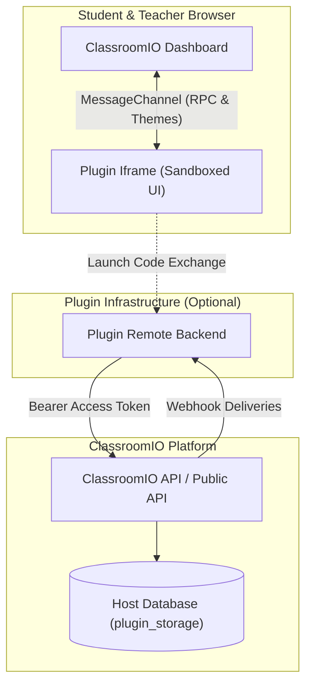

ClassroomIO plugins extend the academy platform with custom user interfaces, automated workflows, and external integrations. Whether you are building an announcement banner, an AI tutoring assistant, a certificate template, or a custom LMS reader widget, the Plugin system provides sandboxed UI embedding and secure host-delegated APIs.



---

## Core Principles

The plugin architecture is built around three foundational design principles:

1. **Sandboxed UI Isolation**: Custom interfaces render inside hardened `<iframe>` environments without `allow-same-origin`. They cannot inspect cookies, local storage, or host DOM, protecting student privacy and security.
2. **Host-Owned Data Residency**: Plugins store tenant data directly in ClassroomIO's managed PostgreSQL database (`plugin_storage`). No student or academy data is stored on third-party servers, ensuring full GDPR, FERPA, and SOC 2 compliance.
3. **Dual SDK Architecture**:
   - **Client SDK (`@classroomio/plugin-sdk/client`)**: Runs inside the browser iframe to handle UI resizing, theme synchronization, native toasts, and modal controls via browser `MessageChannel`.
   - **Server SDK (`@classroomio/plugin-sdk/server`)**: Runs on your backend server to interact with courses, lessons, student progress, certificates, and persistent storage using scoped OAuth tokens.

---

## What Can You Build?

<CardGroup cols={2}>
  <Card title="Inline Lesson Widgets" icon="book-open">
    Add discussion boxes, reading timers, AI flashcards, or interactive code runners directly below lesson content using the <code>lesson.after</code> slot.
  </Card>
  <Card title="Academy Banners & Alerts" icon="megaphone">
    Display system notifications, countdowns, or announcements at the top of the learner LMS view using the <code>lms.banner</code> slot.
  </Card>
  <Card title="Certificate Templates" icon="award">
    Design custom SVG certificate layouts and register them in the visual Certificate Studio with <code>certificate.templates</code>.
  </Card>
  <Card title="Standalone Academy Pages" icon="layout">
    Mount dedicated full-page tools and dashboards inside the academy navigation with <code>plugin.page</code>.
  </Card>
</CardGroup>

---

## Anatomy of a Plugin

A ClassroomIO plugin is a standalone project comprising:

```text
my-classroomio-plugin/
├── plugin.json               # Manifest declaring permissions, slots, and entrypoints
├── package.json
├── vite.config.ts            # Frontend bundler
├── src/
│   ├── banner.html           # UI Entrypoint 1
│   ├── banner.ts
│   ├── settings.html         # UI Entrypoint 2
│   └── settings.ts
├── dist/                     # Compiled production assets
└── server/                   # Optional backend service (Node.js / Express / Cloudflare Worker)
    └── index.ts
```

1. **`plugin.json`**: The immutable manifest defining identity, contribution slots, requested permissions, network domains, and UI entrypoints.
2. **`dist/`**: The static HTML, JS, and CSS files compiled by Vite or your chosen bundler.
3. **Server Service (Optional)**: If your plugin performs background jobs, calls LLMs, or listens to webhooks, you run a server using the Server SDK.

---

## Quickstart: Build a Plugin in 5 Minutes

### 1. Install the SDK

Install the official ClassroomIO Plugin SDK in your project:

<CodeGroup>

```bash pnpm
pnpm add @classroomio/plugin-sdk
```

```bash npm
npm install @classroomio/plugin-sdk
```

```bash yarn
yarn add @classroomio/plugin-sdk
```

</CodeGroup>

### 2. Create the Manifest (`plugin.json`)

Define your plugin metadata and declare the UI slot you wish to render into:

```json
{
  "$schema": "https://classroomio.com/schemas/plugin.v1.json",
  "id": "com.example.reading-timer",
  "name": "Lesson Reading Timer",
  "version": "1.0.0",
  "publisher": "classroomio",
  "description": "Calculates reading time and renders reading metrics below lessons",
  "runtime": {
    "ui": {
      "entrypoints": {
        "timer": "dist/timer.html"
      }
    }
  },
  "contributes": {
    "slots": [
      {
        "id": "reading-timer-slot",
        "target": "lesson.after",
        "entrypoint": "timer",
        "title": "Estimated Reading Time"
      }
    ]
  }
}
```

### 3. Build the UI (`src/timer.ts`)

Create your UI logic using the Client SDK:

```typescript
import { createClassroomIOClient } from '@classroomio/plugin-sdk/client';

const client = createClassroomIOClient();

async function init() {
  // 1. Inspect active iframe surface context
  const context = await client.context.get();

  const container = document.getElementById('app')!;
  container.innerHTML = `
    <div class="reading-badge">
      ⏱️ <strong>Lesson Widget</strong> (Mounted on ${context.surface.target})
    </div>
  `;

  // 2. Automatically inform ClassroomIO dashboard to size the iframe height
  await client.ui.resize(document.documentElement.scrollHeight);
}

init().catch(console.error);
```

### 4. Build and Package

Compile your assets and generate a content-addressed artifact digest using the `cio-plugin` CLI:

```bash
# 1. Compile UI assets
pnpm vite build

# 2. Package and compute SHA-256 digest
npx cio-plugin pack
```

The CLI outputs an immutable digest (e.g. `sha256-4b82...`) and organizes your artifact under `.plugin-artifacts/`.

---

## Documentation Guide

Explore the detailed guides below to master every aspect of plugin development:

<CardGroup cols={2}>
  <Card title="Manifest Reference" href="/developers/plugins/manifest" icon="file-code">
    Complete specification for <code>plugin.json</code>: permissions, slots, pages, and network domains.
  </Card>
  <Card title="Client SDK" href="/developers/plugins/client-sdk" icon="monitor">
    Reference for <code>@classroomio/plugin-sdk/client</code>: toasts, theme tokens, modals, and auto-resize.
  </Card>
  <Card title="Server SDK" href="/developers/plugins/server-sdk" icon="server">
    Reference for <code>@classroomio/plugin-sdk/server</code>: courses, lessons, progress, and certificates.
  </Card>
  <Card title="Host-Owned Storage" href="/developers/plugins/storage" icon="database">
    Store tenant JSONB documents in ClassroomIO PostgreSQL with zero external databases.
  </Card>
  <Card title="Slots & Surfaces" href="/developers/plugins/slots-and-surfaces" icon="layers">
    Overview of all available mounting points: <code>lesson.after</code>, <code>lms.banner</code>, <code>plugin.page</code>.
  </Card>
  <Card title="Packaging & Publishing" href="/developers/plugins/packaging-and-publishing" icon="upload">
    Packaging with <code>cio-plugin</code>, local testing, and production CI/CD deployments.
  </Card>
</CardGroup>
