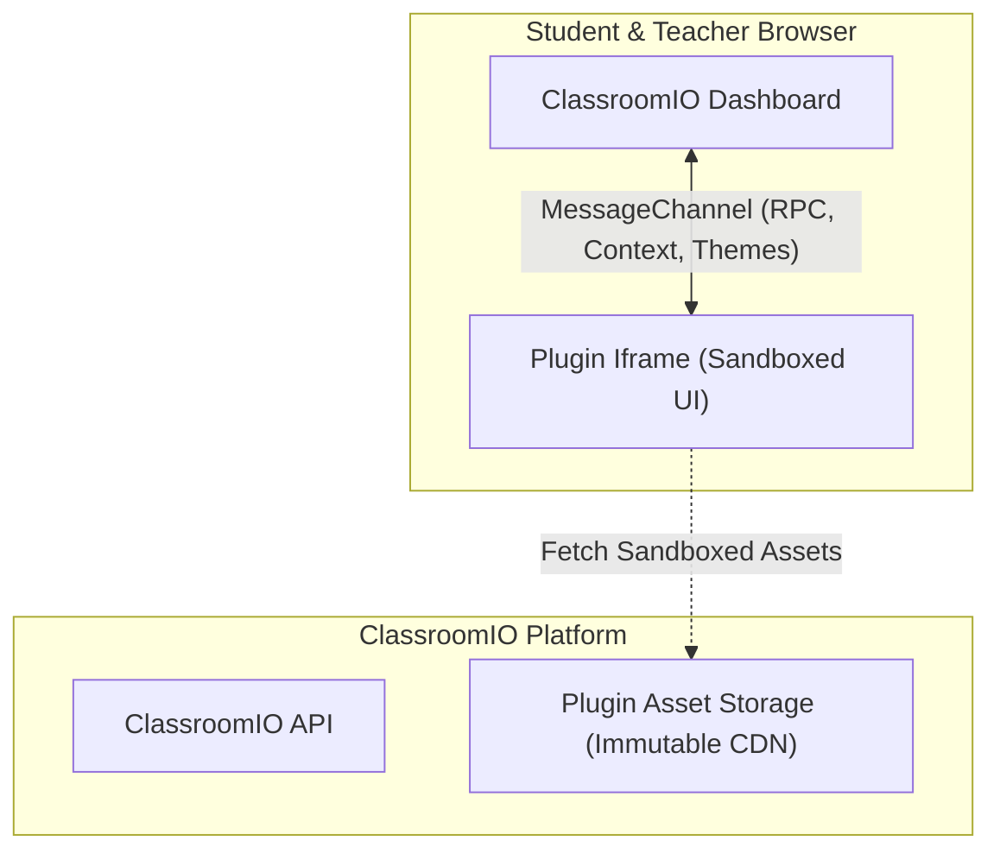

ClassroomIO plugins extend the academy platform with custom user interfaces and workflows. Whether you are building an announcement banner, an interactive lesson widget, or a dedicated academy dashboard, the plugin platform provides sandboxed UI embedding and a secure host bridge.



---

## Core Principles

The plugin architecture is built around three foundational principles:

1. **Sandboxed UI Isolation**: Custom interfaces render inside hardened `<iframe>` environments without `allow-same-origin`. They cannot inspect cookies, host session storage, or the parent DOM, protecting student privacy and platform security.
2. **Deterministic Bridge Communication**: The sandboxed iframe communicates with ClassroomIO exclusively over an authenticated browser `MessageChannel`. The host provides UI resizing, theme synchronization, native toasts, modals, navigation, and client preferences.
3. **Source-Controlled, PR-First Release**: All catalog plugins are maintained in the open `classroomio-plugins` repository. Code is validated in sandboxed CI, reviewed by maintainers, and built into immutable, digest-verified artifacts published to CDN storage upon merge.

---

## What Can You Build?

<CardGroup cols={2}>
  <Card title="Inline Lesson Widgets" icon="book-open">
    Add discussion boxes, reading timers, AI flashcards, or interactive code runners directly below lesson content using the <code>lesson.after</code> slot.
  </Card>
  <Card title="Academy Banners & Alerts" icon="megaphone">
    Display system notifications, countdowns, or announcements at the top of the learner LMS view using the <code>lms.banner</code> slot.
  </Card>
  <Card title="Standalone Academy Pages" icon="layout">
    Mount dedicated full-page tools, reports, and dashboards inside the academy navigation with <code>plugin.page</code>.
  </Card>
  <Card title="Contextual Actions" icon="cursor">
    Inject custom buttons, commands, or dialog triggers into lesson and course action bars using <code>contributes.actions</code>.
  </Card>
</CardGroup>

---

## Anatomy of a Plugin

A ClassroomIO plugin is a standalone frontend project:

```text
my-classroomio-plugin/
├── plugin.json               # Manifest declaring identity, slots, and entrypoints
├── package.json              # Dependencies and lifecycle scripts
├── vite.config.ts            # Frontend bundler configuration
├── src/
│   ├── index.html            # Main UI entrypoint
│   └── index.ts              # UI logic using @classroomio/plugin-sdk
└── dist/                     # Compiled production assets
```

1. **`plugin.json`**: The manifest defining identity, contribution slots, requested permissions, network domains, and UI entrypoints.
2. **`dist/`**: The static HTML, JS, and CSS files compiled by Vite or your chosen bundler.

---

## Get started: build, test, and contribute a plugin

This is the shortest complete path from an empty directory to a released plugin. Run the
commands from the plugin project directory unless noted otherwise.

### 1. Scaffold and install

```bash
npx @classroomio/plugin-sdk create reading-timer \
  --id com.example.reading-timer \
  --name "Reading timer" \
  --publisher "Example"
cd reading-timer
npm install
```

`create` writes `plugin.json`, a Vite UI, an icon, and lifecycle scripts. The generated `dev` and
`build` scripts are standard Vite commands: `dev` serves the UI for browser development and
`build` compiles it. The `cio-plugin` CLI commands package, validate, and install local development artifacts.

### 2. Configure local development

```bash
export CLASSROOMIO_API_URL=http://localhost:3002
export CLASSROOMIO_DEV_TOKEN=<organization-api-key-with-plugin-development-scope>
export CLASSROOMIO_ORG_ID=<organization-id>
npm run seed -- --org "$CLASSROOMIO_ORG_ID"
```

`CLASSROOMIO_API_URL` selects the API. `CLASSROOMIO_DEV_TOKEN` is an organization API key with the
`plugin:development` scope, created by a current administrator of the target organization.
`CLASSROOMIO_ORG_ID` selects the organization that receives the development installation.

The API validates the archive, stores local files under `PLUGIN_ARTIFACTS_PATH`, and installs the
development version into that organization. Use `npm run dev` separately when you want to serve the
UI directly from Vite for standalone browser work.

### 3. Build and test locally

```bash
npm run build
npm run pack
npx @classroomio/plugin-sdk validate
```

`npm run build` compiles the UI. `npm run pack` invokes `cio-plugin build`, validates the manifest, packages the compiled
assets, creates a deterministic `.tar.gz` archive, and computes its `sha256-...` digest. Open the
selected organization's plugin page in the local ClassroomIO dashboard to exercise the iframe,
slots, and host bridge.

### 4. Submit a pull request to classroomio-plugins

Fork [classroomio-plugins](https://github.com/classroomio/classroomio-plugins), add your plugin, and register it in
`registry/plugins.json`. Open a pull request against `main`. Untrusted PR CI builds, tests, and verifies the plugin
in a sandboxed container without cloud secrets.

### 5. Automated release

Maintainers review your pull request, permissions, and network allowlists. Once merged to `main`, trusted GitHub Actions
release CI builds the package, uploads immutable assets to production CDN storage, and registers the release with the
ClassroomIO API. See [Packaging and contributing](/developers/plugins/packaging-and-publishing) for details.

---

## Quickstart: understand the plugin structure

### 1. Install the SDK

Install the official ClassroomIO Plugin SDK in your project:

<CodeGroup>

```bash pnpm
pnpm add @classroomio/plugin-sdk
```

```bash npm
npm install @classroomio/plugin-sdk
```

```bash yarn
yarn add @classroomio/plugin-sdk
```

</CodeGroup>

### 2. Create the Manifest (`plugin.json`)

Define your plugin metadata and declare the UI slot you wish to render into:

```json
{
  "$schema": "https://classroomio.com/schemas/plugin.v1.json",
  "manifestVersion": 1,
  "id": "com.example.reading-timer",
  "name": "Lesson Reading Timer",
  "version": "1.0.0",
  "publisher": "classroomio",
  "description": "Calculates reading time and renders reading metrics below lessons",
  "engines": {
    "classroomio": ">=1.0.0",
    "pluginApi": "1.0.0"
  },
  "runtime": {
    "ui": {
      "entrypoints": {
        "timer": "dist/timer.html"
      }
    }
  },
  "contributes": {
    "slots": [
      {
        "id": "reading-timer-slot",
        "target": "lesson.after",
        "entrypoint": "timer",
        "title": "Estimated Reading Time"
      }
    ]
  },
  "dataPolicy": {
    "storesCustomerData": false,
    "retentionAfterUninstallDays": 0
  }
}
```

### 3. Build the UI (`src/timer.ts`)

Create your UI logic using the Client SDK:

```typescript
import { createClassroomIOClient } from '@classroomio/plugin-sdk/client';

const client = createClassroomIOClient();

async function init() {
  // 1. Inspect active iframe surface context
  const context = await client.context.get();

  const container = document.getElementById('app')!;
  container.innerHTML = `
    <div class="reading-badge">
      ⏱️ <strong>Lesson Widget</strong> (Mounted on ${context.surface.target})
    </div>
  `;

  // 2. Automatically inform ClassroomIO dashboard to size the iframe height
  await client.ui.resize(document.documentElement.scrollHeight);
}

init().catch(console.error);
```

### 4. Build and Package

Compile your assets and generate a content-addressed artifact digest using the `cio-plugin` CLI:

```bash
# Compile UI assets, package, and compute the SHA-256 digest
npm run build
npm run pack
```

The CLI outputs an immutable digest (e.g. `sha256-4b82...`) and organizes your artifact under `.plugin-artifacts/`.

---

## Documentation Guide

Explore the detailed guides below to master every aspect of plugin development:

<CardGroup cols={2}>
  <Card title="Manifest Reference" href="/developers/plugins/manifest" icon="file-code">
    Complete specification for <code>plugin.json</code>: permissions, slots, pages, and network domains.
  </Card>
  <Card title="Client SDK" href="/developers/plugins/client-sdk" icon="monitor">
    Reference for <code>@classroomio/plugin-sdk/client</code>: toasts, theme tokens, modals, and auto-resize.
  </Card>
  <Card title="Slots & Surfaces" href="/developers/plugins/slots-and-surfaces" icon="layers">
    Overview of all available mounting points: <code>lesson.after</code>, <code>lms.banner</code>, <code>plugin.page</code>.
  </Card>
  <Card title="Packaging & Publishing" href="/developers/plugins/packaging-and-publishing" icon="upload">
    Packaging with <code>cio-plugin</code>, local testing, and production CI/CD deployments.
  </Card>
</CardGroup>
