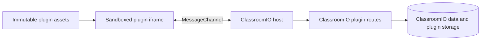

ClassroomIO plugins are reviewed frontend packages hosted by ClassroomIO. A plugin declares its UI
surfaces, permissions, storage documents, and external network origins in `plugin.json`. Its code
runs in a sandboxed iframe and uses the browser SDK to ask the host for approved capabilities.



The platform does not give plugin code host cookies, API tokens, parent-DOM access, or a
plugin-owned server runtime. A plugin may call explicitly allowlisted public HTTPS APIs from its
iframe, but ClassroomIO data access and persistent plugin data flow through the host bridge.

## Supported plugin range

The current platform supports:

- inline widgets in `lms.banner`, `course.sidebar`, and `lesson.after`;
- certificate template pickers and host-rendered certificate URL actions;
- landing-page template pickers with a separate public renderer;
- full organization plugin pages linked from organization navigation;
- typed read APIs for identity, organization, courses, lessons, exercises, progress, certificates,
  and certificate templates;
- learner progress completion updates and certificate template application;
- browser-local preferences and host-managed, schema-declared plugin storage.

It does not currently support arbitrary DOM injection, background jobs, webhooks, host-native
modals, custom server code, organization-member APIs, course or lesson authoring, submissions,
grading, notifications, or analytics APIs. These capabilities must not be advertised in a plugin
manifest until they are implemented and marked active by the manifest validator.

## Runtime boundaries

1. Plugin assets are immutable and addressed by plugin ID, version, and artifact digest.
2. Custom UI runs in an iframe without `allow-same-origin`.
3. The host validates bridge actions, payload sizes, installation grants, actor access, and
   resource ownership.
4. Catalog releases come from reviewed source in `classroomio/plugins`; trusted release CI builds
   and registers them after merge.
5. Plugin data is stored in ClassroomIO's installation-scoped storage, not in a plugin-managed
   backend.

## Create a plugin

```bash
npx @classroomio/plugin-sdk create reading-timer \
  --id com.example.reading-timer \
  --name "Reading timer" \
  --publisher "Example"
cd reading-timer
npm install
```

The scaffold creates a Vite frontend, `plugin.json`, an icon, and scripts for building, packaging,
and local installation.

```bash
export CLASSROOMIO_API_URL=http://localhost:3002
export CLASSROOMIO_DEV_TOKEN=<organization-api-key-with-plugin-development-scope>
export CLASSROOMIO_ORG_ID=<organization-id>

npm run build
npm run pack
npm run seed -- --org "$CLASSROOMIO_ORG_ID"
```

`npm run pack` validates the manifest and produces a deterministic archive. `npm run seed`
installs that archive into one organization on a non-production ClassroomIO API.

## Minimal manifest

```json
{
  "manifestVersion": 1,
  "id": "com.example.reading-timer",
  "name": "Lesson Reading Timer",
  "version": "1.0.0",
  "publisher": "Example",
  "description": "Shows reading metrics after a lesson.",
  "engines": {
    "classroomio": ">=1.0.0",
    "pluginApi": "1.0.0"
  },
  "runtime": {
    "ui": {
      "entrypoints": {
        "timer": "dist/timer.html"
      }
    }
  },
  "contributes": {
    "slots": [
      {
        "id": "reading-timer",
        "target": "lesson.after",
        "entrypoint": "timer",
        "title": "Estimated reading time"
      }
    ]
  },
  "permissions": {
    "required": ["lesson.metadata:read"]
  },
  "dataPolicy": {
    "storesCustomerData": false,
    "retentionAfterUninstallDays": 0
  }
}
```

```typescript
import { createClassroomIOClient } from '@classroomio/plugin-sdk/client';

const client = createClassroomIOClient();
const context = await client.context.get();

console.log(context.surface?.resource);
await client.ui.resize(document.documentElement.scrollHeight);
```

## Documentation

<CardGroup cols={2}>
  <Card title="Manifest reference" href="/developers/plugins/manifest" icon="file-code">
    Identity, contributions, active permissions, storage declarations, and network access.
  </Card>
  <Card title="Client SDK" href="/developers/plugins/client-sdk" icon="monitor">
    Host bridge methods, typed data, storage, themes, and public landing rendering.
  </Card>
  <Card title="Slots and surfaces" href="/developers/plugins/slots-and-surfaces" icon="layers">
    Supported mounting targets, dimensions, resources, and handoffs.
  </Card>
  <Card title="Packaging and contributing" href="/developers/plugins/packaging-and-publishing" icon="upload">
    Local installation, deterministic packages, review, and trusted release CI.
  </Card>
</CardGroup>
