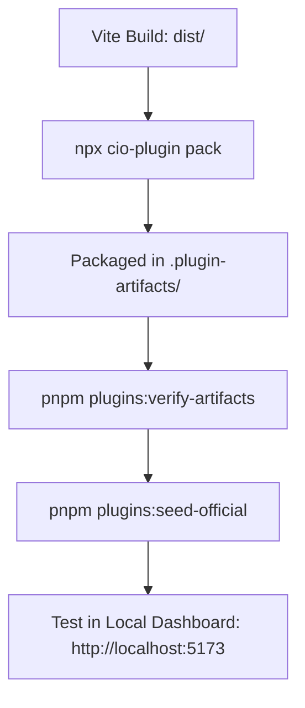
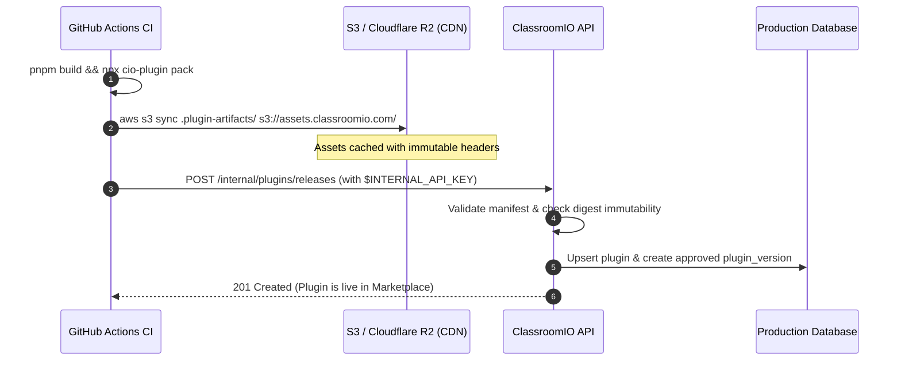

ClassroomIO uses **content-addressed immutable packaging**. Every plugin release is identified by a cryptographic SHA-256 digest calculated over its manifest and compiled production files.

The official `@classroomio/plugin-sdk` includes the `cio-plugin` CLI to validate, hash, and package your plugins for distribution.

---

## The `cio-plugin` CLI

The CLI is included automatically when you install `@classroomio/plugin-sdk`. You can execute it via `npx` or `pnpm exec`:

```bash
npx cio-plugin --help
```

### Commands

| Command | Usage | Description |
| :--- | :--- | :--- |
| `cio-plugin init [name]` | `npx cio-plugin init my-plugin` | Scaffolds a new ClassroomIO plugin starter with TypeScript, Vite, and SDK setup. |
| `cio-plugin validate [path]` | `npx cio-plugin validate` | Validates `plugin.json` structure against the ClassroomIO manifest schema. |
| `cio-plugin pack [path]` | `npx cio-plugin pack` | Validates manifest, creates a deterministic `.tar.gz` archive and canonical SHA-256 digest. |
| `cio-plugin publish [path]` | `npx cio-plugin publish --token $TOKEN` | Packages and uploads plugin to the quarantine registry for automated validation and review. |
| `cio-plugin status <id>` | `npx cio-plugin status <id>` | Checks review and approval status for a submitted plugin release. |
| `cio-plugin digest <dir>` | `npx cio-plugin digest ./dist` | Calculates deterministic SHA-256 hash over directory file paths and byte contents. |


---

## Local Development Workflow

When developing plugins on your local machine, the ClassroomIO API automatically serves files from disk, allowing you to test changes rapidly.



### Step 1: Compile Your Assets
Run your project build command to generate static files in `./dist`:

```bash
pnpm vite build
```

### Step 2: Package the Artifact
Run `cio-plugin pack`:

```bash
npx cio-plugin pack
```

**Output:**
```text
✓ Validated manifest for com.example.reading-timer (v1.0.0)
✓ Packed com.example.reading-timer v1.0.0 (sha256-a1b2c3d4e5f6...)

Successfully packed 1 plugin release(s) in .plugin-artifacts/
```

### Step 3: Verify Integrity
Validate that all files referenced in `runtime.ui.entrypoints` and icons exist:

```bash
pnpm plugins:verify-artifacts
```

### Step 4: Seed Into Local Database
Register the plugin and version in your local PostgreSQL database:

```bash
pnpm plugins:seed-official
```

### Step 5: Test on Dashboard
1. Open the dashboard at `http://localhost:5173`.
2. Navigate to **Settings > Plugins**.
3. Locate your plugin in the Catalog and click **Install**.
4. Visit the slot where your plugin is mounted (e.g. `lesson.after`) to test live.

---

## Production CI/CD Workflow

In production, assets are served from a high-performance CDN / Cloudflare R2 / AWS S3 origin (`PLUGIN_ASSET_ORIGIN`), and releases are published to the ClassroomIO database via authenticated internal endpoints.



### Step 1: CI Build & Packaging
In your CI workflow (e.g. `.github/workflows/deploy.yml`):

```yaml
- name: Build and Pack Plugin
  run: |
    pnpm install --frozen-lockfile
    pnpm vite build
    npx cio-plugin pack
```

### Step 2: Upload Assets to CDN / Object Storage
Upload the contents of `.plugin-artifacts/` to your object storage bucket:

<CodeGroup>

```bash AWS S3
aws s3 sync .plugin-artifacts/ s3://classroomio-plugin-assets/ \
  --cache-control "public, max-age=31536000, immutable"
```

```bash Cloudflare R2
wrangler r2 object put classroomio-plugin-assets/.plugin-artifacts \
  --file=.plugin-artifacts \
  --cache-control="public, max-age=31536000, immutable"
```

</CodeGroup>

Because each version URL includes its exact SHA-256 digest (`/:pluginId/:version/:digest/...`), assets can be cached aggressively forever without cache invalidation risks.

### Step 3: Publish with the `cio-plugin publish` Command

ClassroomIO uses a **three-lane release model** with automated quarantine scanning and integrity verification:

| Release Lane | Publisher | Distribution | Review & Approval Policy |
| :--- | :--- | :--- | :--- |
| **First-Party** | ClassroomIO Core Team | Public Catalog | Fast team approval; auto-promoted on valid signature and `com.classroomio.*` namespace. |
| **Private** | Organization Developers | Organization Only | Automatic approval for the publishing organization; scoped strictly to authorized workspaces. |
| **Community Public** | Third-Party Developers | Public Marketplace | Uploaded to isolated quarantine storage; undergoes static code analysis and ClassroomIO marketplace team review. |

#### Submitting a Release

From your plugin project directory, run:

```bash
npx cio-plugin publish --token $CLASSROOMIO_API_TOKEN
```

For private organization plugins, pass the `--org` flag:

```bash
npx cio-plugin publish --token $CLASSROOMIO_API_TOKEN --org $ORG_ID
```

#### What Happens Under the Hood
1. **Packaging**: Creates an in-memory deterministic POSIX ustar `.tar.gz` archive and computes the exact `sha256-<hex>` digest.
2. **Quarantine Upload**: Creates a submission intent and uploads the tarball to an isolated quarantine bucket.
3. **Automated Security Scan**: The registry downloads the quarantined archive, recomputes the SHA-256 hash, validates `plugin.json` against `ZPluginManifest`, and scans for forbidden imports (`@cio/*`, `$lib/*`) or path traversal attempts.
4. **Promotion**:
   - First-party and private plugins are automatically unpacked into the CDN and published.
   - Community plugins transition to `in_review` and are queued for marketplace approval.

#### Checking Submission Status

You can monitor review progress at any time:

```bash
npx cio-plugin status <submissionId>
```


---

## Provisioning Backend OAuth2 Credentials

If your plugin includes a remote server (`runtime.backend.baseUrl`), generate OAuth2 client credentials to authenticate your backend:

```bash
curl -X POST https://api.classroomio.com/internal/plugins/backend-clients \
  -H "Content-Type: application/json" \
  -H "Authorization: Bearer $INTERNAL_API_KEY" \
  -d '{
    "pluginId": "com.example.reading-timer",
    "label": "Production Backend"
  }'
```

**Response:**
```json
{
  "success": true,
  "data": {
    "clientId": "cio_client_9f8e7d6c5b4a",
    "clientSecret": "cio_sec_1a2b3c4d5e6f...",
    "issuedAt": "2026-10-12T13:00:00Z"
  }
}
```

Store `clientId` and `clientSecret` securely in your backend environment variables to exchange launch codes and authenticate webhooks.
