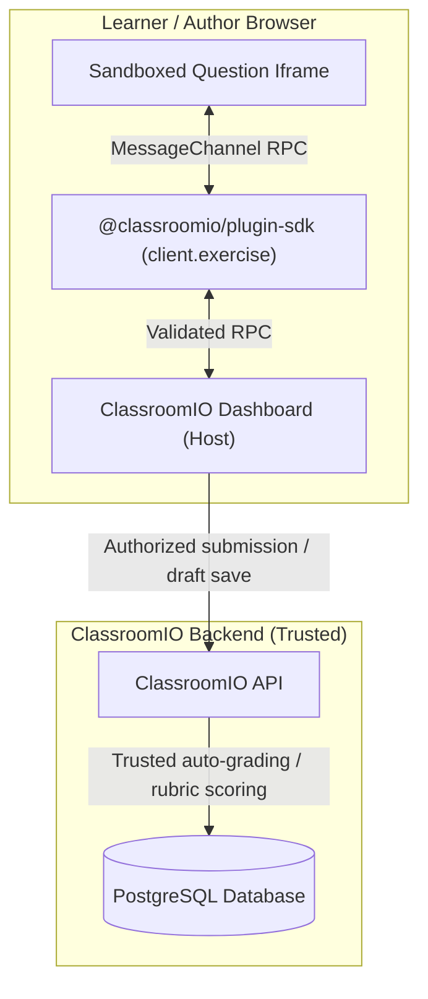

Exercise question type plugins enable developers to create bespoke interactive questions in ClassroomIO—such as code playgrounds, math formula editors, diagram builders, or interactive simulations.

Question plugins run in sandboxed iframes. The ClassroomIO host owns question state, points, drafts, and submissions; the plugin iframe communicates with the host over a secure `MessageChannel` bridge.



---

## Non-Negotiable Platform Boundaries

1. **Host-Owned State**: The ClassroomIO host owns the exercise question draft, student answers, points, and grading records. The iframe never deterministically sets points or passes/fails a student.
2. **Immutable Pinning**: When an author creates a question using a custom type, the question is permanently pinned to `pluginId`, `pluginVersion`, `artifactDigest`, `installationId`, and `contributionId`. Updating a plugin in the organization never rewrites historical questions or past submissions.
3. **Learner Privacy**: Authors may specify server-only `gradingConfig` (such as hidden test cases, regex criteria, or answer keys). The ClassroomIO API strips `gradingConfig` from all learner and public endpoints, ensuring hidden criteria never leak into the learner's browser or DOM.
4. **Trusted Evaluation**: Auto-grading is evaluated exclusively on the ClassroomIO backend using supported declarative strategies or isolated platform runners. Scores reported directly by client iframes are rejected.

---

## Declaring Question Types in `plugin.json`

Add `contributes.questionTypes` to your plugin's `plugin.json` manifest:

```json
{
  "manifestVersion": 1,
  "id": "com.classroomio.code-runner",
  "name": "Python Code Runner",
  "version": "1.0.0",
  "description": "Interactive Python environment with automated unit testing",
  "publisher": "classroomio",
  "engines": {
    "classroomio": ">=2.0.0",
    "pluginApi": "2026-10-08"
  },
  "runtime": {
    "ui": {
      "entrypoints": {
        "questionEditor": "dist/editor.html",
        "questionWidget": "dist/widget.html",
        "questionReview": "dist/review.html",
        "questionSubmission": "dist/submission.html"
      }
    }
  },
  "contributes": {
    "questionTypes": [
      {
        "id": "python-runner",
        "title": "Python Code Runner",
        "description": "Interactive code runner with automated test evaluation",
        "entrypoints": {
          "edit": "questionEditor",
          "take": "questionWidget",
          "preview": "questionWidget",
          "review": "questionReview",
          "submission": "questionSubmission"
        },
        "icon": {
          "resource": "assets/python.svg"
        },
        "answerSchema": {
          "type": "object",
          "properties": {
            "code": { "type": "string", "maxLength": 50000 }
          },
          "required": ["code"],
          "additionalProperties": false
        },
        "publicConfigSchema": {
          "type": "object",
          "properties": {
            "starterCode": { "type": "string" },
            "language": { "type": "string" }
          }
        },
        "grading": {
          "strategy": "platform-code-runner",
          "supportsPartialCredit": true
        }
      }
    ]
  },
  "dataPolicy": {
    "storesCustomerData": false,
    "retentionAfterUninstallDays: 30
  }
}
```

### Manifest Fields

| Field | Description |
| :--- | :--- |
| `id` | Unique contribution identifier within the plugin (e.g. `python-runner`). |
| `title` | Human-readable label displayed in the question type picker. |
| `description` | Optional brief summary of the question capability. |
| `entrypoints` | Object mapping modes (`edit`, `take`, `preview`, `review`, `submission`) to keys in `runtime.ui.entrypoints`. |
| `icon` | Path to a packaged SVG, PNG, or WebP icon file. |
| `answerSchema` | JSON Schema validating student answers proposed via `client.exercise.setAnswer()`. Max payload size is 64 KiB. |
| `publicConfigSchema` | JSON Schema validating public configuration editable by instructors. |
| `grading` | Grading configuration defining `strategy` and `supportsPartialCredit`. |

---

## Supported Modes

ClassroomIO renders question types across five distinct lifecycles:

| Mode | Context | Actor | Role of Iframe |
| :--- | :--- | :--- | :--- |
| `edit` | Teacher exercise editor | Admin, Tutor | Configure starter code, prompts, and grading rules. |
| `take` | Student actively answering an exercise | Learner | Interact with the question and call `setAnswer()`. |
| `preview` | Teacher testing the exercise experience | Admin, Tutor | Interactive preview with test answers. |
| `review` | Submission grading & rubric review | Admin, Tutor | Inspect the student's submitted answer read-only. |
| `submission` | Historical submission confirmation | Learner | Replay past answers in a read-only state. |

---

## Using the Client SDK (`@classroomio/plugin-sdk`)

Install the SDK in your question plugin project:

```bash
npm install @classroomio/plugin-sdk
```

Initialize the client and access exercise question controls:

```typescript
import { createClassroomIOClient } from '@classroomio/plugin-sdk/client';

const client = createClassroomIOClient();

// 1. Fetch initial context
const context = await client.exercise.getContext();
console.log('Mode:', context.mode);
console.log('Public Config:', context.publicConfig);
console.log('Current Answer:', context.currentAnswer);
console.log('Read Only:', context.readOnly);

// 2. Propose an answer update (take / preview mode)
if (!context.readOnly) {
  await client.exercise.setAnswer({
    code: 'def solution():\n    return 42'
  });
}

// 3. Update question configuration (edit mode only)
if (context.mode === 'edit') {
  await client.exercise.updatePublicConfig({
    starterCode: '# Write your solution here\n'
  });

  await client.exercise.updateAuthorConfig({
    strategy: 'platform-code-runner',
    hiddenTests: [{ input: '42', expected: '42' }]
  });
}

// 4. Request dynamic container resize
await client.exercise.resize(document.documentElement.scrollHeight);
```

### Bridge Methods

- `client.exercise.getContext()`: Resolves the active mode (`edit`, `take`, `preview`, `review`, `submission`), public configuration, author configuration (if in `edit` mode), student answer, and read-only flag.
- `client.exercise.setAnswer(value)`: Proposes a new answer value to the host draft. Throws `FORBIDDEN` if called in a read-only mode (`review` or `submission`).
- `client.exercise.updatePublicConfig(value)`: Updates public question configuration. Only permitted for instructors in `edit` mode.
- `client.exercise.updateAuthorConfig(value)`: Updates server-only grading configuration. Only permitted for instructors in `edit` mode.
- `client.exercise.resize(height)`: Requests that the ClassroomIO host update the iframe viewport height, bounded between 60px and 3000px.

---

## Server-Side Evaluation & Security

### Supported Grading Strategies

1. **`manual` (Default)**:
   - Student answers are preserved verbatim in `question_answer.answer_data`.
   - Instructor reviews student submissions via the grading interface and assigns points based on an exercise rubric.
2. **`declarative-match`**:
   - Evaluated server-side by ClassroomIO without running third-party code.
   - Supports:
     - Exact value match (`expected` string, number, or boolean).
     - Regular expression matching (`matchPattern` pattern string).
     - Numeric tolerance (`expected` number within `tolerance` delta).
3. **`platform-code-runner`**:
   - Executed inside a network-denied, CPU- and memory-constrained platform worker.
   - Evaluates hidden test suites against submitted student code.

---

## Virtualization & Performance

To support exercises with dozens of questions on a single page, ClassroomIO implements lazy viewport virtualization:

- **IntersectionObserver Mounting**: Iframes mount only when within 400px of the viewport.
- **Measured Height Caching**: The host caches measured heights so unmounting or scrolling does not cause layout shifts.
- **Eviction Guards**: Active, focused, loading, or dirty iframes are never evicted while a student is interacting with them.
- **Local State Hydration**: When an iframe remounts, the host handshake delivers the latest acknowledged answer so no student progress is lost.
