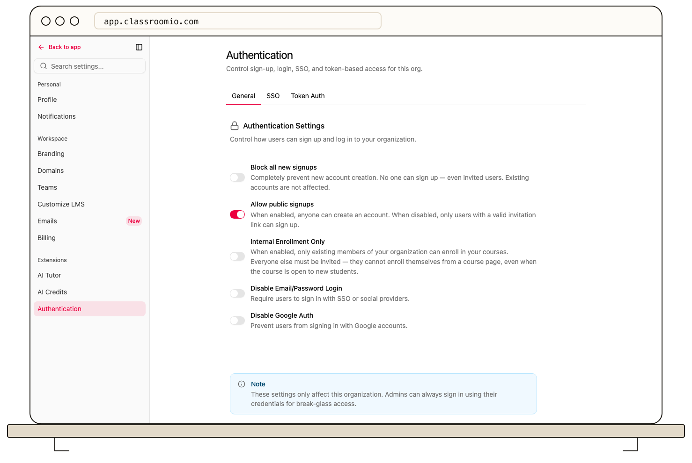

Organization administrators can open **Settings → Authentication → General** to control how people join and sign in to their academy.

The page separates **sign-up** controls from **sign-in** methods. You can allow public sign-ups or require invitations, restrict enrollment to internal use, and configure a message when sign-up is disabled. Enterprise settings can disable email-and-password or Google authentication. SSO and Token Auth are configured in their own tabs.

Before disabling a method, confirm that admins and students have another working way to enter the academy. Test that path with a separate account, then save the settings. Changing sign-up rules does not remove existing memberships. Changing a sign-in method can prevent users who rely on it from starting a new session.

If you plan to enforce SSO, [configure its access policies](/account-team-security/configure-sso-access-policies) and keep a tested recovery path.
