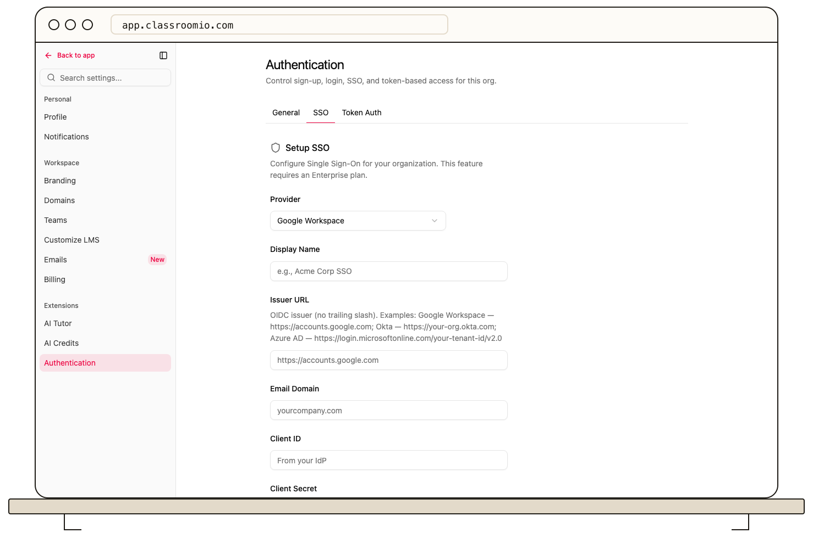

After [setting up enterprise SSO](/integrations/enterprise-sso-setup), open **Settings → Authentication → SSO** to review its access policies. Organization administrator access and an active SSO connection are required.

- **Force SSO** directs eligible users to the organization's identity provider for sign-in. Test provider login before enabling it.
- **Auto-join SSO domains** lets eligible users from your configured domain join through SSO. Confirm the domain and the role they will receive.
- **Break-glass access** provides a recovery path when enforced SSO is unavailable. Restrict and test that path before you need it.

Change one policy at a time, save it, and test with a non-admin account in a separate browser session. Keep an administrator session open until you have verified the new sign-in path. If SSO login fails, check the provider configuration and domain in the same tab before tightening enforcement.

## Related guides

- [Choose allowed sign-in methods](/account-team-security/choose-allowed-sign-in-methods)
