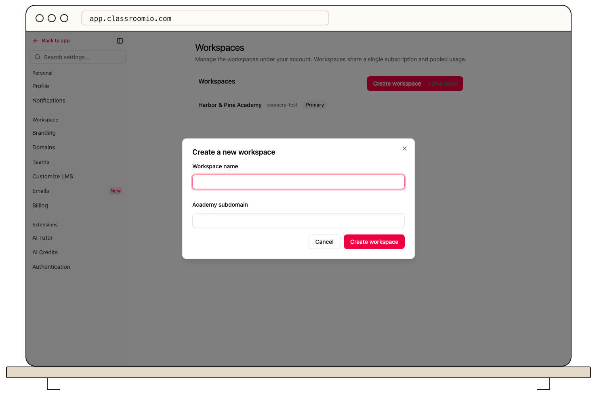

Create an additional organization from **Settings → Workspaces** in the primary organization. Multiple organizations require the Enterprise plan, and the page shows whether you have room under its current allowance.

1. Switch to the primary organization and open **Settings → Workspaces**.
2. Select **Create workspace**. If you see a limit or upgrade message, resolve it before continuing.
3. Enter a **Workspace name** and **Academy subdomain**. Choose an address your students will recognize.
4. Select **Create workspace** and confirm the organization appears in the list.
5. Switch to it to configure its profile, sign-in settings, team, and courses.

You become an administrator of the new organization. The academy has separate data, but its usage contributes to the primary account's allowance and subscription. See [primary and additional organizations](/account-team-security/understand-primary-and-additional-organizations) before inviting people.
