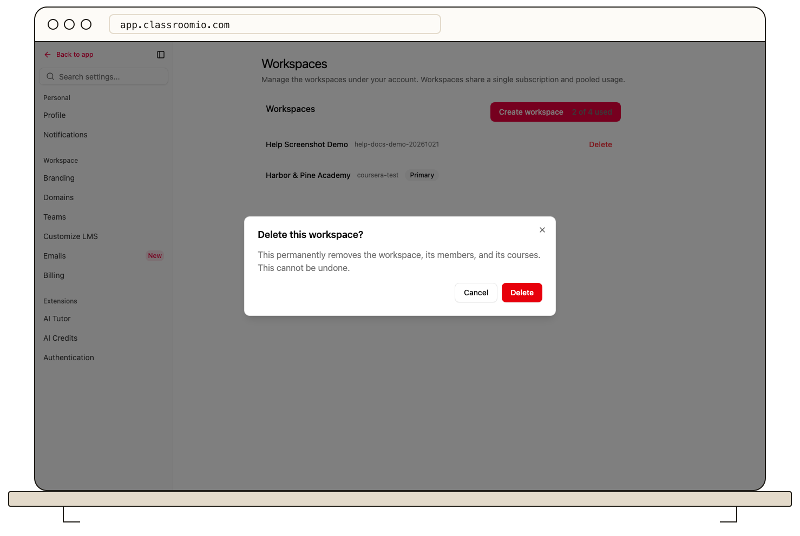

Deleting an additional organization is a permanent, destructive action. The current Settings navigation does not expose organization deletion, so an authorized administrator of the primary account must contact [ClassroomIO support](mailto:help@classroomio.com). The primary organization cannot be deleted.

## Prepare

Check the organization name and site address carefully. Export any student, course, marks, or report data you must retain, and review active domains, integrations, and billing dependencies. Removing the organization also removes access to its academy data for its team and students. Do not assume deleted content or certificates can be recovered.

## Request deletion

1. Contact support from an administrator account on the primary organization and identify the additional organization by name and academy address.
2. Confirm the consequences and any data-retention needs with support before authorizing deletion.
3. After support confirms completion, check that the organization no longer appears in your organization switcher.

The screenshot shows the underlying deletion confirmation, but that screen is not linked from the current Settings sidebar. If support reports a failed deletion, keep treating the organization and its data as active until they confirm otherwise.

If you only need someone to stop working in the academy, [remove the team member](/account-team-security/remove-a-team-member) instead. Contact ClassroomIO support before deleting if you need a data-retention or subscription answer specific to your account.
