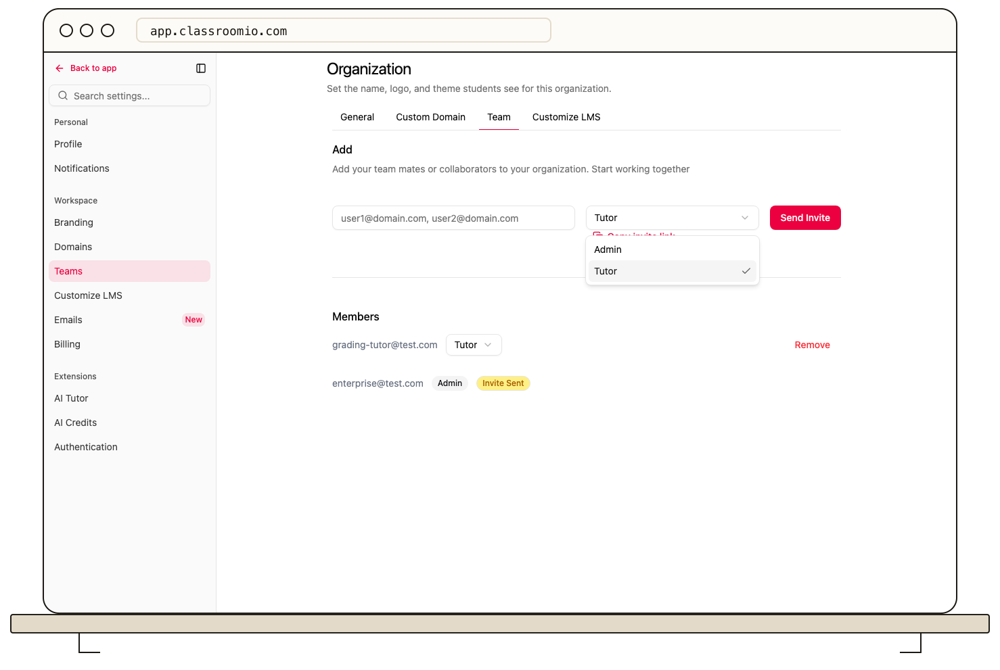

Use **Settings → Teams** to invite colleagues who will manage your academy. Organization administrator access and a paid plan are required.

1. Enter one or more addresses in the invite field, separated by commas.
2. Select **Admin** or **Tutor**. Review [roles and permissions](/organization-and-team/roles-and-permissions) before granting administrator access.
3. Select **Send invite**. If an address belongs to a student, review the confirmation about changing that person's role.
4. Check the team list for **Invite Sent**. The recipient follows the email link and signs in or creates an account.

If the form reports an existing member or invalid address, review that person before retrying. Team invitations do not enroll people in courses. Use [student invitations](/manage-students/invite-students) for course access.
