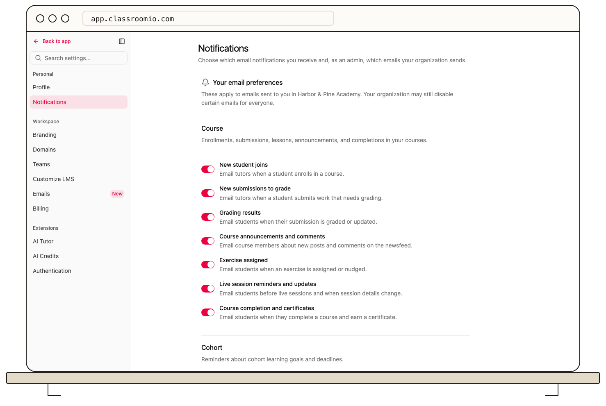

Open **Settings → Notifications** in the admin dashboard or student LMS. These switches control optional **email** notifications, rather than every in-app message.

## Choose your own emails

Under **Personal notifications**, select the categories you want and then **Save changes**. Course options cover new students and submissions for tutors, grading results, news feed activity, assigned quizzes, session updates, and course completion. Cohort reminders have a separate section. Learners do not see tutor-only switches.

Your choices apply in the current organization. An organization-wide switch can still prevent an optional email when your personal switch is on.

## Set organization-wide email delivery

Organization administrators also see **Organization notifications**, including an enrollment-welcome switch. Changing these options affects people across the organization. Review the categories, then save; **Discard** restores your previous choices.

Account and security emails without a switch on this page still go out when required. If an optional email is missing, check both levels of preference before troubleshooting delivery.

## Related guides

- [Troubleshoot invitation and notification emails](/troubleshooting-and-reference/troubleshoot-invitation-and-notification-emails)
