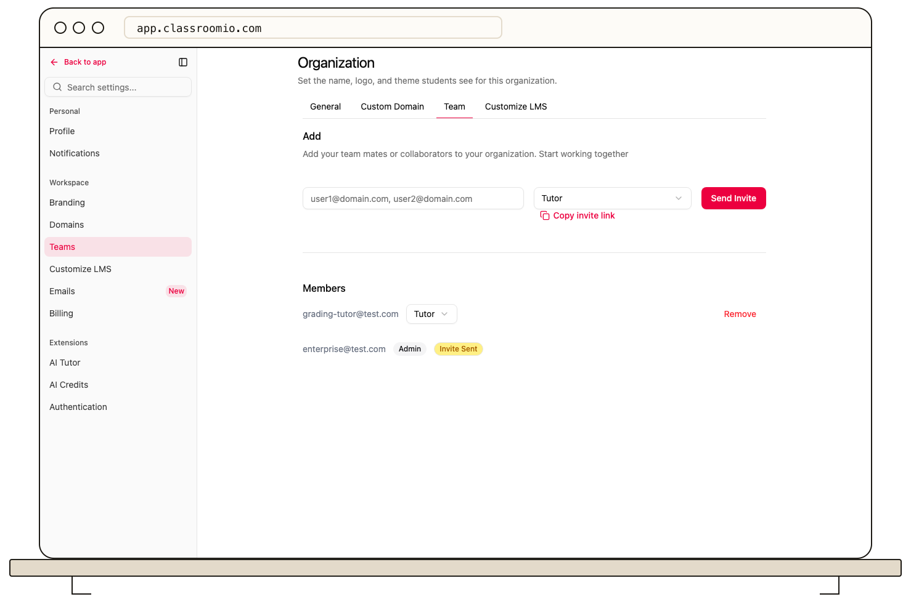

Organization administrators on a paid plan can remove an admin or tutor from **Settings → Teams**. On the Free plan, **Remove** prompts for an upgrade and leaves the member unchanged. First check whether that person teaches a course that needs another tutor.

1. Open the correct organization and go to **Settings → Teams**.
2. Find the person and verify their email, role, and pending-invitation status before removing them. There is no confirmation step.
3. Select **Remove** on their row.
4. Check the updated team list and assign another tutor in any affected course **People** page.

Removal ends that person's team membership. It does not erase course content, submissions, or discussion history they previously authored. Course enrollment is managed separately in each course's **People** page.

You can invite the person again later. Check the new invitation's role before sending it.
