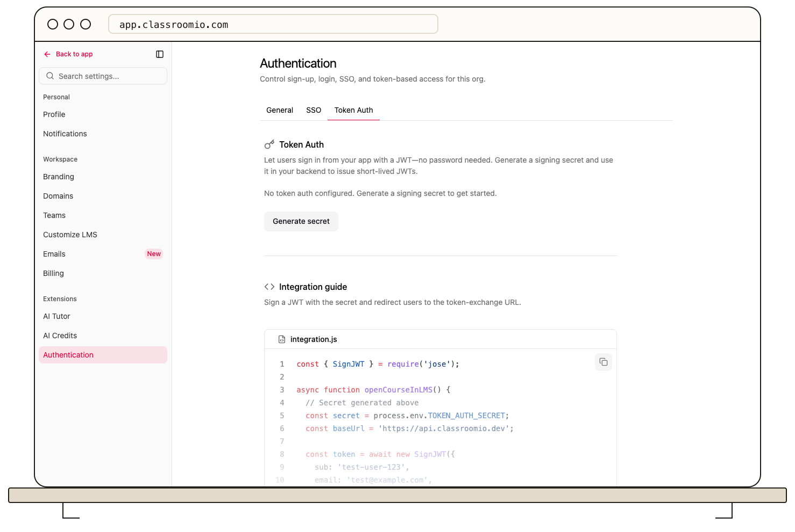

Token Auth signs a user in from another application by exchanging a short-lived JWT. It requires an Enterprise plan and an organization administrator.

1. Open **Settings → Authentication → Token Auth** and select **Generate secret**.
2. Copy the secret when it is shown. Store it in your backend's secret manager; do not put it in browser code or a client-side configuration file.
3. Have your backend sign an **HS256** JWT with `sub`, `email`, `iat`, and `exp` claims. Use a short expiry.
4. Enable Token Auth in the same settings tab and test the handoff with a non-admin user.

The cloud exchange endpoint is `https://api.classroomio.com/api/auth/token-exchange`. Send the signed token as the `token` query parameter; an optional `redirect` must be a ClassroomIO path beginning with `/`. ClassroomIO verifies the token and signs the user in to the organization tied to the secret.

Use **Rotate** if the secret is exposed or due for replacement. Update your backend immediately: tokens signed with the previous secret stop working. **Deactivate** stops new exchanges without deleting the configuration. For payload examples and troubleshooting, see the [Token Auth developer guide](https://classroomio.com/docs/developers/token-auth).
