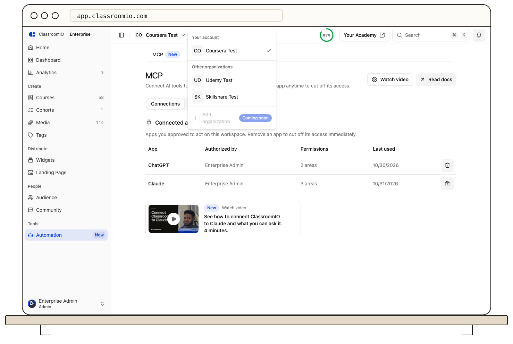

Use the organization switcher in the dashboard to move between academies you belong to. Select the organization you want, then confirm its name in the dashboard before changing settings or content.

The switcher groups your memberships:

- **Your account** — the organizations on your current account. A check marks the active one.
- **Other organizations** — organizations you manage on other accounts. Selecting one keeps you in the admin dashboard.
- **Learning** — academies where you are a student. Each shows its address and an arrow, because selecting it leaves the admin dashboard and opens that academy's own site, where ClassroomIO signs you in.

If you only learn in academies and manage none, signing in at `app.classroomio.com` opens **Choose where to go** instead. It lists every academy with your role and its address, plus any pending invitations you can accept.

An arrow pointing up and out marks only the choices that take you to a different web address, such as an academy's subdomain or custom domain. Choices without it stay in the admin dashboard.

Each organization has separate courses, students, team members, and settings. A missing course or person may belong to another organization. **Workspaces** lists the primary and additional organizations on the same account.

Save or discard edits before switching. If files are still uploading from the **Media** page, you're asked to confirm first, and switching cancels those uploads. If an organization is missing, check that you accepted its invitation with the same account. Ask its administrator to confirm your membership if it still does not appear.

## Related guides

- [Understand primary and additional organizations](/account-team-security/understand-primary-and-additional-organizations)
