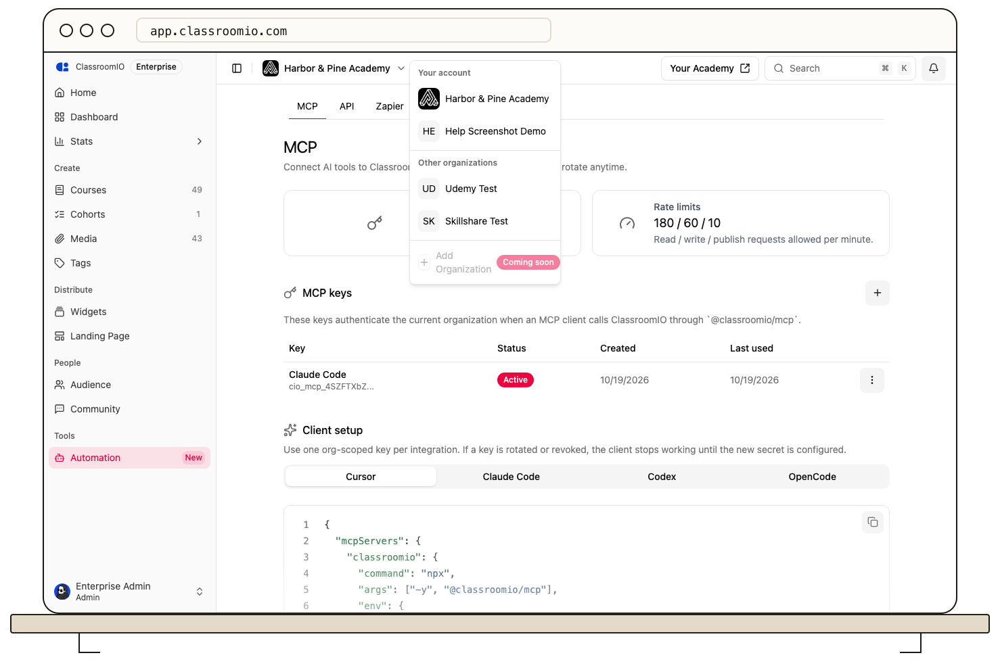

Use the organization switcher in the dashboard to move between academies you belong to. Select the organization you want, then confirm its name in the dashboard before changing settings or content.

Each organization has separate courses, students, team members, and settings. A missing course or person may belong to another organization. **Workspaces** lists the primary and additional organizations on the same account.

Save or discard edits before switching. If an organization is missing, check that you accepted its invitation with the same account. Ask its administrator to confirm your membership if it still does not appear.

## Related guides

- [Understand primary and additional organizations](/account-team-security/understand-primary-and-additional-organizations)
