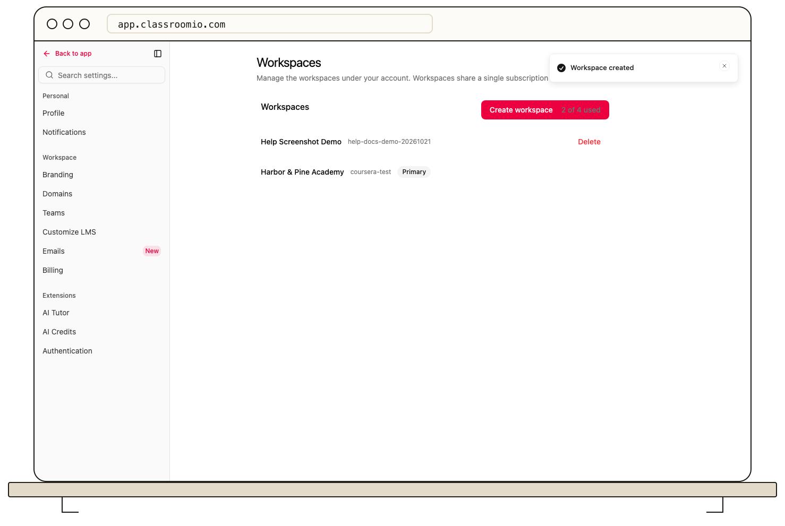

Your first organization is the **primary** organization. Additional organizations are separate academies attached to that primary account. The **Workspaces** page labels the primary organization and shows your organization count.

The primary organization holds the account subscription and organization allowance. Manage billing there. Each organization has its own name, academy address, team, courses, and students. Account usage combines organization and student counts, so another academy can affect plan limits.

Use the organization switcher to move between academies. Check the active name before editing settings, inviting people, or creating courses. A new organization does not move existing courses or students into it.

The primary organization cannot be deleted from **Workspaces**. Additional ones can be deleted there; [review the consequences first](/account-team-security/delete-an-organization).

## Related guides

- [Create another organization](/account-team-security/create-another-organization)
- [Understand student and organization limits](/account-team-security/understand-student-and-organization-limits)
