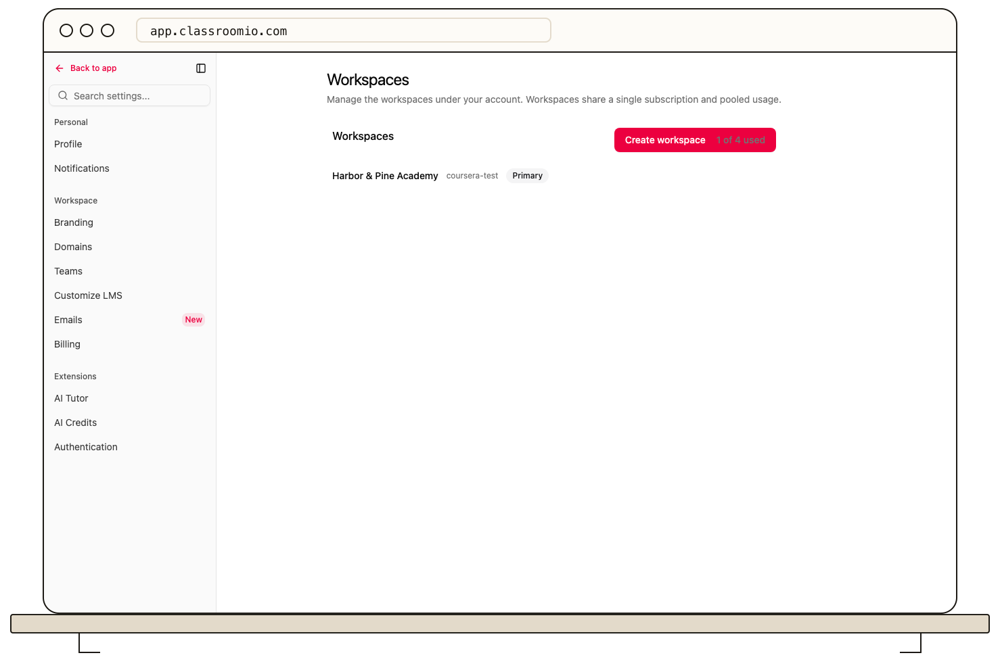

The account's **Workspaces** screen summarizes combined usage: student count, monthly AI-token use, and organization count. This screen is not linked from the current Settings navigation; contact [ClassroomIO support](mailto:help@classroomio.com) for your account's organization allowance.

## What is counted

An account includes its primary organization and any additional organizations. The organization count includes all of them. The student count adds non-archived members with the **Student** role in each organization; a pending email invitation alone is not an organization member. Deactivated students still occupy a seat, while archiving a student frees one. Removing someone from one course does not remove their organization membership.

Additional organizations require an Enterprise plan and an available organization slot. Student-seat limits can also prevent invitations or CSV imports. When a limit blocks an action, its message is the best source for the current allowance.

## Reduce usage or increase capacity

Review inactive students and unnecessary additional organizations before deleting anything. Export data you need first. If the account needs more capacity, open [Billing](/account-team-security/view-and-change-your-plan) to review a plan change.

For course-only access, remember that enrollment and organization membership are separate; removing a course enrollment alone may not reduce the organization's student count.
