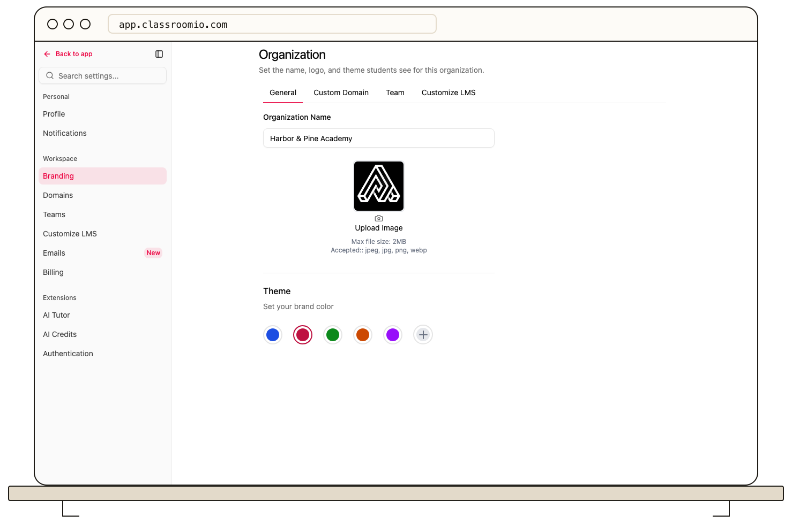

Organization administrators can open **Settings → Organization** to change the identity shown across their academy.

## Change the organization profile

1. Confirm the active organization in the switcher.
2. Edit **Organization name** and choose an organization image if needed.
3. Select **Save changes** in the save bar. **Discard** restores the previous name and image.

The theme section lets you choose a preset or custom color. Theme selections save when chosen, so check your academy after making one.

This page changes the displayed organization identity. Domains, sign-in rules, and student navigation have separate settings. For the wider branding tour, see [Customize your organization](/organization-and-team/customize-organization).
