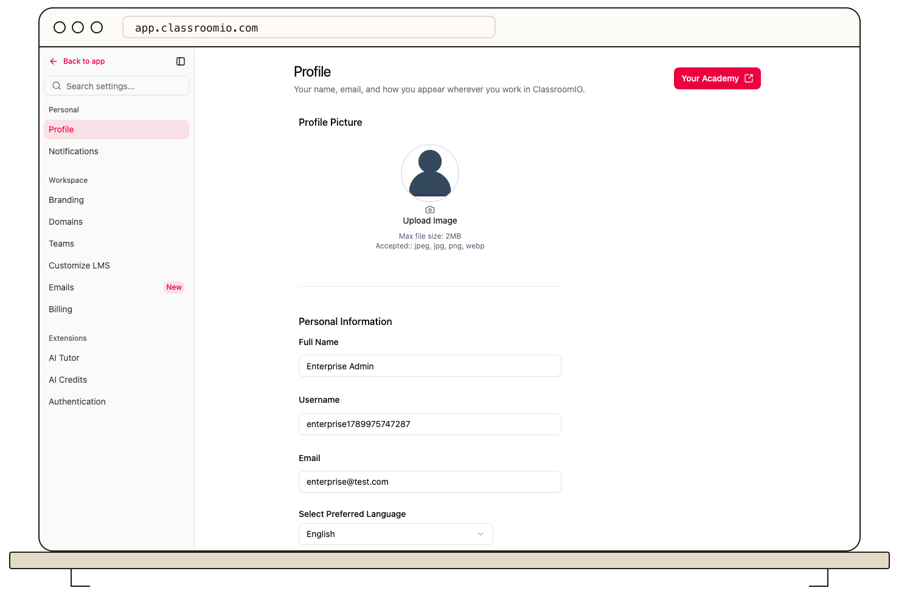

Open **Settings → Profile** in the admin dashboard or student LMS to edit the details shown on your account.

## Edit your profile

1. Choose a profile picture, then edit **Full Name** and **Username** as needed.
2. Choose your preferred language.
3. Select **Save changes** in the bar that appears after an edit. **Discard** restores the saved values.

If a field is rejected, use its validation message to correct the value and save again. Your updated name and picture appear wherever ClassroomIO shows your profile, including discussions.

## Change your email

Edit **Email** and use the email-change action beside it. ClassroomIO sends a verification message to the new address. Open that message to finish the change; saving your other profile fields does not change your email. If your organization manages identities through SSO, ask its administrator how to update identity-provider details.

## Related guides

- [Manage your notification preferences](/account-team-security/manage-your-notification-preferences)
- [Sign in and reset your password](/learner-guides/sign-in-and-reset-your-password)
