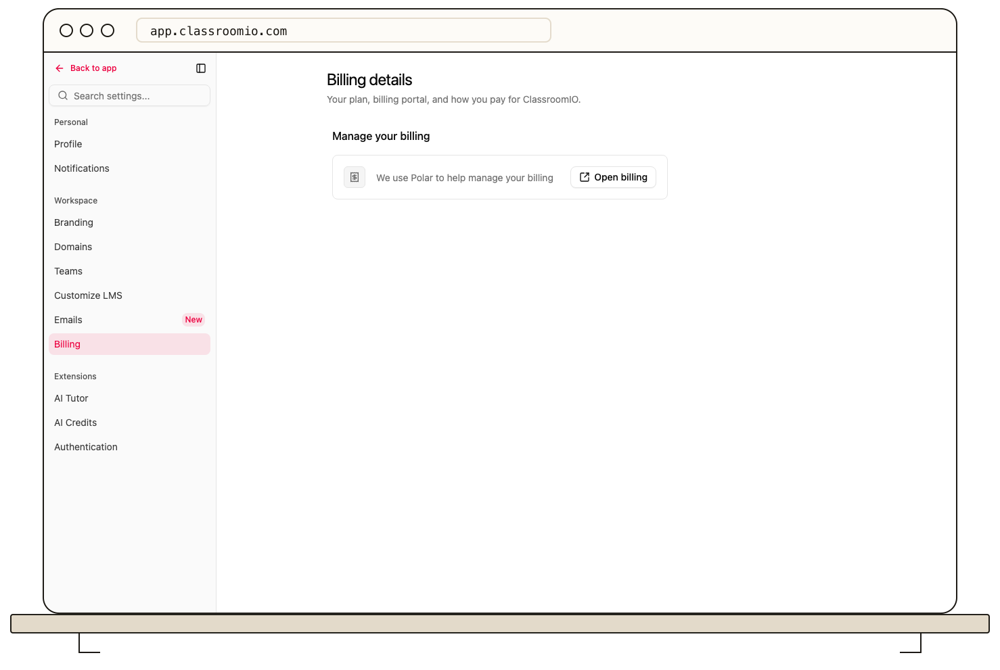

Open **Settings → Billing** in your primary organization to see the active plan and the billing provider. Additional organizations show a notice that their billing belongs to the primary account.

## Review a plan change

1. Check the active plan under **Settings → Billing**.
2. Select **Upgrade** to view available plans, or **Open billing** to manage the existing subscription in the billing portal.
3. Review the quoted price, effective date, renewal, and any limits shown before confirming in the checkout or portal.
4. Return to ClassroomIO and verify that the plan displayed in Billing has updated.

A lower plan may allow fewer organizations or students. Check [student and organization limits](/account-team-security/understand-student-and-organization-limits) before changing plans. If you need invoices, payment details, or cancellation, use **Open billing**; its options depend on your billing provider. Do not change a subscription based only on a feature banner—read the portal confirmation first.
