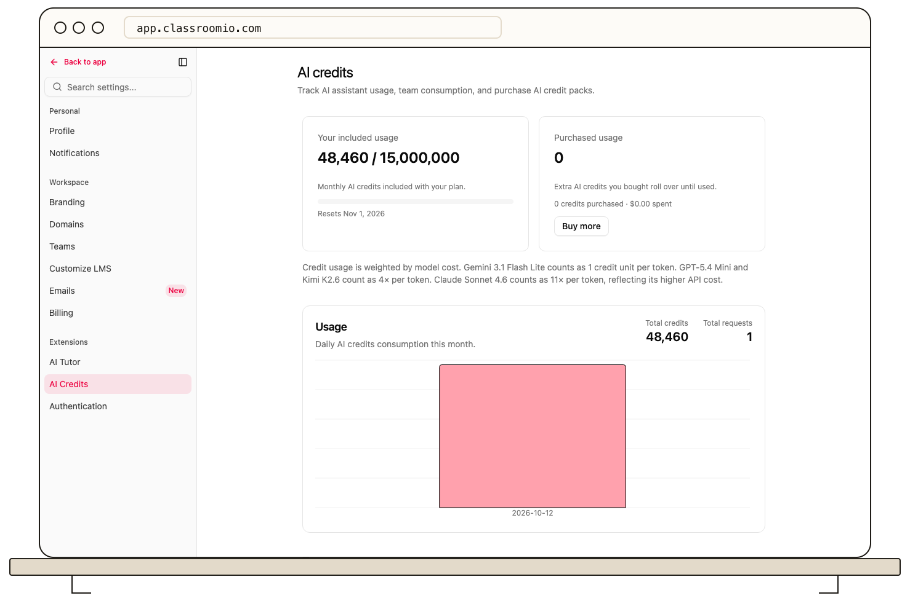

Open **Settings → AI Credits** in the active organization to review AI usage. The page shows usage summary cards, a chart, and a purchase option where available.

AI course and content features consume credits according to the action shown in the product. Review the cost note on this page before a large generation task. The usage display helps you identify consumption over time; it is separate from the account's organization and student limits.

To add credits, choose the purchase option, review the checkout amount, and return to the credits page after payment. A successful purchase should update the available balance. If an AI action reports insufficient credits, check this page and the current organization before retrying.

Only purchase after reviewing the amount and billing terms shown at checkout. If the displayed balance does not change after a completed payment, contact support with the transaction details; do not share payment-card information in a support message.

## Related guides

- [View and change your plan](/account-team-security/view-and-change-your-plan)
