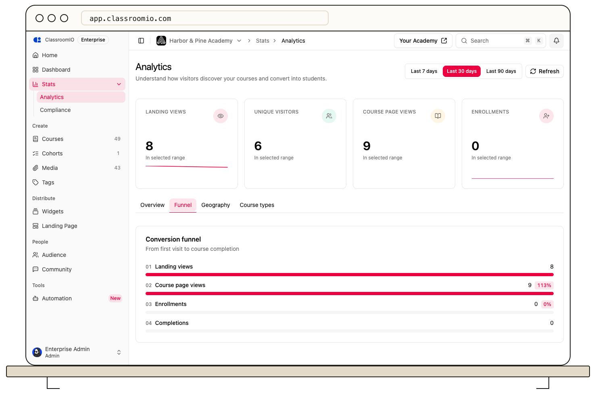

Use **Analytics → Overview** or **Funnel** to compare academy visits, course page views, enrollments, and completions during one date range. These are aggregate counts of different events, not a tracked journey for each visitor.

## Compare traffic over time

Select **Last 7 days**, **Last 30 days**, or **Last 90 days**. The **Traffic over time** chart shows daily **Views** and **Enrollments**. Views on this chart combine academy landing page and course page views; the **Landing views** and **Course page views** cards separate them.

Use the chart to spot days with unusually high visits or enrollments. The chart groups days into wider visual buckets when space is limited, so read the tooltip or date label before comparing individual points.

## Read the conversion funnel

Open **Funnel** to see four counts: **Landing views**, **Course page views**, **Enrollments**, and **Completions**. The percentage beside a step is its count divided by the preceding step's count. If the preceding count is zero, no percentage is shown.

:::note[The steps are independent totals]
A student may enter on a course page without first viewing your academy landing page. Someone can also complete a course during the selected range after enrolling earlier. The counts therefore need not decrease at every step, and the percentages are not unique-person conversion rates.
:::

If the funnel says **No funnel data yet**, try a longer date range. Select **Refresh** to request the latest available data after a recent campaign or course launch.

## Related guides

- [Read your organization analytics overview](/analytics-and-reporting/read-your-organization-analytics-overview) — locate every organization-level panel
- [Compare your top courses](/analytics-and-reporting/compare-your-top-courses) — see which course pages receive views
- [Review course performance and student progress](/analytics-and-reporting/review-course-performance-and-learner-progress) — inspect one course after enrollment
