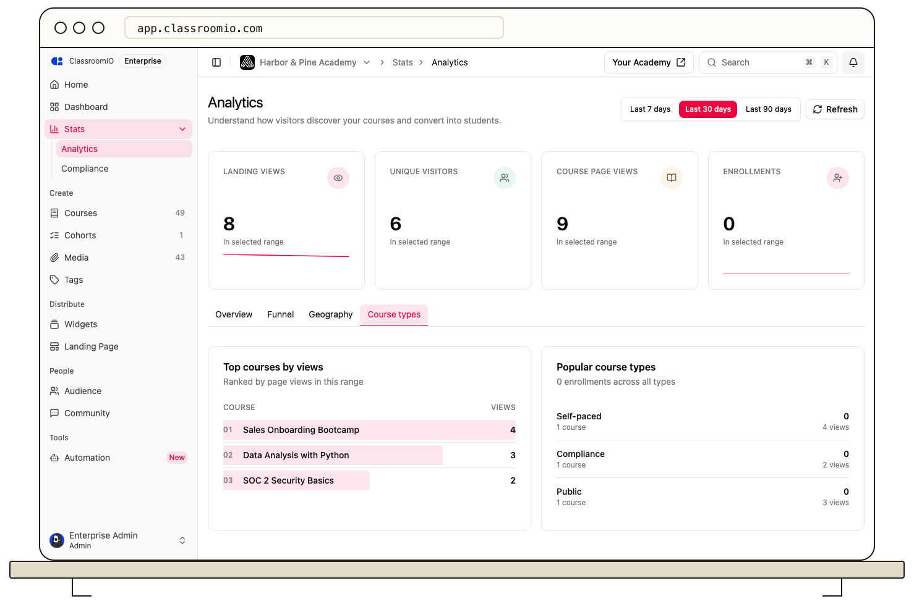

The **Top courses by views** panel ranks course pages by views in your organization's selected analytics range. Use it to find which courses attract attention, then open a course to see whether students are progressing.

## Find the ranking

In your organization sidebar, open **Analytics**. Select **Overview** or **Course types**, then find **Top courses by views**. Choose **Last 7 days**, **Last 30 days**, or **Last 90 days** at the top of the page. The panel shows each course's rank, title, and page views for that range.

The panel ranks by page views, not enrollments, completion, or revenue. Repeat visits can increase a course's count. If it says **No course page views yet**, try a longer range or select **Refresh** after traffic arrives.

## Inspect a course

Select a course title to open it, then select its **Analytics** tab. Review enrollment, lesson progress, exercise completion, grades, and the student table. If a highly viewed course has low enrollment, check its [landing page](/publish-and-brand/course-landingpage) and [enrollment settings](/manage-students/enrollment-access-control). If students enroll but do not progress, examine the course content and completion rules.

## Related guides

- [Review course performance and student progress](/analytics-and-reporting/review-course-performance-and-learner-progress) — read the course's own data
- [Analyze landing views, enrollments, and completions](/analytics-and-reporting/analyze-landing-views-enrollments-and-completions) — compare organization-wide traffic and conversion
