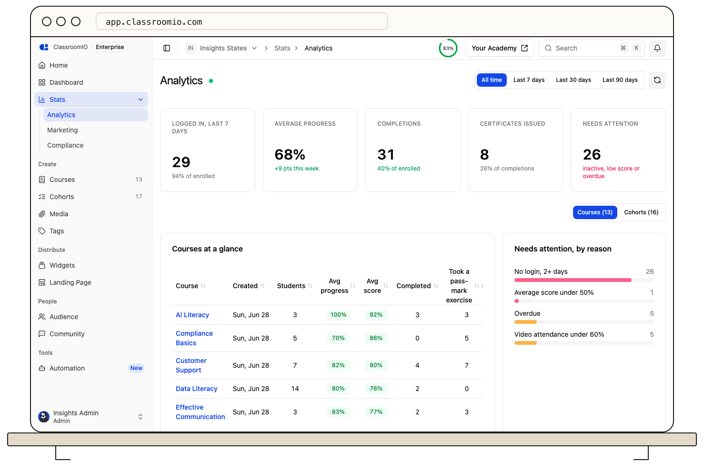
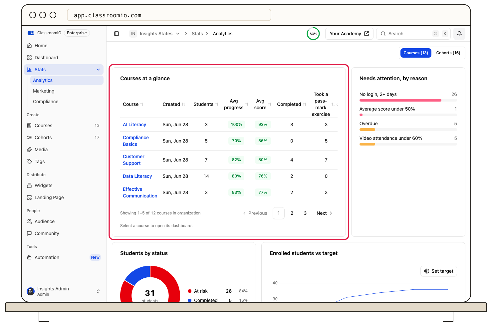
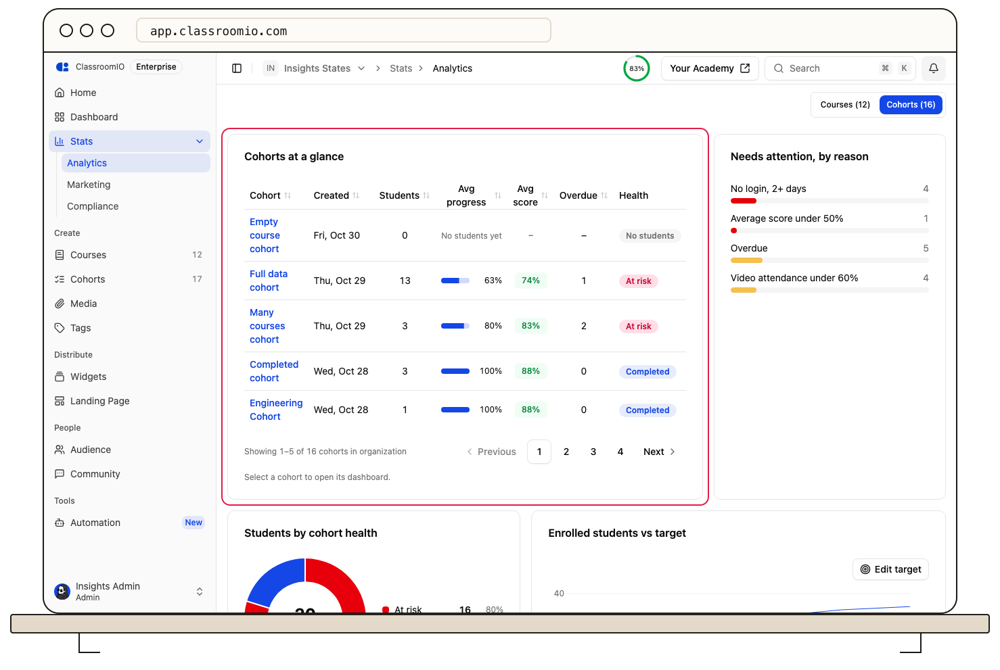
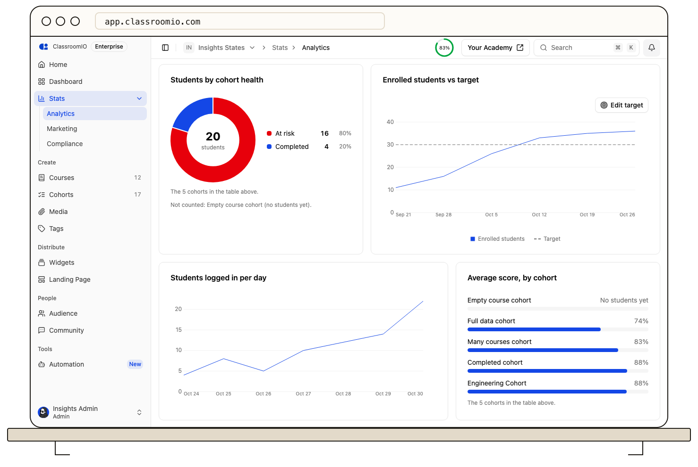

Open **Stats → Analytics** in your organization sidebar to see how students are doing across every course and cohort. The page shows organization-wide summary cards, a health check for each cohort, the reasons students need attention, login and growth trends, and your courses ranked by completion.

The live indicator dot next to the page title shows when figures were last updated. If your plan has a student limit, seat usage appears alongside the student growth chart.

Select **Courses** or **Cohorts** above the cards to switch between course figures and cohort figures. The page opens on **Courses**. If your organization has no cohorts, the switch is hidden and only the course figures appear. The summary cards, **Needs attention**, the growth and login charts, and **Courses by completion** stay in both views.

## Before you start

Only organization administrators can open **Analytics**. Tutors and students don't see the item, and opening its URL without access shows "You don't have access to these analytics."

The page counts students enrolled in any of your organization's courses, including courses that aren't published yet. Deleted courses and course templates are not counted, and neither are students whose organization membership is deactivated.

## When there's nothing to show yet

If your organization has no students, a notice appears at the top explaining that analytics fill in as students open lessons and submit exercises. The notice offers an inline link to **Add students** to open your organization's audience page, then enrol them in courses or cohorts. The summary cards show zeros or dashes, and the cards below show their usual empty states. The range picker remains enabled.

The page keeps checking in the background, so the notice disappears and cards fill in on their own when the first student joins. Reload the page if you need the change immediately.

:::info[Looking for landing page traffic?]
Visitor, enrollment, and funnel figures for your academy landing page moved to **Stats → Marketing**. See [Read your organization analytics overview](/analytics-and-reporting/read-your-organization-analytics-overview).
:::

## Read the summary cards

The five cards under the page header summarize students' work across all of your courses.

| Card                       | What it shows                                                                                                                                                                                                               |
| -------------------------- | --------------------------------------------------------------------------------------------------------------------------------------------------------------------------------------------------------------------------- |
| **Logged in, last 7 days** | Students who signed in at least once in the past 7 days. The hint shows them as a share of enrolled students. Under a range, the title and count use the last N days.                                                       |
| **Average progress**       | The mean share of lessons and exercises each student has completed, across all of their courses. The hint shows the change this week, or across the selected range.                                                         |
| **Completions**            | Course completions: each student who finished a course counts once for that course. Under **All time**, the hint shows the share of enrolled students. Under a range, it shows how many completions happened in that range. |
| **Certificates issued**    | Certificates students have earned. Under **All time**, the hint shows them as a share of completions. Under a range, it shows how many certificates were issued in that range.                                              |
| **Needs attention**        | Students who are not finished and are at risk: no login for 2 or more days, an average score under 50%, or overdue work. The card turns red when at least 5% of students need attention.                                    |

## Choose a time range

Use the range picker beside **Refresh** to choose **All time**, **Last 7 days**, **Last 30 days**, or **Last 90 days**. **All time** is the default. A range covers today and the days before it, by UTC day.

A range changes what students _did_ in that window. Where students _stand_ is always as of now.

- **Follow the range:** **Logged in** (the title becomes **Logged in, last N days**), **Average progress**, **Completions**, **Certificates issued**, **Enrolled students vs target**, and **Students logged in per day**.
- **Stay current:** **Needs attention**, **Courses at a glance**, **Students by status**, **Average score, by course**, **Courses by completion**, **Cohorts at a glance**, **Students by cohort health**, and **Average score, by cohort**.

Cards that stay current carry a **Now** tag. Its tooltip explains that the range does not change that card. Your range choice carries over when you move between analytics pages, and resets on a full reload.

On the Free plan, only **Last 7 days** is available and the page opens on it. The other ranges show a lock, and selecting one opens the upgrade dialog.

## Compare your courses

**Courses at a glance** is the default table. It lists courses five per page in title order. Each row shows **Course**, **Created**, **Students**, **Avg progress**, **Avg score**, **Completed**, **Took a pass-mark exercise**, and **Passed first try**. Select a course's name to open its **Analytics** page. When there are more than five courses, the pager reads **Showing 1–5 of N courses in organization**.

**Students by status** groups all students into **Completed**, **At risk**, **Lagging**, and **On track**. **Average score, by course** ranks the courses on the current page by their students' average score. **Courses by completion** ranks courses by the share of enrolled students who completed them, five per page. When there are more than five, the pager reads **Showing 1–5 of N courses in organization**.

## Compare your cohorts

Select **Cohorts** above the cards to see these figures.

**Cohorts at a glance** lists active cohorts five per page, newest first. Each row shows the cohort's name, when it was **Created**, its **Students** (with invited students underneath when there are any), a progress bar, **Avg score**, **Overdue** students, and a **Health** pill. Empty cohorts are included, so a newly created cohort appears before anyone joins. A cohort with no students yet shows **No students yet** under **Progress**, **–** for **Overdue**, and a muted **No students** pill under **Health**; its **Students** count stays at 0, with any invitations underneath. Select a cohort's name to open that cohort's own **Analytics** page.

When there are more than five active cohorts, the pager under the table reads **Showing 1–5 of N cohorts in organization** and moves through the rest. Every active cohort appears on some page. An archived cohort does not appear here; open it from **Cohorts** to see its own dashboard.

The **Health** column rates each cohort from the same row, checking these rules in order:

- **Completed:** at least 95% of its students completed every course.
- **At risk:** at least 20% of its students are at risk.
- **Lagging:** its average score is under 65%.
- **On track:** every other cohort.

**Students by cohort health** is its own card. It adds up the students in each health group from the cohorts on the current page (five by default) and shows the total in the centre. The note names those cohorts, for example "The 5 cohorts in the table above." Cohorts with no students add nothing to the donut; the note names them afterwards, for example "Not counted: Cohort 2 (no students yet)."

**Average score, by cohort** ranks the cohorts on the current page by their students' average score. A student's score is the best graded attempt on each exercise they have taken. A cohort with no students shows **No students yet** instead of a bar; a cohort with students but no graded attempts shows **No graded attempts**.

## See why students need attention

**Needs attention, by reason** counts the students who are not finished for each reason:

- **No login, 2+ days**
- **Average score under 50%**
- **Overdue**
- **Video attendance under 60%**

A student can meet more than one reason, so these counts can add up to more than the **Needs attention** card.

## Follow growth and logins

**Enrolled students vs target** shows the running total of enrolled students. Under **All time**, it covers the last six weeks. A flat stretch means no students joined that week. Set a target with **Set target**, or change it with **Edit target**. The target appears as a dashed line, and the vertical axis extends to your plan's seat limit when one is set.

Under **Last 7 days** and **Last 30 days**, the chart shows one point per day. Under **Last 90 days**, it groups the points by week.

**Students logged in per day** counts the students who signed in on each of the last 7 days. Under a range, it covers the last N days. Days run in Coordinated Universal Time (UTC), and a sign-in to any ClassroomIO academy counts, not only yours. The chart draws as a line, and its date labels are thinned as the range widens so they stay readable.

## Keep figures current

The chips show when the figures were last updated. Select **Refresh** to request the latest data for every card and for the course and cohort lists. While the page stays open and visible, it also refreshes on its own about every minute.

## Troubleshoot missing figures

- **Analytics couldn't load:** select **Try again**. If the page still fails, reload it.
- **The page says there are no students yet:** add students to your audience and enrol them in courses or cohorts, then wait for the page to refresh or select **Refresh**.
- **A chart says there is no data yet:** no student has matching activity yet, for example no graded attempts for **Average score, by cohort**.
- **A cohort says No students yet:** the cohort has no active students. Invite students to the cohort, then wait for the page to refresh.
- **A cohort is missing from Cohorts at a glance:** the table pages through active cohorts five at a time. Use the pager to reach older cohorts. An archived cohort does not appear; open it from **Cohorts** to see its own dashboard.
- **A student is missing from the counts:** confirm that the student is enrolled in at least one course and that their organization membership is active.

## Related guides

- [Track a cohort with analytics](/analytics-and-reporting/track-a-cohort-with-analytics) — open one cohort's students, overdue work, and reminders
- [Review course performance and student progress](/analytics-and-reporting/review-course-performance-and-student-progress) — inspect a single course
- [Read your organization analytics overview](/analytics-and-reporting/read-your-organization-analytics-overview) — landing page traffic and enrollments on **Marketing**
- [Roles and Permissions](/organization-and-team/roles-and-permissions) — who can open each analytics page
