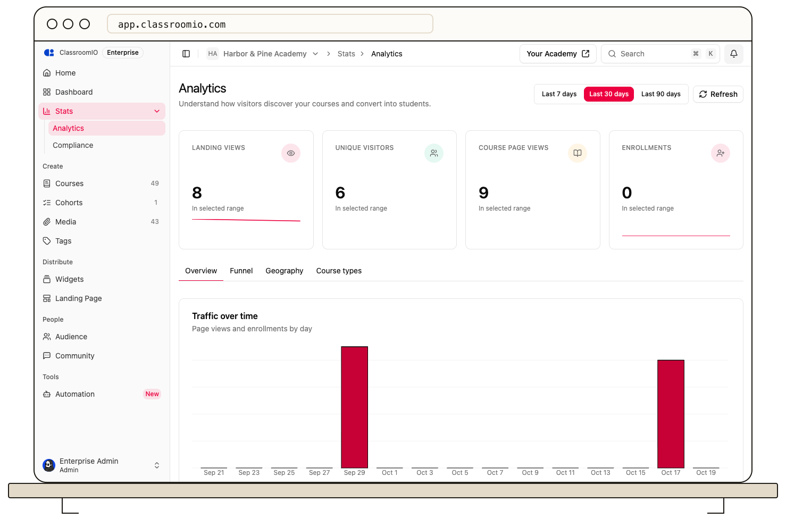

Open **Analytics** in your organization sidebar to see how people find your academy, view courses, enroll, and complete them. The page combines summary counts with traffic and course breakdowns for the date range you select.

## Choose a date range

Select **Last 7 days**, **Last 30 days**, or **Last 90 days** at the top of **Analytics**. All cards and tabs use the selected range. Select **Refresh** if you need to request the latest available figures.

The four headline cards show **Landing views**, **Unique visitors**, **Course page views**, and **Enrollments** in that range. A view is an event, so several page visits by one person can produce more views than visitors.

## Read the tabs

- **Overview** brings the traffic chart, conversion funnel, top courses, popular course types, and top countries together.
- **Funnel** shows landing views, course page views, enrollments, and completions in sequence.
- **Geography** shows the countries associated with visitors and their enrollments.
- **Course types** shows courses ranked by views and enrollments grouped by course type.

**Traffic over time** plots views and enrollments by day. The chart's view series combines academy landing page and course page views; the **Landing views** headline card counts only academy landing page views.

The funnel compares aggregate events in the chosen range. Its percentages divide each step's count by the previous step's count. They don't follow one fixed group of visitors through every stage, so treat them as an orientation signal rather than a person-by-person conversion rate.

## Go deeper

Select a course in **Top courses by views** to open that course. Its **Analytics** tab shows student progress, lesson completion, submissions, and grades. Use **Audience** to inspect an individual student's courses and grades.

## Related guides

- [Analyze landing views, enrollments, and completions](/analytics-and-reporting/analyze-landing-views-enrollments-and-completions) — interpret the traffic chart and funnel
- [View top countries and popular course types](/analytics-and-reporting/view-top-countries-and-popular-course-types) — read the breakdowns
- [Review course performance and student progress](/analytics-and-reporting/review-course-performance-and-learner-progress) — inspect one course
