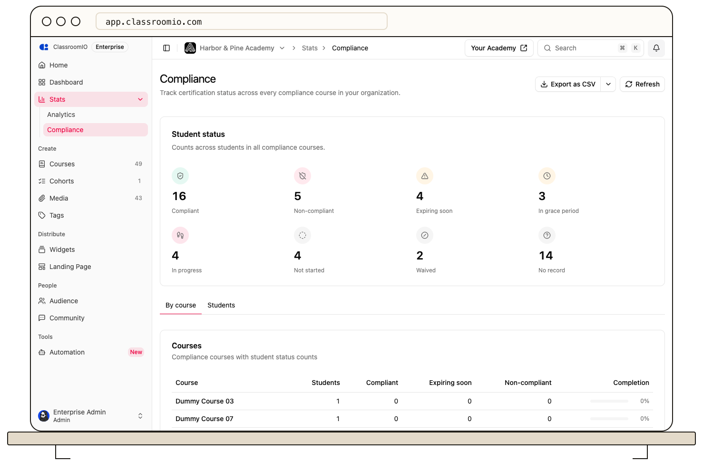

Open **Compliance** in your organization sidebar to see current compliance status across courses, then export the student-course rows you need. The report contains student names, email addresses, due dates, and expiry dates, so restrict access to the file.

## Review the status summary

The summary counts obligations marked **Compliant**, **Non-compliant**, **Expiring soon**, **In grace period**, **In progress**, **Not started**, **Waived**, or **No record**. Select **By course** to compare each compliance course's student count and status totals. Its completion percentage is the share of students currently counted as compliant.

## Filter student records

Select **Students** to see a row for each student and course obligation. The table shows the student's name, course, status, due date, and expiry date. Select a status chip, or select **All** to restore every row. Use **Refresh** to request the latest report.

The status chips filter the student table and the export together. A student can appear on several rows if they have several compliance courses.

## Export the report

After selecting the status you need, select **Export** and choose a format. The file contains the same filtered rows with name, email, course, status, due date, and valid-until date. The export is disabled when there are no rows to export.

:::warning[Review before sharing]
The export contains personal and training-status data. Check the active filter and recipient list before saving or sending it.
:::

## Related guides

- [Monitor organization compliance](/deliver-and-engage/monitor-organization-compliance) — use the summary to identify courses needing attention
- [Review a student's compliance history](/deliver-and-engage/review-learner-compliance-history) — inspect an individual obligation
- [Exports](/reference/exports) — compare file formats and row limits
