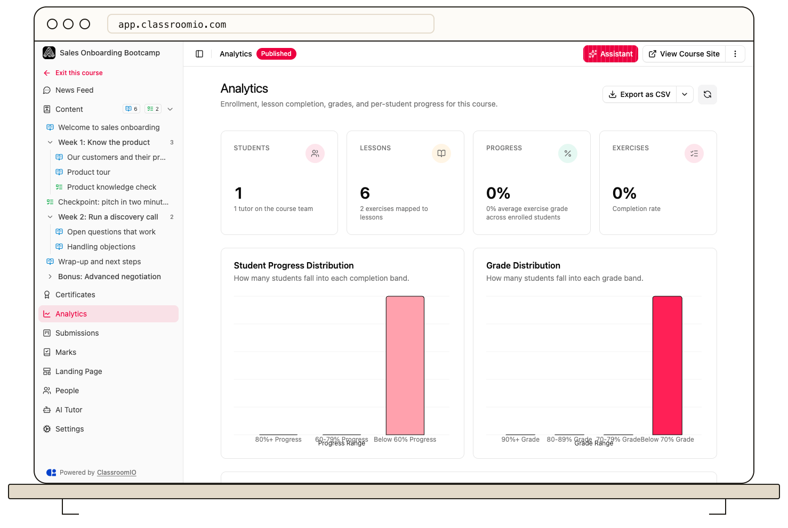

Open a course and select **Analytics** to see how its students are progressing. The page summarizes lesson and exercise completion, grades, and the progress of each enrolled student.

## Read the course summary

The top cards show **Students**, **Lessons**, **Progress**, and **Exercises**. The **Students** card counts enrolled students and notes the number of tutors. **Lessons** shows the number of lessons and exercises. **Progress** is the lesson completion rate, with the average exercise grade below it. **Exercises** shows the exercise completion rate.

The **Student Progress Distribution** and **Grade Distribution** charts group students into progress and grade bands. Use these to see whether a low overall figure is widespread or concentrated among a smaller group.

## Find a student who needs help

In **Student Progress Overview**, review **Lessons Completed**, **Exercises Submitted**, **Average Grade**, and **Last seen**. The table shows 15 students per page. Select **View Details** beside a student to open their course profile and inspect the work behind the summary.

If the table says **No Students Found**, nobody is enrolled in this course yet. If the page says **No Analytics Data**, try reloading it; contact support if it still fails to load.

For a shareable file, use **Export** on the course's **Analytics** page. The export includes every student, even though the on-screen table is paginated. Handle the file as student data and share it only with people who need access.

## Related guides

- [View submissions and completion data](/analytics-and-reporting/view-submissions-and-completion-data) — inspect submitted work
- [View a student's analytics](/analytics-and-reporting/view-a-learners-analytics) — see that student's courses and grades
- [Exports](/reference/exports) — choose a file format and understand the columns
