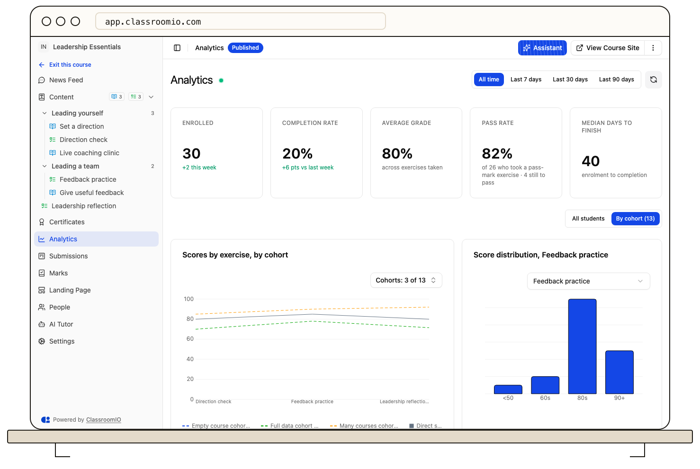
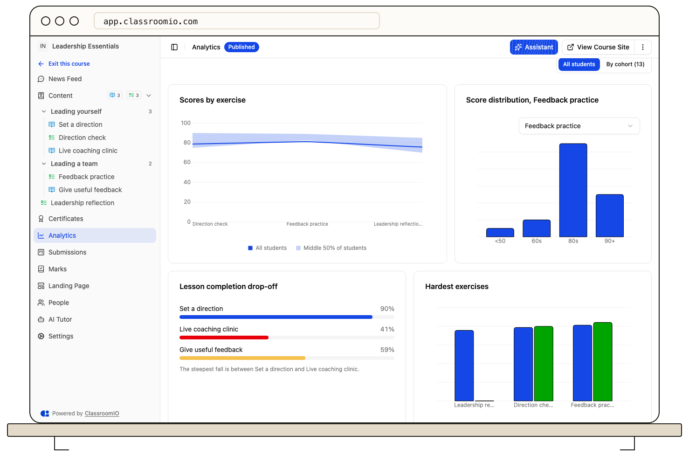
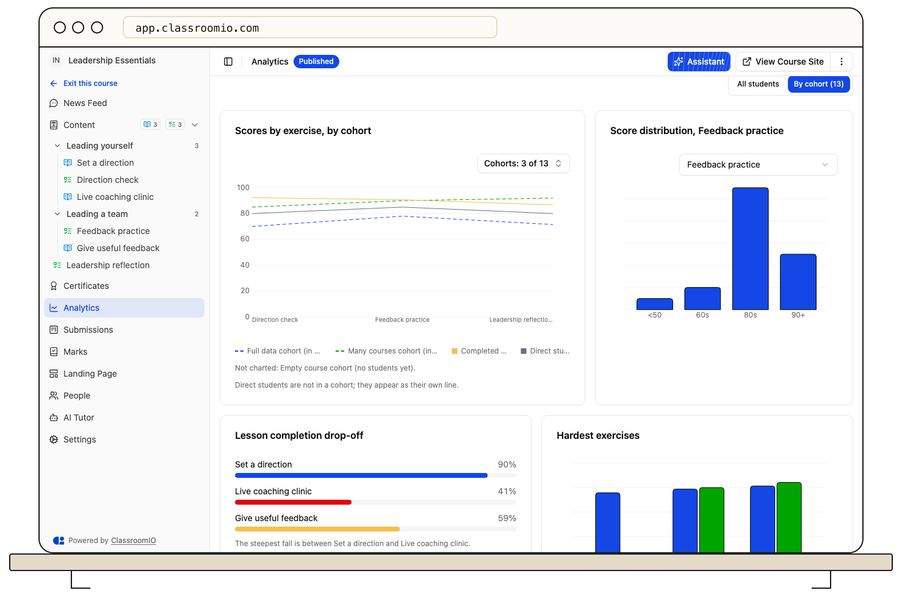
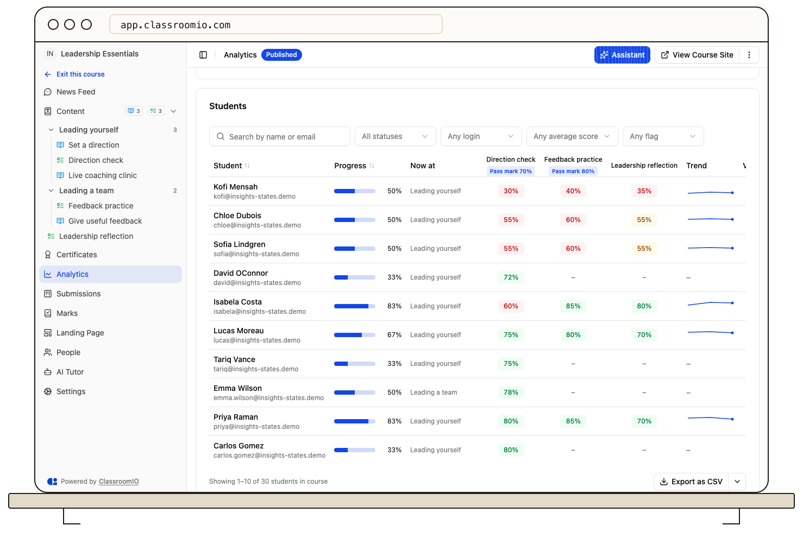

Open a course and select **Analytics** in its sidebar to see how its students are progressing. The page summarizes completion and scores, compares cohorts and sections, and lists every enrolled student with their progress. The live indicator dot next to the page title shows when figures were last updated.

## Before you start

You need to be an administrator or tutor of the course. Students do not see **Analytics**, and template courses do not show it.

The page counts active organization members who are enrolled in the course. Deactivated and archived members are excluded. Students who are not enrolled do not appear; [add students to a course](/manage-learners/add-a-learner-directly-to-a-course) when the list is missing someone.

## When there's nothing to show yet

If no students are enrolled in the course, a notice appears at the top explaining that analytics fill in as students open lessons and submit exercises. The notice offers an inline link to **Invite students** to open the course's people page. The summary cards show zeros or dashes, and the cards below show their usual empty states. The range picker remains enabled.

The page keeps checking in the background, so the notice disappears and cards fill in on their own when the first student joins. Select **Refresh** if you need the change immediately.

## Read the summary cards

The top row of summary cards summarizes the course.

| Card                      | What it shows                                                                                                                                                                                                                                                            |
| ------------------------- | ------------------------------------------------------------------------------------------------------------------------------------------------------------------------------------------------------------------------------------------------------------------------ |
| **Enrolled**              | Students enrolled in the course. Under **All time**, the hint shows how many joined this week. Under a range, it shows how many joined in the last N days.                                                                                                               |
| **Completion rate**       | The share of enrolled students who finished the course. Under **All time**, the hint compares the rate with last week. Under a range, it compares it with N days ago.                                                                                                    |
| **Average grade**         | The mean of each student's best graded attempt, across the exercises they have taken. Under a range, only attempts made in that range count.                                                                                                                             |
| **Pass rate**             | The share of students who reached the pass mark on their first graded attempt, on exercises that have a pass mark. The hint shows how many students were graded and how many still have to pass. The card appears only when the course has an exercise with a pass mark. |
| **Median days to finish** | The middle number of days between enrollment and course completion, among students who finished. It counts to completion, not to the certificate. It shows – until someone finishes.                                                                                     |

A student finishes the course by completing every lesson and exercise, or by earning a certificate.

## Choose a time range

Use the range picker beside **Refresh** to choose **All time**, **Last 7 days**, **Last 30 days**, or **Last 90 days**. **All time** is the default. A range covers today and the days before it, by UTC day.

A range changes what students _did_ in that window. Where students _stand_ is always as of now.

- **Follow the range:** all five summary cards and the score charts: **Scores by exercise** (all students) or **Scores by exercise, by cohort**, **Score distribution, \{exercise\}**, **Hardest exercises**, and **Hardest questions**.
- **Stay current:** **Lesson completion drop-off**, **Cohorts taking this course**, **Cohort details**, **Section-by-section scorecard**, **Needs attention**, and the **Students** table.

Cards that stay current carry a **Now** tag. Its tooltip explains that the range does not change that card. Your range choice carries over when you move between analytics pages, and resets on a full reload.

On the Free plan, only **Last 7 days** is available and the page opens on it. The other ranges show a lock, and selecting one opens the upgrade dialog.

## Switch between all students and cohorts

When the course has at least one cohort, a switch above the score charts chooses between the whole course and a cohort view. It opens on **By cohort**; select the other option to see one view for everyone. The cohort cards (**Cohorts taking this course** and **Cohort details**) only appear in the cohort view. A course with no cohorts has no switch and no cohort cards.

## Compare scores across the course

In the all-students view, **Scores by exercise** plots one line for everyone, with a shaded band for the middle 50% of students.

In the cohort view, **Scores by exercise, by cohort** plots the average score for each exercise in course order, with one line per cohort. The average uses each student's best graded attempt in the selected range. A line has a gap where that cohort has no graded attempt yet. The chart opens with the three newest cohorts that have students. When the course has more than one cohort with students, the cohort picker above the chart can search for older cohorts, add them, select all (or select shown when more results exist), clear the selection, or reset to the newest three. Students who are not in a cohort stay on the chart as a separate line. A cohort with unfinished students is dashed and labelled **(in progress)**. Students who are not in a cohort appear as a **Direct students** line; when no cohort has students, that is the only line.

**Score distribution, \{exercise\}** groups students by the score of one exercise. Choose the exercise in the **Exercise** menu; it defaults to the last exercise with a pass mark. The bars count students in each band, from `&lt;50` to **90+**, plus **No score** for students without a graded attempt.

**Lesson completion drop-off** shows the share of students who completed each lesson, in course order. Bars turn amber below 75% and red below 50%. The note names the steepest fall, for example "The steepest fall is between X and Y."

**Hardest exercises** ranks the four exercises with the lowest average score and compares each one with its **Pass rate**. Exercises with fewer than three graded attempts are left out.

**Hardest questions** ranks the five questions with the lowest share of correct answers, using each student's best graded attempt in the range. Questions with fewer than five answers are left out. A note under a bar shows the context and the most common wrong answer.

## Compare sections and cohorts

**Section-by-section scorecard** appears when the course is divided into sections. It shows five sections per page; when there are more, the footer reads **Showing 1–5 of N sections in course**. Each row shows:

- **Exercises taken:** students with a graded attempt on every exercise in the section, out of the students in that section.
- **Avg score** for the section, averaged across students.
- **Pass rate:** among students with a graded first attempt on every exercise with a pass mark in the section, the share who passed all of them on the first try.
- **Video attendance** and **Classroom attendance**.

**Cohorts taking this course** compares cohorts that include the course **and have students** by **Average progress**, **Average score**, and **Pass rate**. It shows four cohorts per page, newest first; when there are more than four, the pager under the chart reads **Showing 1–4 of N cohorts taking this course**. When a cohort has no students yet, it is left out of the chart and the note adds **Not charted: Cohort 2 (no students yet).** **Cohort details** lists every cohort that takes the course in a sortable, paginated table (five per page), with **Students**, **Progress**, **Avg score**, **Pass rate**, and **Overdue**. Click any column header to sort ascending or descending. When there are more than five cohorts, the footer reads **Showing 1–5 of N cohorts taking this course**. A cohort with no students shows **No students yet** under **Progress**, with **–** for **Avg score**, **Pass rate**, and **Overdue**. Students who are not in a cohort are not grouped into a separate row.

## Review each student

The **Students** card lists the course's students. Search by name or email, or narrow the list with the filters:

- **Status** — **At risk**, **Lagging**, **On track**, or **Completed**
- **Last login** — **Logged in today** or **No login 2+ days**
- **Average score** — **Under 50%**, **50% to 69%**, or **70% and above**
- **Flags** — **Overdue**, **Certificate issued**, or **No certificate**

The table starts with students who need attention most: **At risk** first, then **Lagging**. Click a column header to sort by that column, ascending or descending. When filters are active, **Clear N filters** removes them all.

Each row shows progress, **Now at**, a score column for each exercise in the course, **Trend**, **Video** and **Classroom** attendance, **Certificate**, **Last login**, and **Status**. Locked exercises with no attempts are hidden unless they have a pass mark. **Trend** plots the student's scores across the exercise columns. In a score column:

- – means the student has not attempted the exercise.
- **Pending** means an attempt is waiting for a grade.
- A percentage is the student's best graded attempt. A **Pass mark 70%** tag under the exercise name shows its pass mark.

**Last login** shows **Never** for a student without a login event. **Status** uses the same rules as the [cohort page](/analytics-and-reporting/track-a-cohort-with-analytics#understand-status-and-attention-reasons): **Completed** means the course is finished, **At risk** means no login for 2 or more days, an average score under 50%, or overdue work, **Lagging** means an average score under 65% or video attendance under 60%, and everyone else is **On track**. An **Overdue** badge marks a student with a past-due goal, compliance item, or exercise due date.

The table shows 10 students per page. Numbered pages below it move through the list, and the footer reads **Showing 1–10 of N students in course**. When a search or filter is active, it also reports how many students match. **Export as CSV** downloads every student that matches the current filters and order, including the exercise scores; the menu beside it offers Excel, PDF, and HTML. The export covers all matching students, not only the rows on screen, up to 50,000 students; see [Exports](/reference/exports) for the cap and the exercise-column limit.

## Open a student's course profile

Select a student's name to open their profile for this course. The profile shows the student's progress in each course they are enrolled in and their exercise scores. Use the back button to return to **Analytics**.

## Keep figures current

The chips show when the figures were last updated. Select **Refresh** to request the latest data for every card, the student list and the cohort picker. While the page stays open and visible, it also refreshes on its own about every 30 seconds.

## Troubleshoot missing figures

- **Analytics couldn't load:** select **Try again**. If the page still fails, reload it.
- **The page says there are no students yet:** invite students to the course, then wait for the page to refresh or select **Refresh**.
- **A chart says there is no data yet:** the course has no matching activity in the selected range, or no lessons and exercises yet.
- **A cohort is not charted:** the cohort has no students yet. Invite students to the cohort, then wait for the page to refresh.
- **Average grade shows –:** no exercise attempt has been graded in the selected range. Scores appear after graded work.
- **Pass rate is missing or shows –:** the card is hidden when the course has no exercise with a pass mark. When it is shown, – means no student has a graded first attempt in the range.
- **Median days to finish shows –:** no student has finished the course in the selected range.
- **A student is missing from the list:** confirm that the student is an active organization member and is enrolled in the course.
- **A score differs from Marks:** **Average grade** and the exercise columns use the best graded attempt, while a mark can show another attempt.

## Related guides

- [Track a cohort with analytics](/analytics-and-reporting/track-a-cohort-with-analytics) — review several courses and the students who need attention
- [View a student's analytics](/analytics-and-reporting/view-a-students-analytics) — follow one student across courses and grades
- [Review a student's course progress](/manage-learners/review-a-learners-course-progress) — inspect one student's work in this course
- [View and export marks](/deliver-and-engage/view-and-export-marks) — compare exercise scores and grades
- [Exports](/reference/exports) — see formats and fields
