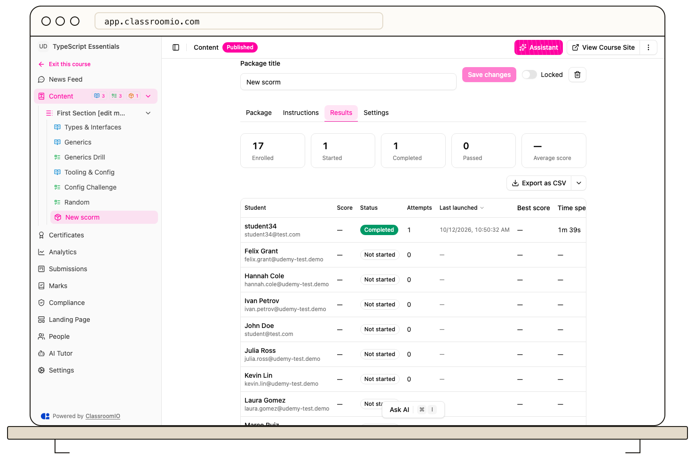
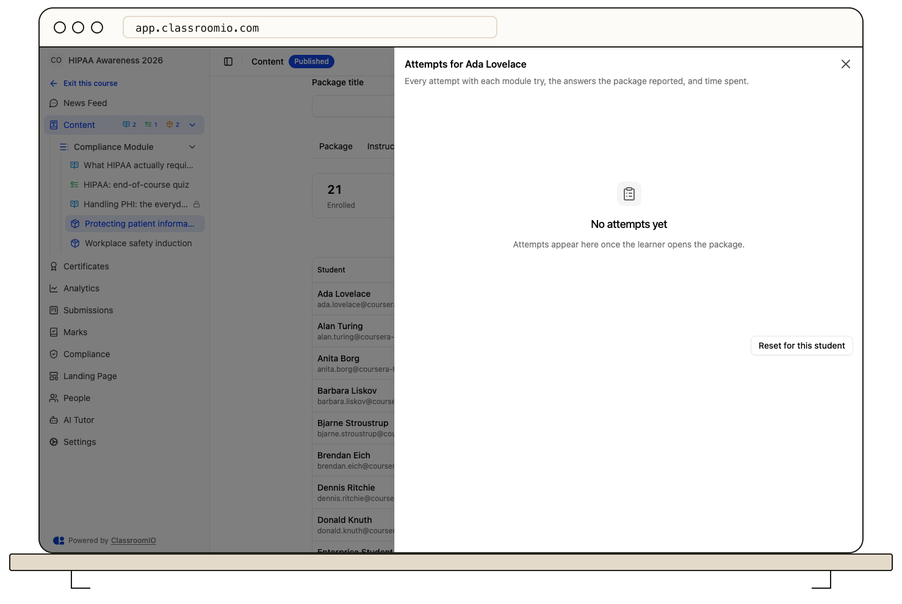

To review SCORM results, open the SCORM item and switch to the **Results** tab. Four summary cards show enrolled, in progress, completed, and average score (or not started for ungraded packages); the table shows each learner's status, pass or fail, score, best score, time spent, attempts, and last launch, with CSV export.

## Before you start

Results, export, and reset are available to the course team and are never gated by plan or license. When a plan lapses or a self-hosted license no longer includes SCORM, learners keep taking packages and you can still see and export results — only authoring is paused.

Scores come from the package itself, as with every SCORM platform. For high-stakes certification, end the course with a ClassroomIO exercise as the graded step.

## Read the Results tab

The tab is modelled on the compliance records table:

- **Summary:** four summary cards report enrolled, in progress, completed, and average score (for graded packages) or not started (for ungraded packages). Score is the attempt score: the average of the modules that report one.
- **Table:** student, status, pass or fail, score, best score, time spent, attempts, last launched. Attempts counts attempts, not module tries; attempts replaced when the package version changed are left out of this table. The table is sortable and paginated, with CSV export. Use the export menu to download the rows you see.
- **Empty state:** when nobody has launched yet, the tab explains that scores, attempts, and time appear once learners open the package.

Status values are **Not started**, **In progress**, **Not passed yet**, and **Completed**. With the default settings — **All modules** and **Any order** — a package with several modules completes only when every module meets the rule, in any order; the table stays in progress until the last module does. **Graded modules only** can complete while ungraded modules remain incomplete, and **In sequence** requires learners to finish modules in order.

## Open a learner's attempts

Select a row to open the student sheet. It shows every attempt and the **Package version N** each one ran against, and inside it every module try with its status, score, time, location and exit, the answers the package reported, and diagnostic events. When the learner has attempts, it has **Reset for this student**, which deletes that learner's attempts and completion for this item.

Interactions read from `cmi.interactions` appear as **N answers reported**. Diagnostics list launch, connect, save, finish, save-on-exit, error, and did-not-connect events, which help when a package is not tracking — open the learner's events, confirm Initialize and Commit, and compare with SCORM Cloud. If it fails there too, the package is at fault.

## Failed learners and retakes

A learner who fails stays incomplete and can open the package again — the failed module starts from the beginning, with no limit on tries. You do not need to reset anything for them to try again.

By default a completed package reopens in review mode and nothing changes. With **Allow retakes** on in the package settings, review mode offers **Start a new attempt**, which opens the next attempt number. Results shows the best score, and the item stays complete. A new compliance cycle starts a new attempt either way.

## Reset progress

Course progress reset counts and clears activity completions and attempts with everything else, in one transaction. The reset dialog lists SCORM attempts so you can see what will be cleared before confirming. Resetting one student from the sheet only affects that learner and that item.

The course student page lists SCORM items with status and score next to exercises.

## Troubleshooting

### A learner completed before taking the quiz

With the **Automatic** rule, a package with no pass mark in its manifest counts as soon as it reports completed — sometimes before the quiz reports pass or fail. Set the package rule to **Passed** and have the learner try again. See [Add a SCORM package](/build-courses/add-a-scorm-package).

### Results show time but no score

The package reported time without reporting a score. Score is the average of the modules that report one — when none do, the table shows no score. That is expected for packages without a quiz.

### A streamed package shows little data

Packages that stream content from the vendor (for example Rustici Dispatch or Elucidat's default export) report only what the vendor passes on. The table shows what the launcher reported and nothing more.

## Related guides

- [Add a SCORM package](/build-courses/add-a-scorm-package) — completion rules, modules, replacing versions, and streamed-package limits
- [Create a SCORM course](/build-courses/create-a-scorm-course) — courses that are one package, and converting them
- [Review course performance and learner progress](/analytics-and-reporting/review-course-performance-and-learner-progress) — course-level analytics beyond one package
