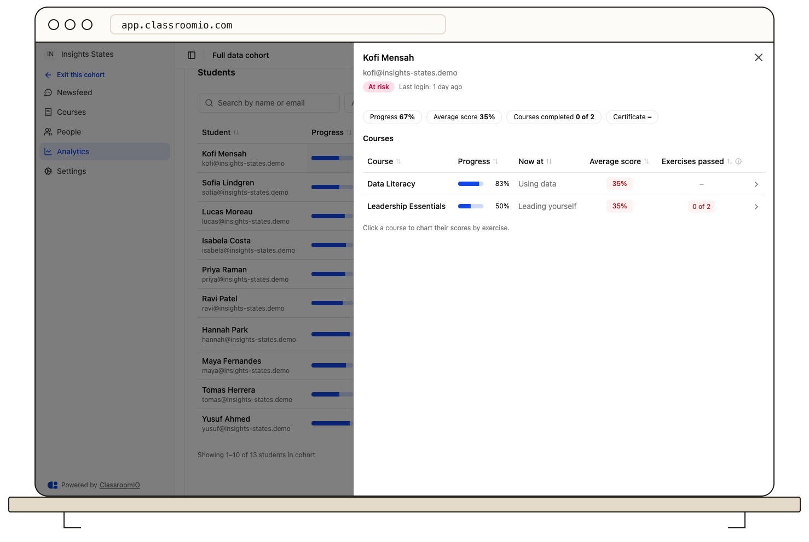
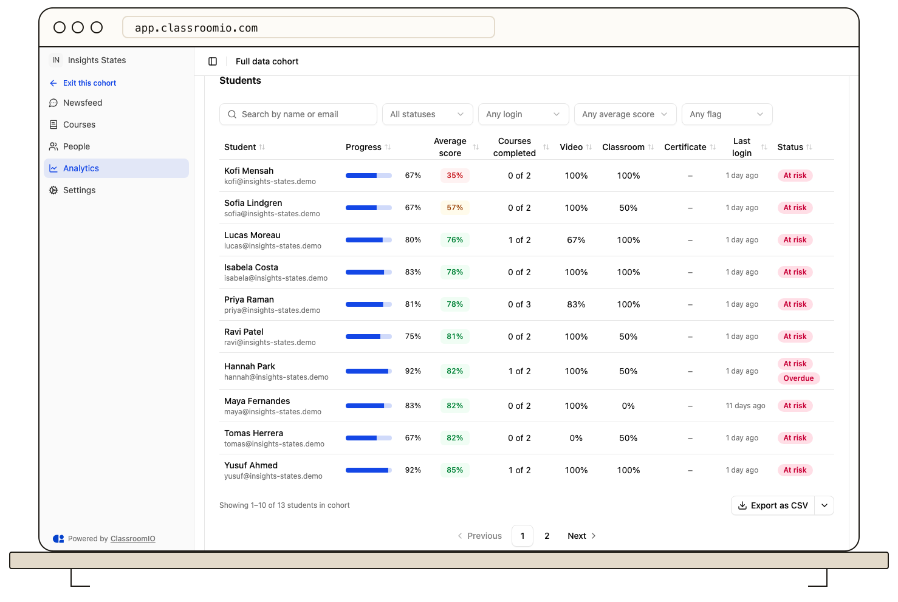

Open a cohort and select **Analytics** in its sidebar to review progress across the cohort's courses. The page opens on **All courses** and combines summary cards, course and student detail, overdue work, and a filterable student list. The **Course** picker above the cards is always available, even when the cohort has only one course.

The live indicator dot next to the page title shows when figures were last updated.

## Before you start

You need to be an organization administrator, or an administrator or tutor of that cohort. Students do not see the **Analytics** item, and opening its URL without access shows a lock message.

The cohort's figures come from its linked courses and the students enrolled through the cohort. [Add courses to a cohort](/manage-learners/add-courses-to-a-cohort) when the cohort has none.

## When there's nothing to show yet

If the cohort has no students, a notice appears at the top explaining that analytics fill in as students open lessons and submit exercises. With no linked courses, the notice offers inline links to **Add courses** and **Invite students**. With courses already linked, it offers **Invite students** and mentions any invitations that are waiting to be accepted. The summary cards show zeros or dashes, and the cards below show an empty state. The range picker remains enabled.

When a cohort has students but no overdue items or nobody at risk, **Needs attention** and **Overdue, with reminders** show reassuring messages ("Nobody needs attention", "Nobody is overdue"). If you select a range like **Last 7 days** and there was no activity in that window, cards show a range message ("No activity in the last 7 days") with a button to **Show all time**.

The page keeps checking in the background, so the notice disappears and cards fill in on their own when the first student joins. Reload the page if you need the change immediately.

## Read the summary cards

The row under the chips summarizes the cohort's students and their work in the selected courses. Under **All time**, the context lines describe the current position and the last week. Under a shorter range, cards that measure activity use that range instead.

| Card                 | What it shows                                                                                                                                                                             |
| -------------------- | ----------------------------------------------------------------------------------------------------------------------------------------------------------------------------------------- |
| **Logged in today**  | Students with a login event today, out of all students in the cohort. The hint repeats that count as a share of the cohort. Under a range, the card is titled **Logged in, last N days**. |
| **Average progress** | The mean share of lessons and exercises each student has completed across the selected courses. Under a range, the hint compares that figure with the start of the range.                 |
| **Average score**    | The mean of each student's best graded attempt, across the exercises they have taken. Under a range, only attempts made in that range count.                                              |
| **Overdue**          | Students with at least one past-due goal, compliance item, or exercise due date that is not done. The card turns red when at least 5% of students are overdue.                            |
| **Completed**        | Students who completed every selected course. The hint reads **x% of the cohort · N certified** under **All courses**, and shows the share of the cohort under a single course.           |

## Understand status and attention reasons

The **Status** pill on each student row checks these rules in order:

- **Completed:** the student finished the course or courses.
- **At risk:** the student has no login for 2 or more days, an average score under 50%, or overdue work.
- **Lagging:** the student has an average score under 65% or video attendance under 60%.
- **On track:** everyone else.

**Needs attention, by reason** counts the students who are not finished for each reason:

- **No login, 2+ days**
- **Average score under 50%**
- **Overdue**
- **Video attendance under 60%**

A student can meet more than one reason, so these counts can add up to more than the **Students** count.

## Choose a time range

Use the range picker beside **Refresh** to choose **All time**, **Last 7 days**, **Last 30 days**, or **Last 90 days**. **All time** is the default. A range covers today and the days before it, by UTC day, like the login figures.

A range changes what students _did_ in that window. Where students _stand_ is always as of now.

- **Follow the range:** **Logged in** (the title becomes **Logged in, last N days**), **Average progress**, **Average score**, and **Completed**. The **Scores by exercise** chart, the selected student's chart, **Average score distribution**, **Hardest questions**, and **Students logged in per day** also follow it.
- **Stay current:** **Overdue**, **Students by status**, **Courses in this cohort**, **Course details**, the student's courses, **Progress distribution**, **Scores and attendance by section**, **Section-by-section scorecard**, **Needs attention**, **Overdue, with reminders**, and the **Students** table.

Cards that stay current carry a **Now** tag. Its tooltip explains that the range does not change that card. Your range choice carries over when you move between analytics pages, and resets on a full reload.

On the Free plan, only **Last 7 days** is available and the page opens on it. The other ranges show a lock, and selecting one opens the upgrade dialog.

## Compare courses

**Courses in this cohort** compares average progress, average score, and **Pass rate** for each course that has at least one student, in a grouped vertical bar chart. It shows four courses per page in title order; when more than four courses have students, a pager under the chart reads **Showing 1–4 of N courses in cohort** and moves through the rest. **Students by status** sits beside it and groups students into **Completed**, **At risk**, **Lagging**, and **On track**. The donut shows the total number of students in the centre.

**Course details** lists every course in the cohort that has at least one student in a sortable, paginated table (five per page). Click any column header to sort ascending or descending (empty cells sort last). When more than five courses have students, the footer reads **Showing 1–5 of N courses in cohort**. Each row shows:

- **Course:** the course name.
- **Students** enrolled in the course.
- **Avg progress** and **Avg score**.
- **Completed:** students who finished the course.
- **Took a pass-mark exercise:** students graded on at least one exercise with a pass mark.
- **Pass rate:** the share of those students who reached the pass mark on their first graded attempt.

**Pass rate** is – when the course has no exercise with a pass mark. A note under the card explains why and how to set a pass mark on an exercise. The card's other note points you to the course picker for scores by exercise, the section scorecard, and the hardest questions.

A course with no students yet does not appear in either card. It still appears in the **Course** picker, where its cards show an empty state.

## Focus on one course

Select a course in the **Course** picker. When the cohort is linked to nine or more courses, the picker becomes a searchable combobox with **All courses** at the top of the list.

The course detail cards appear below the cohort summary:

- **Scores by exercise, \{course\}** plots the average and middle 50% of scores for each exercise.
- **Progress distribution** groups students by how much of the course they completed. It always shows the current position.
- **Scores and attendance by section** and **Section-by-section scorecard** appear when the course is divided into sections. The chart shows four sections per page and the scorecard shows five; each has its own pager. Section labels read **Section 1**, **Section 2**, and so on. The scorecard includes **Pass rate**.
- **Hardest questions** ranks questions by the share of students who answered correctly and shows the most common wrong answer.
- **Students logged in per day** groups consecutive days into bars as the time range widens. Each bar adds up the logins in its days, and the note under the chart names the group size. A student counts once per day.
- The **Students** table adds a **Now at** column and a score column for each exercise in that course.

Select a student in the **Students** table to open their details beside it. If a course is picked when you open the sheet, it starts on that course's scores; select **All courses** to see the student's course list. Under **All courses** you see each course's progress, position, average score and exercises passed. With a course picked, you see their scores by exercise against the cohort average, and a link to their course profile. The sheet's course choice does not change the page's **Course** picker.

## Read a student's courses

In the sheet, under **All courses**, the student's courses appear in a sortable, paginated table (five per page). Each row shows **Course**, **Progress**, **Now at**, **Average score**, and **Exercises passed**. **Now at** names the section or item the student is working on, or **Finished** at 100%. **Exercises passed** shows how many exercises with a pass mark the student has passed, such as **2 of 3**; it is – when the course has no pass-mark exercise.

Click a course row to chart the student's scores by exercise. The sheet switches to **Scores by exercise, \{course\}** with the dashed cohort average, chip stats, and an **Open course profile** link. Select **All courses** at the top of the sheet to return to the course list. The sheet keeps its own course choice; it does not change the page's **Course** picker.

## Find students in the list

The **Students** card lists the cohort's students. Use the search box to find someone by name or email, or narrow the list with the filters:

- **Status** — **At risk**, **Lagging**, **On track**, or **Completed**
- **Last login** — **Logged in today** or **No login 2+ days**
- **Average score** — **Under 50%**, **50% to 69%**, or **70% and above**
- **Flags** — **Overdue**, **Certificate issued**, or **No certificate**

The table starts with students who need attention most: **At risk** first, then **Lagging**. Click a column header to sort by that column, ascending or descending. When filters are active, **Clear N filters** removes them all.

Under **All courses**, each row shows progress, **Average score**, **Courses completed**, **Video** and **Classroom** attendance, **Certificate**, last login, and status. The **Certificate** column shows **Issued** when the student has one certificate, the number when they have more, and – when they have none. When you pick a course, the table replaces the course summary columns with **Now at**, one score column per exercise, and **Trend**. In an exercise column, – means the student has not attempted it, **Pending** means an attempt is waiting for a grade, and a percentage is the best graded score. A **Pass mark 70%** tag under the exercise name shows its pass mark.

The table shows 10 students per page. Numbered pages below it move through the list, and the footer reads **Showing 1–10 of N students in cohort**. When a search or filter is active, it also reports how many students match. **Export as CSV** downloads every student that matches the current filters and order, including the exercise columns for the selected course, not only the rows on screen. The export is capped at 50,000 students; see [Exports](/reference/exports) for the current limits.

## Send reminders for overdue goals

The **Overdue, with reminders** card lists overdue students five per page, with students who have an overdue goal first and then the most overdue. When there are more than five, the pager under the card reads **Showing 1–5 of N overdue students in cohort**. Each row shows the student, the course and overdue item, progress, last login, and a **Send reminder** button when the student has an overdue cohort goal.

For a learning goal, select **Send reminder** to email that student now. **Remind all N overdue students** emails every student with an overdue goal in the cohort; when you have picked a course, it covers overdue goals for that course. The button changes to **Queued** after the reminders are queued.

A reminder can be skipped. The page reports when one is, for example because the student already received a manual reminder today or turned off these emails. Compliance items and exercise due dates appear in the list but do not have a reminder button. Reminders cover cohort goals only.

## Keep figures current

The chips show when the figures were last updated. Select **Refresh** to request the latest data for every card, the student list, the course picker and any open student detail. While the page stays open and visible, it also refreshes on its own about every 30 seconds.

## Troubleshoot missing figures

- **Analytics couldn't load:** select **Try again**. If the page still fails, reload it.
- **The page says there are no students yet:** add courses and invite students, then wait for the page to refresh or select **Refresh**.
- **A chart says there is no data yet:** the cohort's students have no matching activity in the selected course or range, or the course has no lessons or exercises yet.
- **Average score shows –:** no exercise attempt has been graded in the selected range. Scores appear after graded work.
- **A student is missing from the list:** confirm that the student is a cohort member and is enrolled in one of the cohort's linked courses.
- **A reminder was not sent:** the student may have received a manual reminder today already, or turned off these emails. A student without an email address cannot be reminded.

## Related guides

- [Configure cohort goals and settings](/manage-learners/configure-cohort-goals-and-settings) — create goals and set their deadlines and reminders
- [Assign students to a cohort](/manage-learners/assign-learners-to-a-cohort) — add the students the page counts
- [Understand cohorts](/reference/cohorts) — how courses, people, and goals fit together
- [Review course performance and student progress](/analytics-and-reporting/review-course-performance-and-student-progress) — inspect a single course's analytics
- [View a student's analytics](/analytics-and-reporting/view-a-students-analytics) — follow one student's courses and grades
- [Monitor students across your organization](/analytics-and-reporting/monitor-students-across-your-organization) — compare every cohort in your organization
