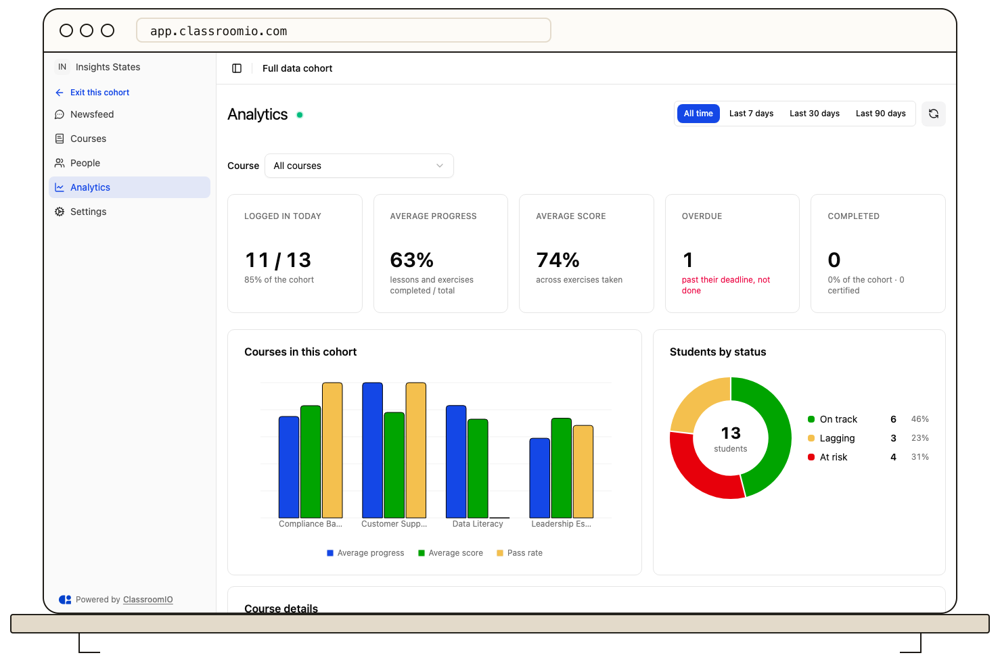
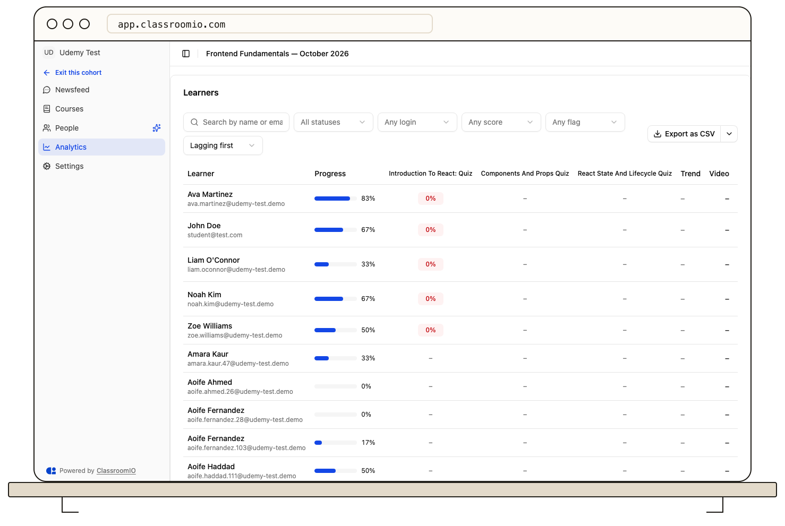
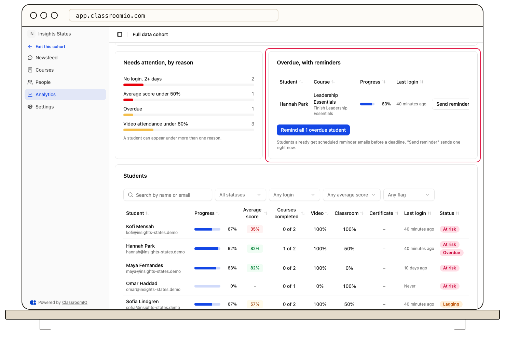

Open a cohort and select **Analytics** in its sidebar to review progress across the cohort's courses. The page combines summary cards, a learner status chart, attention reasons, overdue work, and a filterable learner list.

## Before you start

You need to be an organization administrator, or an administrator or tutor of that cohort. Students do not see the **Analytics** item, and opening its URL without access shows a lock message.

The cohort must have at least one linked course with students enrolled through the cohort. [Add courses to a cohort](/manage-learners/add-courses-to-a-cohort) if the page has nothing to summarize.

## Read the summary cards

The row under the page title counts the cohort's learners and summarizes their work in the cohort's courses.

| Card                 | What it shows                                                                                                                          |
| -------------------- | -------------------------------------------------------------------------------------------------------------------------------------- |
| **Logged in today**  | Students with a login event today, out of all learners in the cohort. The hint repeats that count as a share of learners.              |
| **Average progress** | The mean share of lessons and exercises each student has completed across the cohort's courses.                                        |
| **Average score**    | The mean of each student's best graded attempt, across the exercises they have taken. It shows – until at least one attempt is graded. |
| **Overdue**          | Students with at least one past-due goal, compliance item, or exercise due date that is not done.                                      |
| **Completed**        | Students who completed every course in the cohort. The hint counts the certificates they earned.                                       |

## Understand status and attention reasons

**Learners by status** groups students into four statuses. A student appears under the first rule that matches, in this order:

- **Completed:** the student completed every course in the cohort.
- **At risk:** the student has not logged in for 2 or more days (or never), has an average score under 50%, or has overdue work.
- **Lagging:** the student has an average score under 65%, or video attendance under 60%.
- **On track:** everyone else.

The legend shows how many students are in each status that appears.

**Needs attention, by reason** counts the students who are not completed for each reason:

- **No login, 2+ days**
- **Average score under 50%**
- **Overdue**
- **Video attendance under 60%**

A student can meet more than one reason, so these counts can add up to more than the number of students at risk.

## Focus on one course

When the cohort has more than one course, the page header shows a **Course** picker. **All courses** is the default and shows summaries across the whole cohort. Selecting a course adds exercise and section detail:

- **Scores by exercise** plots the average and middle 50% of scores for each exercise.
- **Progress distribution** groups learners by how much of the course they completed.
- **Learner score progression** compares one student's scores with the cohort average.
- **Scores and attendance by section** and **Section-by-section scorecard** appear when the course is divided into sections.
- **Hardest questions** ranks questions by the share of students who answered correctly.
- The **Learners** table replaces the course summary columns with a score column for each exercise in that course.

The page selects a cohort's only linked course automatically.

## Find students in the list

The **Learners** card lists the cohort's students. Use the search box to find someone by name or email, or narrow the list with the filters:

- **All statuses** — **At risk**, **Lagging**, **On track**, or **Completed**
- **Any login** — **Logged in today** or **No login 2+ days**
- **Any score** — **Under 50%**, **50% to 69%**, or **70% and above**
- **Any flag** — **Overdue**, **Certified**, or **Not certified**

**Lagging first** is the default order. You can also sort by **Least progress**, **Name A to Z**, or **Lowest score**. When filters are active, **Clear filters** removes them all.

Each row shows progress, the score for each exercise in the selected course, **Video** and **Classroom** attendance, last login, and status. In an exercise column, – means the student has not attempted it, **Pending** means an attempt is waiting for a grade, and a percentage is the graded score. A **Pass** tag under the exercise name shows its pass mark, such as **Pass 70%**.

Select **Show 25 more** to load more students. **Export as CSV** downloads the students that match the current filters and order, including the exercise columns for the selected course.

Under **All courses**, select a student to open **Learner's courses** with that student's progress, **Now at** position, score, required exercises, and completion for each course.

## Send reminders for overdue goals

The **Overdue** card lists up to five overdue items, most overdue first. Each row shows the student, the item, whether it is a **Goal**, **Compliance** item, or exercise **Due date**, and how many days it is overdue.

For a learning goal, select **Send reminder** to email that student now. **Remind all overdue learners** emails every student with an overdue goal in the cohort; when you have picked a course, it covers overdue goals for that course.

A reminder can be skipped. The page reports when one is, for example because the student already received a manual reminder today or turned off these emails. Compliance and exercise due dates appear in the list but do not have a reminder button.

## Keep figures current

The header shows when the figures were last updated. Select the refresh icon (**Refresh**) to request the latest data. While the page stays open and visible, it also refreshes on its own about every 30 seconds.

## Troubleshoot missing figures

- **Analytics couldn't load:** select **Try again**. If the page still fails, reload it.
- **A chart says there is no data yet:** the cohort's students have no matching activity in the selected course, or the course has no lessons or exercises yet.
- **Average score shows –:** no exercise attempt has been graded. Scores appear after graded work.
- **A student is missing from the list:** confirm that the student is a cohort member and is enrolled in one of the cohort's linked courses.
- **A reminder was not sent:** the student may have received a manual reminder today already, or turned off these emails. A student without an email address cannot be reminded.

## Related guides

- [Configure cohort goals and settings](/manage-learners/configure-cohort-goals-and-settings) — create goals and set their deadlines and reminders
- [Assign students to a cohort](/manage-learners/assign-learners-to-a-cohort) — add the students the page counts
- [Understand cohorts](/reference/cohorts) — how courses, people, and goals fit together
- [Review course performance and student progress](/analytics-and-reporting/review-course-performance-and-learner-progress) — inspect a single course's analytics
- [View a student's analytics](/analytics-and-reporting/view-a-learners-analytics) — follow one student's courses and grades
- [Monitor students across your organization](/analytics-and-reporting/monitor-learners-across-your-organization) — compare every cohort in your organization
