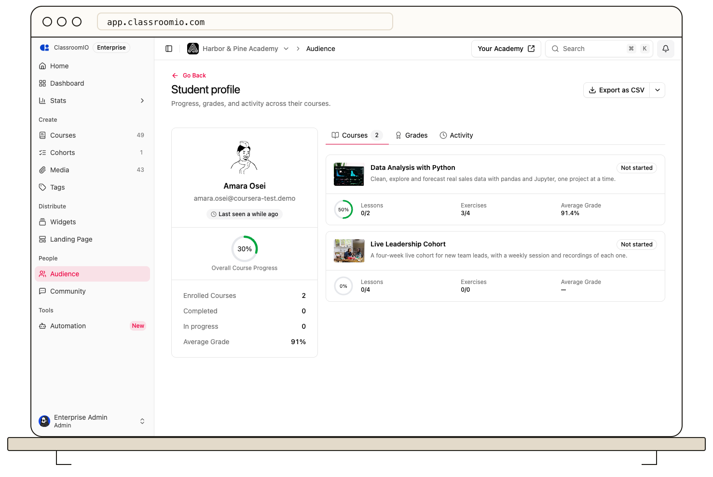

Open a student from **Audience** to see their enrolled courses and grades. The profile helps you identify which course needs attention without checking every course separately.

## Open the student profile

In your organization sidebar, select **Audience**, find the student, and open their profile. You can also select **View Details** beside the student on a course's **Analytics** tab to open their course profile.

The organization profile has **Courses**, **Grades**, and **Activity** tabs. **Courses** shows the student's enrolled courses and progress. **Grades** shows the available grade details for those courses. The **Activity** tab currently displays an empty state; use course **Analytics** for the **Last seen** value instead.

If the student has no enrolled courses, **Courses** and **Grades** show empty states. Adding someone to your organization without enrolling them in a course does not create course progress or marks.

## Export the record

Select **Export** on the student's profile when you need a course-by-course file. It includes lessons completed, exercises completed, progress, and average grade for each enrolled course. The export contains personal student information; store and share it according to your organization's access rules.

## Related guides

- [Review a student's course progress](/manage-learners/review-a-learners-course-progress) — inspect one course in detail
- [Review course performance and student progress](/analytics-and-reporting/review-course-performance-and-learner-progress) — compare students in a course
- [Exports](/reference/exports) — see formats and fields
