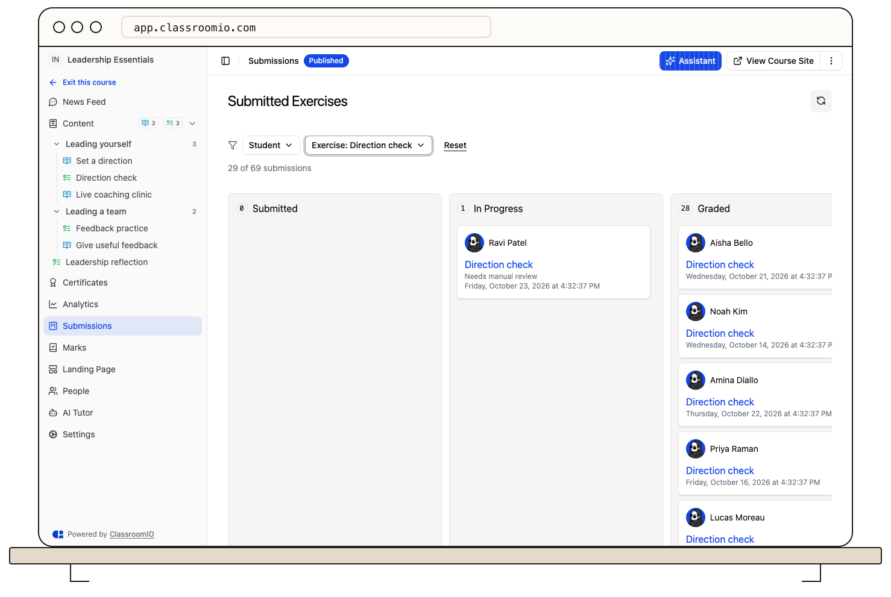

Open a course's **Submissions** tab to review student exercise work. Use **Analytics** for course-wide lesson and exercise completion rates; a submitted exercise is one part of progress, not necessarily a completed course.

## Find a submission

From **Courses**, open the course and select **Submissions** in its sidebar. Choose the exercise or submission you want to inspect. The submission view shows the student's answers and any available grading actions. If **Submissions** reports that access is denied, ask an organization administrator or course owner for grading access.

For a student-by-student overview, open **Analytics** on the same course. **Student Progress Overview** shows **Exercises Submitted** alongside **Lessons Completed**, **Average Grade**, and **Last seen**. Select **View Details** to open one student's course profile.

## Understand the counts

The **Exercises** percentage on course **Analytics** summarizes exercise completion across enrolled students. A student's **Exercises Submitted** cell compares submitted exercises with the exercises in the course. Use the submission itself to check grading status and feedback; an answer can be submitted before its grade is final.

For scores across the course, open **Marks**. Its export has one column per exercise and an average grade for each student. Export course **Analytics** when you need progress and last-seen data instead.

## Related guides

- [Understand the submission workflow](/deliver-and-engage/understand-the-submission-workflow) — follow work from submission to grading
- [View and export marks](/deliver-and-engage/view-and-export-marks) — compare exercise scores
- [Review course performance and student progress](/analytics-and-reporting/review-course-performance-and-learner-progress) — interpret the course summary
