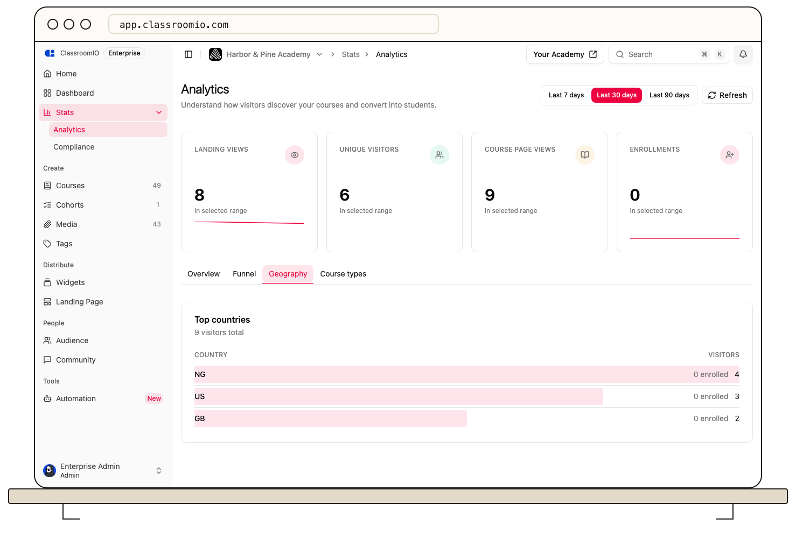

Open **Stats → Marketing** in your organization sidebar to compare **Top countries** and **Popular course types** for the same selected date range. These panels summarize visits and enrollments; they don't identify individual students.

## View top countries

Select **Geography**, or find **Top countries** on **Overview**. Each row shows a country, its page views, and associated enrollments. The panel shows up to ten countries, ordered by views. If there is no location data for the range, it shows **No location data yet**.

Country comes from the location available for a page event. Use it as an approximate audience signal; it is not proof of a student's residence or an enrollment requirement.

## Compare course types

Select **Course types**, or find **Popular course types** on **Overview**. The panel groups **Self-paced**, **Live class**, **Compliance**, and **Public** courses. For each type, it shows the number of courses, enrollments, and views. The bar and main number compare enrollments, not course completions.

Select **Last 7 days**, **Last 30 days**, or **Last 90 days** to compare a different period. A type with many views but few enrollments may warrant a look at its [course landing pages](/publish-and-brand/course-landingpage) and enrollment settings. Compare similar course types before drawing conclusions; a public course and a compliance assignment serve different purposes.

## Related guides

- [Read your organization analytics overview](/analytics-and-reporting/read-your-organization-analytics-overview) — understand the other panels
- [Compare your top courses](/analytics-and-reporting/compare-your-top-courses) — find individual courses behind the traffic
- [Understand course types](/create-and-deliver/course-types) — compare how each type is delivered
- [Monitor students across your organization](/analytics-and-reporting/monitor-learners-across-your-organization) — see how students progress after they enroll
