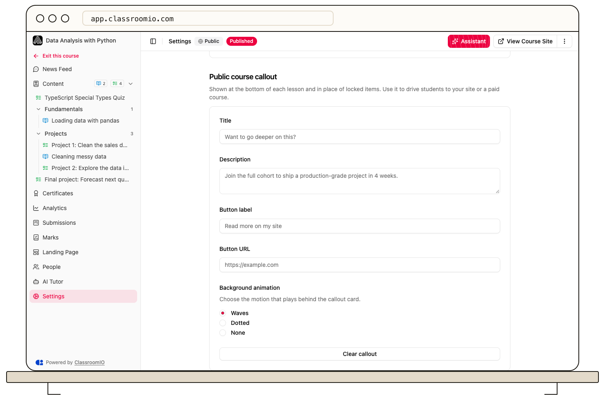

A **Public course callout** gives visitors a next step, such as visiting your website or opening a paid course. Configure it in a public course’s **Settings**; it appears below lessons and in place of locked content.

## Before you start

Callouts appear only on **Public** courses. You need administrator or tutor access to edit the course settings. Choose a destination visitors can access and a button label that clearly describes it.

A callout does not enroll visitors or change the access rules of its destination.

## Configure the callout

### 1. Open the public course settings

Open your public course and select **Settings**. Find **Public course callout**. If the course uses another type, this card is not shown; review [course types](/create-and-deliver/course-types) before changing its delivery model just to add a callout.

### 2. Write the message and action

Fill in **Title** and **Description**, then enter **Button label** and **Button URL**. Use a complete destination URL, such as `https://example.com/training`.

Explain what visitors get after following the link. For example, a public introduction can direct visitors to the full training catalog without implying that selecting the button enrolls them.

### 3. Choose the background and save

Under **Background animation**, choose **Waves**, **Dotted**, or **None**. Select **Save changes**.

### 4. Check the public result

Open **View Course Site** in a signed-out browser. Open a lesson, check the callout below it, and follow the button to confirm its destination. Also review the callout state for locked items if the course includes them.

## Remove the callout

Select **Clear callout** in the settings card and select **Save changes**. Reopen a public lesson to confirm the callout is gone. Clearing it does not remove the lesson content or change the course's publishing state.

## Related guides

- [Create a public course](/build-courses/create-a-public-course) — set up the anonymous learning experience
- [Publish a course and allow self-enrollment](/build-courses/publish-a-course-and-allow-self-enrollment) — make the finished course available
- [Enable comments and course downloads](/build-courses/enable-comments-and-course-downloads) — review other sharing controls
