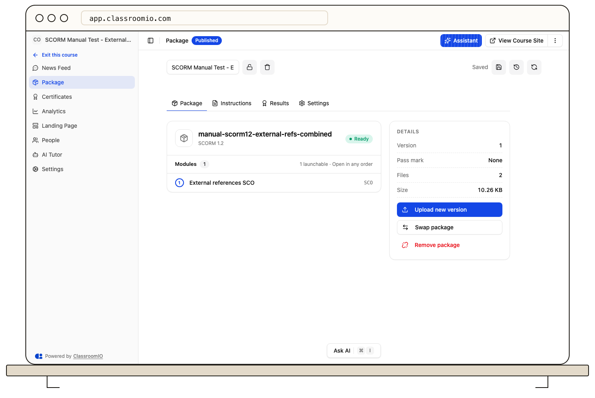
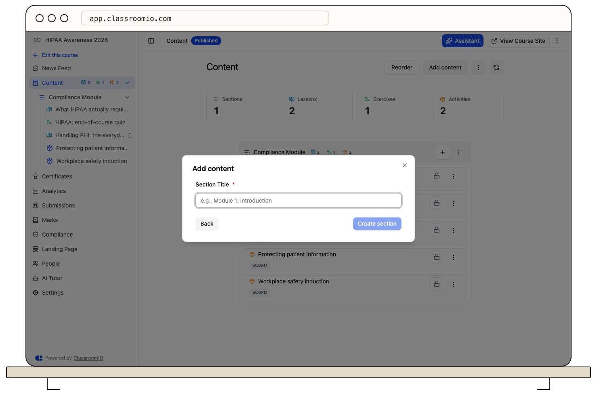
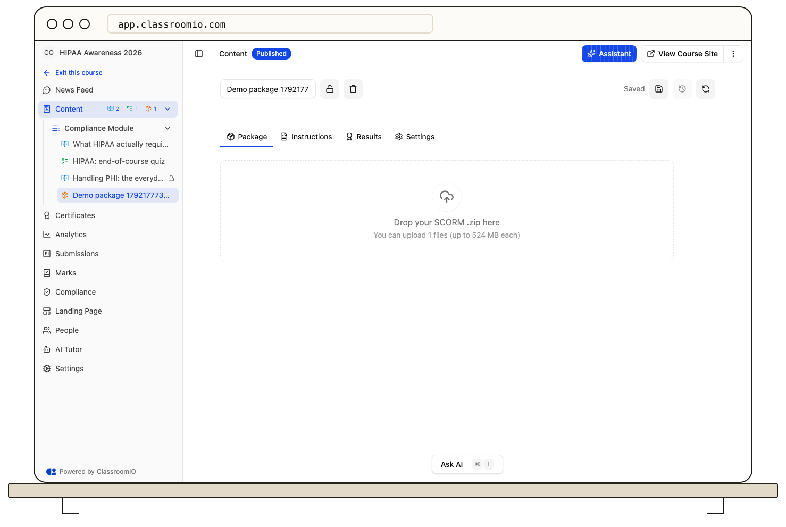
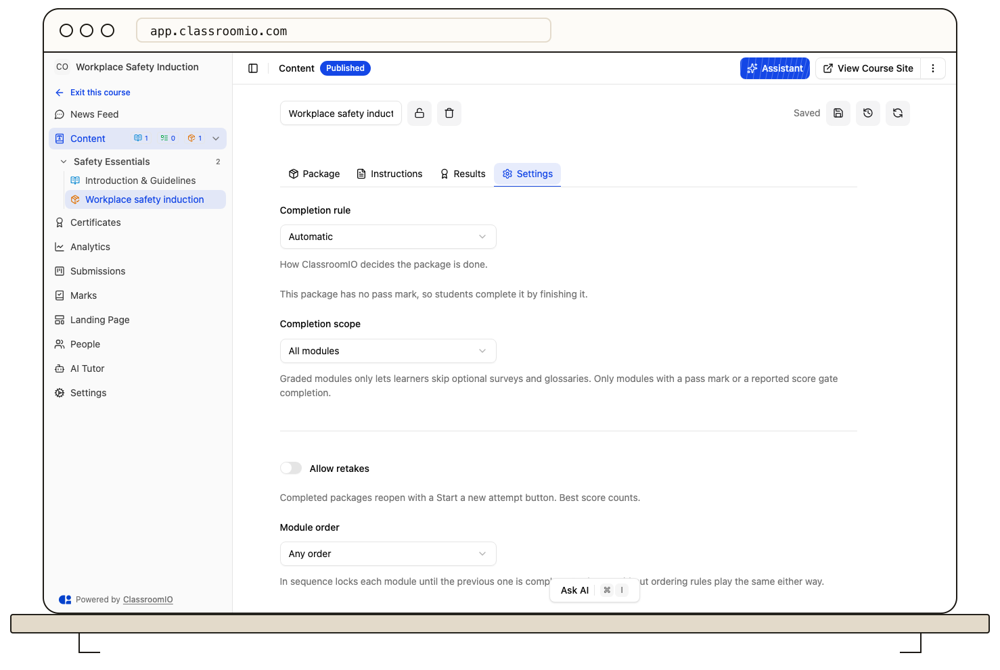

To add a SCORM package to a course, open the course and choose **Add content → SCORM package**, give it a title, and drop your ZIP on the upload area. ClassroomIO checks and unpacks the package, then lists its modules and pass mark so you can choose the completion rule.

## Before you start

:::info[SCORM is an Enterprise feature]
On ClassroomIO Cloud, SCORM packages are included in every paid plan. On the Free plan the **SCORM package** option shows a **Paid plans** pill and opens the upgrade modal. On a self-hosted server it needs an enterprise license key that includes SCORM — see [Enterprise & licensing](https://classroomio.com/docs/self-hosted/enterprise).
:::

You need a SCORM 1.2 or SCORM 2004 package exported for an LMS. Articulate Storyline and Rise, Adobe Captivate, iSpring, Elucidat, and Lectora all export one. Packages up to 500 MB are accepted.

SCORM packages cannot be added to `PUBLIC` courses, because those are taken without signing in. They have instructions in one language and no comments. xAPI, cmi5, AICC, LTI, and H5P are not supported yet — an xAPI or cmi5 ZIP fails with its own message telling you to re-export as SCORM.

## Add the package

### 1. Create the SCORM item

Open the course, choose **Add content → SCORM package**, and enter a package title such as `Workplace safety induction`. The item opens in the package editor with four tabs: **Package**, **Instructions**, **Results**, and **Settings**. There is no language picker or version history.

The option is hidden in `PUBLIC` courses and in SCORM-format courses, which already hold exactly one package.

### 2. Upload the ZIP

On the **Package** tab, drop your `.zip` on the area labelled **Drop your SCORM .zip here**. Only `.zip` files are accepted.

Uploading shows a progress bar with **Cancel upload**. If you leave the page while uploading, ClassroomIO asks for confirmation. Once the upload finishes, processing starts — validating, extracting, uploading files, and reading the manifest — and you can leave the page. The tab shows the stage and percentage while it works.

### 3. Review the package details

When processing finishes, the tab shows the title, SCORM version, file count, size, the pass mark when the manifest sets one, and the list of modules.

- **This package has N modules** lists every launchable module in manifest order. Learners pick them from a menu above the package, in any order. The completion rule applies to each module.
- A SCORM 2004 package with sequencing rules shows which parts apply: with **Module order** set to **In sequence** (the default for such packages), each module unlocks as the previous one completes. Pre-tests, rollup rules, and attempt limits are still ignored.
- Modules of type asset appear in the menu but never count toward completion, because assets never talk to the SCORM API.
- **Some file names differ only in letter case** appears when a package built on Windows references files in the wrong case. ClassroomIO resolves them, but re-export with matching case when you can.

Switch the page to view mode to play the package as a learner would — nothing is recorded. The buttons below the details hold **Upload new version** for a revised export of the same course and **Swap package** for a different course; **Remove** detaches the package from the item and the header deletes the item. The file stays in the Media Manager.

If processing fails, the tab shows a specific reason — no `imsmanifest.xml`, an xAPI or cmi5 package, an unsupported version, a file that is too large, unsafe paths, a missing launch file, a module that launches from another website, or a package where nothing reports progress — with a **Try another file** action.

### 4. Choose the completion rule

Open the **Settings** tab. Under **Completion rule**, choose how ClassroomIO decides the package is done:

- **Automatic** — a graded module counts when it reports passed; an ungraded module counts when it reports completed. A module is graded when its manifest sets a passing score, or once it has reported passed or failed. Pass or fail always wins over completed, including in the same save.
- **Completed** — every module must report completed.
- **Passed** — every module must report passed.
- **Minimum score** — every module must report completed, and the average score of the modules that report one must reach **Minimum score (%)**, which defaults to 80.

Under the rule, a line says whether the package is graded: **This package has a pass mark of 80%, so students must pass it** or **This package has no pass mark, so students complete it by finishing it**.

Choosing **Passed** for a package with an ungraded module shows a warning: a module that never reports passed keeps the item from completing.

Why the Passed rule matters: with **Automatic**, a package that has no pass mark in its manifest counts as soon as it reports completed. A few packages report that at the end of the slides, before the quiz reports pass or fail. If learners complete before taking the quiz, set the rule to **Passed** for that package. With **Automatic**, a SCORM 1.2 quiz package whose manifest already has a mastery score does not complete on completed alone — it completes on a raw score at or above that score.

The tab also holds **Allow retakes**. With retakes on, a completed package reopens with a **Start a new attempt** button and ClassroomIO keeps the best score. Settings save automatically.

### 5. Add instructions and publish

Use the **Instructions** tab for optional rich text shown to learners above the player, such as what to know before opening the package. Then publish the course as usual. You can move, lock, and reorder a SCORM package like a lesson, and it follows the course's sequential progression setting.

## What learners see

The package opens in a large frame with a full-screen button. Packages with several modules show a module bar above the frame — **Previous**, **Module N of M · title**, **Next** — opening a menu with a tick on each finished module and **N of M modules complete**. In full screen the bar floats over the top and hides until the mouse moves. The page opens on the first module that has not met the rule.

Progress saves automatically. When the package reports that the learner finished or passed, the item is marked complete and the course moves on. Learners never see a **Mark as complete** button on SCORM packages.

- A package that never calls the course player shows a did-not-connect notice after 30 seconds, with an explanation and **Reload**. This usually means it was exported for the web rather than for an LMS — re-export it with an LMS or SCORM publishing option.
- A learner who fails sees **Not passed yet** and can open the package again for a fresh try. The failed module starts from the beginning. There is no limit on tries.
- By default a completed package reopens in review mode and nothing changes. With retakes on, review mode offers **Start a new attempt**.
- A retake never starts automatically on launch.

## Replace a package without losing progress

**Upload new version** adds a new version of the same course. After you pick a file, ClassroomIO reads its contents and says whether it matches the current package. A file that matches exactly disables uploading — it is already the current version. A file whose modules do not match disables uploading too, with an offer to swap instead. Learners in the middle of an attempt keep the old version until they finish — or restart them on the new version, per the choice shown when learners are part-way through. If learners start while the new version is processing, ClassroomIO asks again with fresh numbers before switching.

**Swap package** attaches a different course as a new package. Picking a file shows what it contains; a file that matches the current course disables swapping, with an offer to upload a new version instead. In-progress attempts on the previous package close at once, and learners start the new package from the beginning on their next launch; learners who completed it stay completed. The previous package stays in the Media Manager with its results.

When learners are still on an older version after an upgrade, the Package tab states how many and offers **Move them to this version** — the dialog states how many learners it affects.

Unpinned package versions are deleted 30 days after replacement. The original ZIP of each version is kept for reprocessing.

## Packages that stream content from elsewhere

Some packages stream their content from the vendor's servers instead of carrying it in the ZIP — for example Rustici Dispatch packages and Elucidat's default export. They work as ordinary packages: the small launcher runs on the content domain, finds the SCORM API as any package does, and frames or fetches the vendor's content.

They report only what the vendor passes on, they need the vendor's site to be reachable, and they stop working if your licence with the vendor ends. If a streamed package loads blank, the vendor's requests are usually failing — check that its site is reachable and that its own cookies are allowed. Content given only as a link to another website, without a SCORM ZIP, cannot be added as a package.

## What happens when a plan or license lapses

Learners keep taking the packages you already have, and you can still see and export results. You cannot add new packages or change existing ones until SCORM is included again. The editor shows **SCORM authoring is paused** with the reason, and authoring controls are disabled.

## Troubleshooting

### The package says it did not connect

The package never called the SCORM API. Re-export it with an LMS or SCORM publishing option, then upload the new ZIP.

### A learner completed before taking the quiz

With the **Automatic** rule, a package with no pass mark counts as soon as it reports completed — sometimes at the end of the slides, before the quiz reports pass or fail. Set the rule to **Passed** for that package.

### A failed learner is stuck

They are not stuck: the item stays incomplete and they can open it again. The failed module starts from the beginning, with no limit on tries.

### The package opens content from another website

Import rejects a module whose launch URL points at another website, because content launched straight from another site cannot reach the API. Re-export so the content is inside the ZIP, or use a streamed-content launcher that runs locally and frames the vendor.

## Related guides

- [Create a SCORM course](/build-courses/create-a-scorm-course) — turn one package, or several at once, into a course of its own
- [Review SCORM results](/analytics-and-reporting/review-scorm-results) — see status, score, time, and attempts per learner and export them
- [Control progression and completion](/create-and-deliver/course-progression) — how locks and sequential progression treat SCORM items
