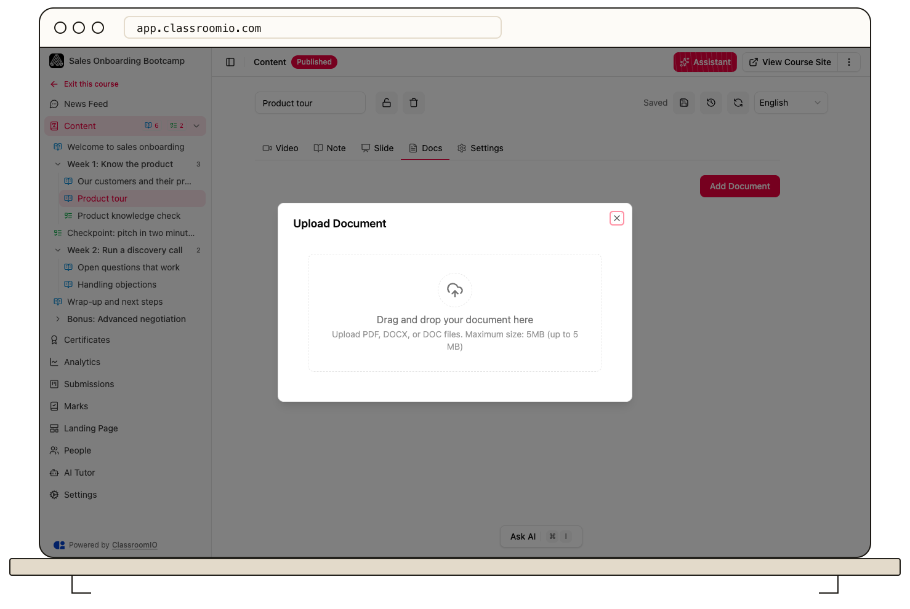

Open a lesson in **Edit** mode, choose **Docs**, and select **Add Document** to attach a PDF or Word file. Students can then use the file controls shown in the lesson.

## Before you start

Document uploads require a paid plan and administrator or tutor access to the course. Prepare a `.pdf`, `.docx`, or `.doc` file. Use the size limit displayed by the upload control; deployment limits can vary.

Remove private information and confirm you have permission to share the document with the intended students. A public lesson can make its attachments available to visitors without an account.

## Attach the document

### 1. Open Docs

From your course's **Content**, open the lesson, select **Edit**, and choose **Docs**. Select **Add Document**.

### 2. Choose and upload the file

Drag the file into the upload area or select **Choose File**. Review the selected file and select **Upload Document**. Keep the dialog open until the upload completes and the attachment appears.

If the upload fails, check the type and displayed size limit, then try the file again. Renaming a file extension does not convert its format.

### 3. Check student access

Return to the lesson and use **View file** or **Download** to confirm the attachment opens. PDF files can be viewed in the document viewer. Test the lesson as a demo student before sharing it.

## Maintain the attachment list

In edit mode, use the file's delete control to remove it from the lesson, or reorder attachments with their drag control. Review the saved list afterward so students see the intended files and sequence.

## Attachments and lesson PDF downloads

An attached document is separate from a PDF export of the lesson itself. To let registered students download the lesson as a PDF, configure **Settings → Access → Lesson download**. See [Enable comments and course downloads](/build-courses/enable-comments-and-course-downloads) for the available download controls and their limits.

## Related guides

- [Create and edit a lesson](/build-courses/create-and-edit-a-lesson) — add teaching materials
- [Enable comments and course downloads](/build-courses/enable-comments-and-course-downloads) — configure lesson PDF downloads
- [Add slides and presentations](/build-courses/add-slides-and-presentations) — embed presentations instead of uploading them as documents
