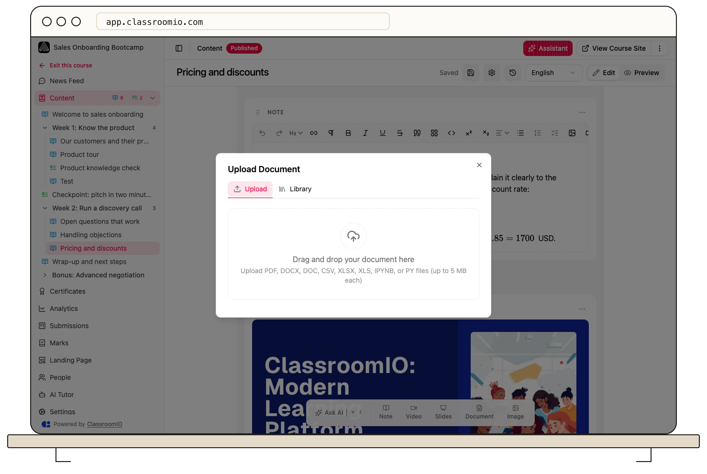

Open a lesson in **Edit** mode and choose **Document** in the **Add content** row. The new block starts with an example PDF; select **Change Document** to upload your own file or pick one from your library. Each file becomes its own document block, where students can view or download it.

## Before you start

Document uploads require a paid plan and administrator or tutor access to the course. Prepare a PDF, DOCX, DOC, CSV, XLSX, XLS, IPYNB, or PY file. Use the per-file size limit displayed by the upload control; deployment limits can vary.

Remove private information and confirm you have permission to share the document with the intended students. A public lesson can make its attachments available to visitors without an account.

## Add the document

### 1. Open the upload dialog

From your course's **Content**, open the lesson and select **Edit**. Choose **Document** in the **Add content** row to add a document block with an example PDF. Point to the block and select **Change Document** to open the **Upload Document** dialog.

### 2. Upload a file or choose one from your library

On **Upload**, drag files into the upload area or click it to choose them. You can upload up to 10 files at once. Keep the dialog open while each file shows its progress, then select **Finish** when every file is complete.

To reuse a file you uploaded before, open **Library**, select one or more documents, and choose **Add 1 file** (or **Add N files**). You can upload documents to the library ahead of time from the **Media** page: see [Upload files to your media library](/build-courses/upload-files-to-your-media-library).

The first file replaces the example in the block, and each additional file appears after it as its own **Document** block. If an upload fails, check the type and displayed size limit, then use **Try Again**. Renaming a file extension does not convert its format.

### 3. Check student access

Select **Preview** and check each document block: select the file name to open the document in a new browser tab, or select **Download** to save a copy. Test the lesson as a demo student before sharing it.

## Maintain the documents

In **Edit** mode, point to a document block and select **Change Document** to replace its file. Drag the block by its handle to move it, or open its **⋯** (Block actions) menu and choose **Move up**, **Move down**, or **Remove block**. Students see documents in the same order as the rest of the lesson's blocks.

## Attachments and lesson PDF downloads

A document block is separate from a PDF export of the lesson itself. To let registered students download the lesson as a PDF, configure **Settings → Access → Lesson download**. See [Enable comments and course downloads](/build-courses/enable-comments-and-course-downloads) for the available download controls and their limits.

## Related guides

- [Create and edit a lesson](/build-courses/create-and-edit-a-lesson) — add and arrange lesson blocks
- [Enable comments and course downloads](/build-courses/enable-comments-and-course-downloads) — configure lesson PDF downloads
- [Add slides and presentations](/build-courses/add-slides-and-presentations) — embed presentations instead of uploading them as documents
