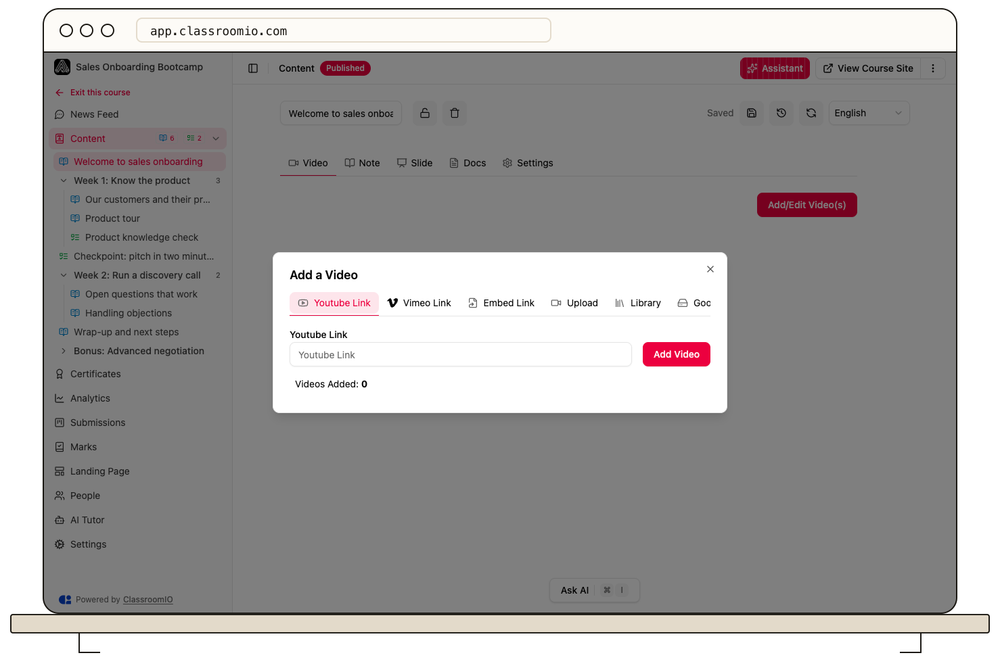

Open a lesson in **Edit** mode, choose **Video**, and select **Add/Edit Video(s)**. Choose a hosted link, upload, or library video, then check playback in the lesson.

## Choose a source

### 1. Open the video dialog

Open the course's **Content**, choose the lesson, select **Edit**, and open **Video → Add/Edit Video(s)**. You need administrator or tutor access to the course.

### 2. Add a link or existing video

Choose the source that matches your material:

- **Youtube Link** or **Vimeo Link**: paste the video link and select **Add Video**. Check each link if adding several.
- **Embed Link**: use the supported video embed URL in the form.
- **Library**: search your media library, select a video, and choose **Add from library**.
- **Google Drive**: choose a video through the Google picker. Students still need permission to view it in Drive.

For a Vimeo video with domain restrictions, allow the academy host shown in the dialog. Keep the full unlisted link, including its privacy key. Test external sources using the access a student actually has.

### 3. Or upload a file

Video uploads require a paid plan. Select **Upload** and choose or drop a video file. Follow the file-size limit displayed by the uploader; it can depend on your deployment's configuration.

Keep the tab open while the upload runs. Wait for the uploaded video to appear before closing the dialog. Upload and processing are separate states: check the status and playback rather than treating a progress bar alone as completion. Use **Cancel Upload** if you need to stop.

## Check the lesson

Close the dialog, confirm that the video appears, and test playback. Save the lesson if changes remain pending. A lesson can contain multiple videos.

:::warning[Video-watch completion needs uploaded video]
YouTube, Vimeo, Google Drive, and other external embeds do not supply ClassroomIO's video-watch completion tracking. Upload the video or use a manual lesson completion rule when students must complete the lesson to continue.
:::

## Related guides

- [Create and edit a lesson](/build-courses/create-and-edit-a-lesson) — add teaching materials
- [Control progression and completion](/create-and-deliver/course-progression) — choose when students can continue
- [Add slides and presentations](/build-courses/add-slides-and-presentations) — embed a slide deck separately
- [Troubleshoot video uploads and playback](/troubleshooting-and-reference/troubleshoot-video-uploads-and-playback) — check failed uploads and student playback
