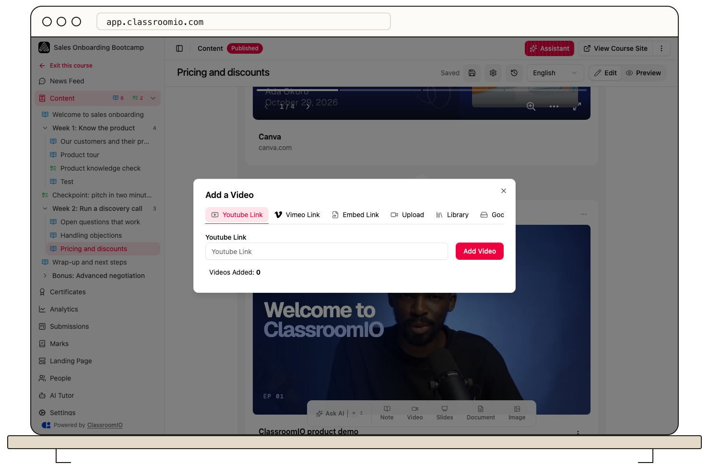
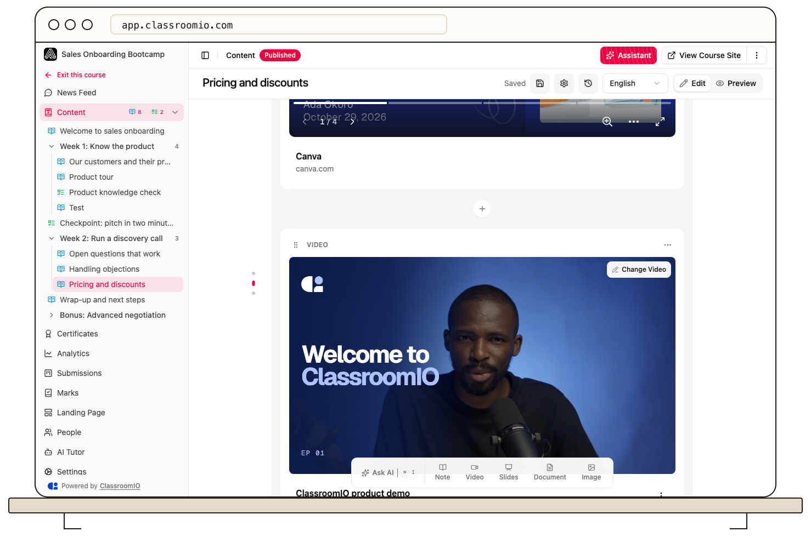
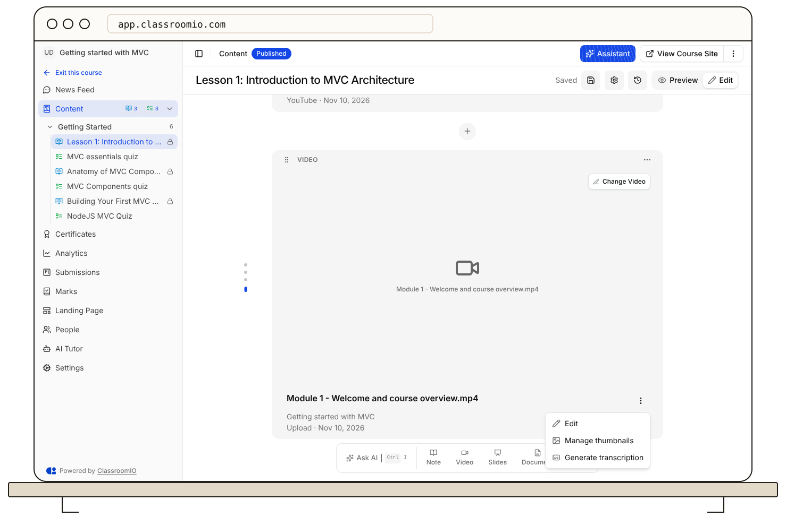

Open a lesson in **Edit** mode, add a **Video** block, and select **Change Video** on it. Choose a hosted link, upload, or library video, then check playback in **Preview**.

## Choose a source

### 1. Add a video block

Open the course's **Content**, choose the lesson, and select **Edit**. Choose **Video** in the **Add content** row. You need administrator or tutor access to the course.

The new block shows an example video. Point to the block and select **Change Video** to open the **Add a Video** dialog. Use the same button later to replace a video that is already in the lesson.

### 2. Add a link or existing video

Choose the source that matches your material:

- **Youtube Link** or **Vimeo Link**: paste the video link and select **Add Video**. Check each link if adding several.
- **Embed Link**: use the supported video embed URL in the form.
- **Library**: search your media library and select **Add** on the video you want. To fill the library with several files at once, see [Upload files to your media library](/build-courses/upload-files-to-your-media-library).
- **Google Drive**: choose a video through the Google picker. Students still need permission to view it in Drive.

For a Vimeo video with domain restrictions, allow the academy host shown in the dialog. Keep the full unlisted link, including its privacy key. Test external sources using the access a student actually has.

### 3. Or upload a file

Video uploads require a paid plan. Select **Upload** and choose or drop a video file. Follow the file-size limit displayed by the uploader; it can depend on your deployment's configuration.

Keep the tab open while the upload runs. Wait for the uploaded video to appear in the lesson before closing the dialog. Upload and processing are separate states: check the status and playback rather than treating a progress bar alone as completion. Use **Cancel Upload** if you need to stop.

## Check the lesson

The first video you add replaces the example. Each further video you add in the same dialog becomes its own video block directly below it. Close the dialog, confirm the videos appear where you want them, and drag a block by its handle to move it. To delete a video, open the block's **⋯** (Block actions) menu and choose **Remove block**.

Select **Preview** and test playback before students use the lesson.

## Rename a video

Open the **⋮** (Video options) menu on the video block and select **Edit**. In the **Edit Asset** dialog, change the **File Name**, **Description**, or thumbnail, then select **Save Changes**.

This is the video's own menu, not the block's **⋯** (Block actions) menu. The video belongs to your media library, so the new name appears on the **Media** page and on the video's card in the lesson editor and in the lesson's settings, in every lesson that uses it. **Edit** appears on every video that has an entry in your media library, including linked YouTube and Vimeo videos.

:::warning[Video-watch completion needs uploaded video]
YouTube, Vimeo, Google Drive, and other external embeds do not supply ClassroomIO's video-watch completion tracking. Upload the video or use a manual lesson completion rule when students must complete the lesson to continue.
:::

## Related guides

- [Create and edit a lesson](/build-courses/create-and-edit-a-lesson) — add and arrange lesson blocks
- [Control progression and completion](/create-and-deliver/course-progression) — choose when students can continue
- [Add slides and presentations](/build-courses/add-slides-and-presentations) — embed a slide deck in its own block
- [Troubleshoot video uploads and playback](/troubleshooting-and-reference/troubleshoot-video-uploads-and-playback) — check failed uploads and student playback
