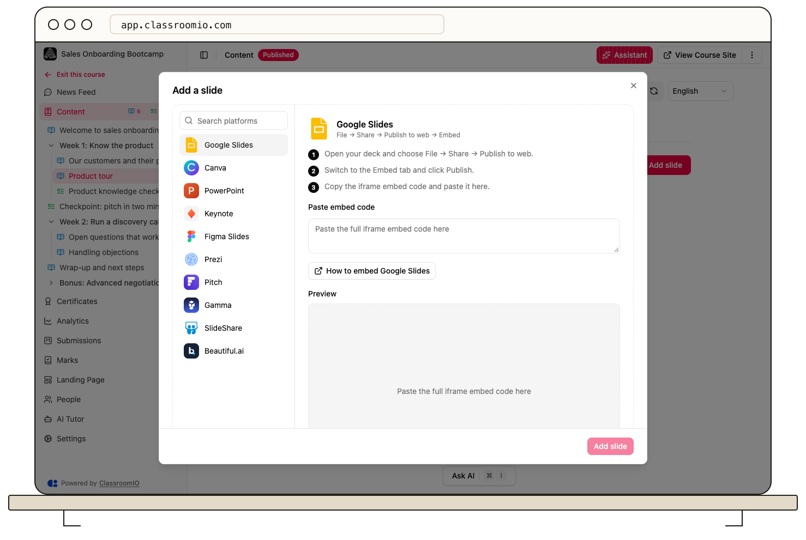

Open a lesson in **Edit** mode, choose **Slide**, and select **Add slide**. Pick the presentation platform and paste its full iframe embed code; a normal share link is not enough.

## Add the presentation

### 1. Open the slide picker

Open the course's **Content**, choose the lesson, select **Edit**, and open **Slide → Add slide**. Administrators and tutors with course access can add lesson materials.

### 2. Choose the platform and get its embed code

Select the platform in the picker. ClassroomIO displays that platform's instructions above **Paste embed code**. Obtain the full iframe snippet from the source presentation, rather than copying the browser address or a download link.

:::warning[Review the source presentation's sharing]
Publishing or enabling an embed can make the source deck public. Remove private information and check the sharing requirements before generating its embed code. Access restrictions on the source platform still affect students.
:::

### 3. Paste, preview, and add

Paste the iframe snippet into **Paste embed code**. Check the **Preview**, then select **Add slide** when the embed is accepted. ClassroomIO extracts the source URL and sizes the presentation to its lesson player; you do not need to match the iframe's width and height.

A lesson can contain multiple slide decks. Repeat the workflow for another presentation, then review the lesson in view mode.

## Get the right code for your platform

### Google Slides [#google-slides]

In Google Slides, use **File → Share → Publish to web**, choose **Embed**, publish, and copy the iframe code. Your organization may restrict publishing. See [Google's publishing and embedding instructions](https://support.google.com/docs/answer/183965?hl=en).

### Canva [#canva]

Use Canva's **Embed** sharing option and copy the HTML embed code, rather than the ordinary view link. Review [Canva's embed and unpublish guidance](https://www.canva.com/help/embed-designs/) before making a design available publicly.

### PowerPoint [#powerpoint]

Save the deck to OneDrive and open it in **PowerPoint for the web**. Use its **Embed** sharing option and copy the iframe code. Check [Microsoft's embedding instructions](https://support.microsoft.com/en-gb/powerpoint/embed-a-presentation-in-a-web-page-or-blog) if your account's menus differ. Organization permissions may still require students to sign in.

### Keynote [#keynote]

Choose **Keynote** in the picker and use its displayed sharing instructions to obtain an iframe for the iCloud presentation. A `.key` file or an ordinary collaboration link is not the required iframe code.

### Figma Slides [#figma]

Enable the sharing access your students need and copy the embed code for the Slides deck. Use a Slides presentation embed rather than a design-file link. See [Figma's embed guidance](https://help.figma.com/hc/en-us/articles/360039827134-Embed-files-and-prototypes).

### Prezi [#prezi]

Use the presentation's **Embed** sharing option and copy the code into ClassroomIO with **Prezi** selected.

### Pitch [#pitch]

Use the external sharing link's embed-code option. Keep that link available while the deck is embedded. See [Pitch's external sharing guidance](https://help.pitch.com/en/articles/3748926-share-an-external-link-to-your-presentation).

### Gamma [#gamma]

Use Gamma's sharing controls to obtain the iframe for your deck, then paste it with **Gamma** selected. See [Gamma's embedding guidance](https://help.gamma.app/en/articles/11047806-can-i-embed-gamma-into-another-site).

### SlideShare [#slideshare]

Open the deck's sharing controls and copy its embed code. Select **SlideShare** in ClassroomIO before pasting.

### Beautiful.ai [#beautiful]

Use the deck's sharing settings to obtain its embed code, then paste it with **Beautiful.ai** selected. Review the source deck's public-sharing requirements first.

## If the presentation does not load

Confirm that you pasted the full iframe from the selected supported platform. If the preview works for you but students see an access prompt, test the source presentation with the same permissions as a student and adjust its sharing.

Deleting the source presentation or disabling its sharing can break the lesson embed. For a downloadable handout instead, export a PDF and [attach it under Docs](/build-courses/add-documents-and-downloads).

## Related guides

- [Create and edit a lesson](/build-courses/create-and-edit-a-lesson) — combine slides with other teaching materials
- [Add documents and downloads](/build-courses/add-documents-and-downloads) — attach a handout
- [Set course order and content grouping](/build-courses/set-course-order-and-content-grouping) — choose where the Slide tab appears
