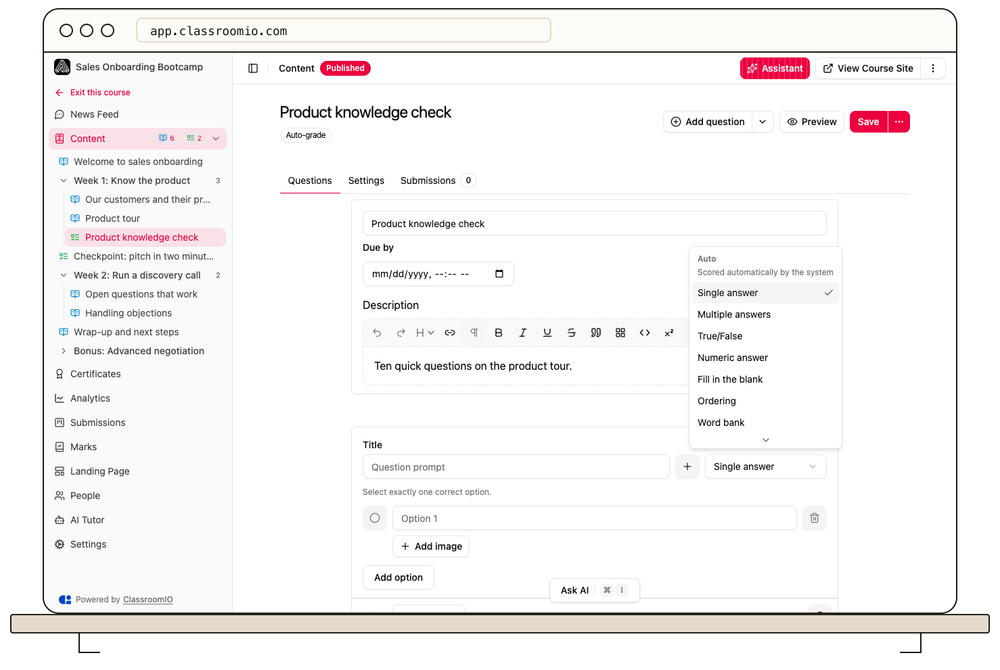

Open an exercise’s **Questions** tab and use the question type picker to choose how students respond. The picker groups types under **Auto** and **Manual** so you can see which support automatic scoring.

## Change a question type

Open the course's **Content**, choose the exercise, and open **Questions**. Select **Add question** if you need a new question, then open its type picker. Administrators and tutors with course access can edit questions.

:::warning[Check the answer after changing a type]
A different response format can require different options, answer keys, and scoring settings. Review the whole question and preview it before saving changes to an assessment students already use.
:::

## Automatically graded types

Choose a type under **Auto** when the correct response can be defined in advance:

- **Single answer**: choose one option.
- **Multiple answers**: select more than one option.
- **True/False**: choose between two statements.
- **Numeric answer**: respond with a number.
- **Fill in the blank**: supply missing text.
- **Ordering**: arrange items in the required order.
- **Word bank**: choose words to complete a response.
- **Star rating**: respond on the configured rating scale.

Configure the answer and scoring fields appropriate to the selected type. A format being in **Auto** does not mean a new question already has a correct answer.

## Other response types

The other group includes **Paragraph**, **Short answer**, **File upload**, **Links**, **Video recording**, and **Thumbs up/down**. Use open responses for work that needs judgment; thumbs responses are useful for feedback rather than a knowledge-check answer key.

Exercises containing questions that require instructor review need grading after submission. Check the exercise's grading badge and [configure its points and answers](/build-courses/set-answers-points-and-automatic-grading).

## Plan and public-course limits

**File upload**, **Ordering**, **Links**, **Star rating**, and **Video recording** require a paid plan. A premium choice opens the upgrade flow on the Free plan.

Public courses only offer automatically graded question types. **Matching** and **Hotspot** are not currently offered in the picker.

## Related guides

- [Create an exercise](/create-and-deliver/create-exercise) — add questions and an assessment
- [Set answers, points, and automatic grading](/build-courses/set-answers-points-and-automatic-grading) — configure scoring before students submit
- [Create a public course](/build-courses/create-a-public-course) — understand anonymous exercise limits
