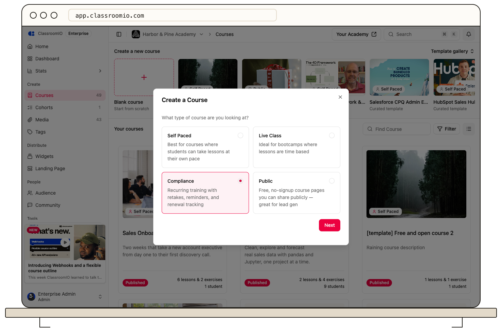

Choose **Compliance** for training that needs a completion deadline and compliance tracking. Add the content and completion requirements, then set the deadline before publishing or enrolling students.

## Create the course

### 1. Select Compliance

As an administrator, open **Courses → Blank course**, choose **Compliance**, and select **Next**. Enter the course name and short description, then select **Finish**.

For an existing course, select **Compliance** under **Settings → Course type**. Review the current students and completion rules before saving a change to the delivery model.

### 2. Define the training requirements

Create lessons and exercises from **Content → Add content**. Configure lesson completion and exercise passing rules so students must finish the required work.

In course **Settings**, review **Minimum completion (%)** and any **Final exercise (optional)** requirement. A final exercise adds a score requirement to the overall completion percentage. See [Control progression and completion](/create-and-deliver/course-progression).

### 3. Set the completion deadline

Enter **Course Completion Deadline** in **Settings** and save your changes. The date and time are shown in your local time.

:::warning[Set the deadline before publishing]
Compliance courses require a completion deadline before publishing and student enrollment. If publishing takes you to the deadline field, fill it in and save before trying again.
:::

### 4. Publish and verify tracking

Review the access settings, publish the course, and enroll a demo student. Open **Compliance** to check the student's training status. Membership in **People** and compliance completion are separate: an enrolled student may still be **Not started**.

For repeat training, review the course's recurrence and retake settings before assigning it to your audience. Completing the content once should be tested separately from the next training cycle.

## Related guides

- [Control progression and completion](/create-and-deliver/course-progression) — choose when students can continue
- [Create certificates](/create-and-deliver/certificates) — review certificate eligibility and design
- [Publish a course and allow self-enrollment](/build-courses/publish-a-course-and-allow-self-enrollment) — make the finished course available
