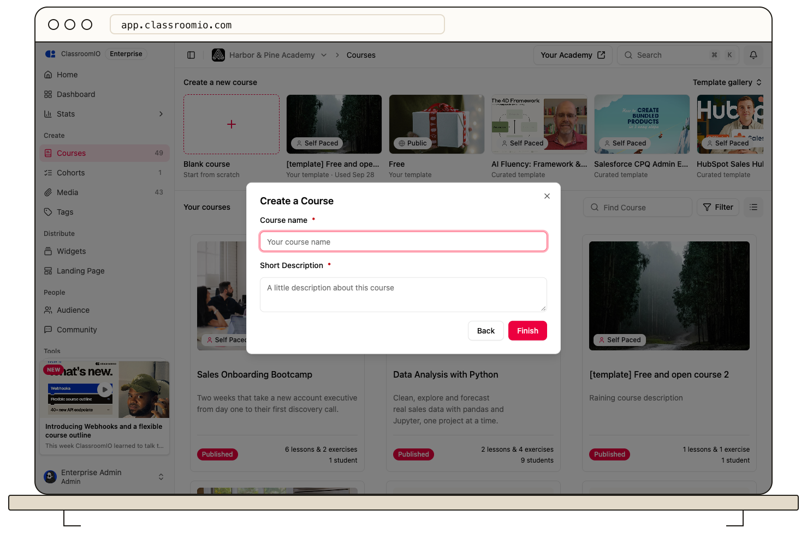

Open **Courses**, select **Blank course**, and enter a course name and description. ClassroomIO creates an empty course where you can build your own content.

## Before you start

You need an organization administrator account to create a course. Tutors can manage content in courses they have access to, but they do not see the blank course creator.

## Create the course

### 1. Open the blank course creator

In your organization's dashboard, open **Courses**. In **Create a new course**, select **Blank course**.

### 2. Choose a course type

Select **Self Paced**, **Live Class**, **Compliance**, or **Public**, then select **Next**. [Compare the course types](/create-and-deliver/course-types) if you are unsure which to choose.

A public course makes unlocked content available without an account. Choose it only for material you intend to share openly.

### 3. Enter the course details

Fill in **Course name** and **Short Description**. Both fields are required. Use **Back** if you need to change the type, then select **Finish**.

The course opens in **Content**. Add sections, lessons, or exercises with **Add content**; you do not need a section before adding a lesson.

Prefer a generated outline? [Create a course with AI](/build-courses/create-a-course-with-ai) from the organization Home page.

## Prepare it for students

Open **Settings** to review the title, cover image, access, and progression rules. Creating a course does not enroll students. Review the content and [publish the course](/build-courses/publish-a-course-and-allow-self-enrollment) when you are ready to share it.

## Related guides

- [Compare ClassroomIO course types](/create-and-deliver/course-types) — choose the delivery and access model
- [Organize content with sections](/build-courses/organize-content-with-sections) — group your course outline
- [Create and edit a lesson](/build-courses/create-and-edit-a-lesson) — add teaching materials
- [Publish a course and allow self-enrollment](/build-courses/publish-a-course-and-allow-self-enrollment) — make the finished course available
