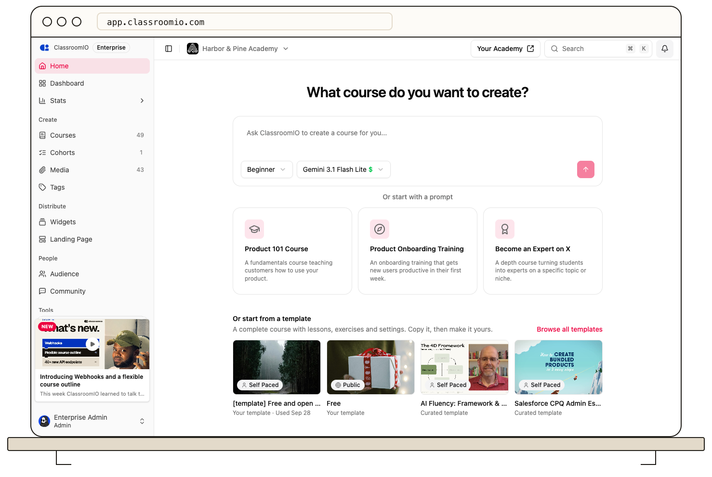

Start on **Home**, describe the course you need, and send your request. ClassroomIO creates a self-paced course and opens the course assistant so you can review the plan and build the content.

## Before you start

Use an organization administrator account. AI requests use your organization's AI allowance; available models depend on your plan. Check [usage and plan limits](/get-started/understand-usage-and-plan-limits) if a request is blocked.

## Build the course

### 1. Describe the outcome

Open **Home** in the organization dashboard. In **What course do you want to create?**, describe the audience, topic, learning outcomes, and desired structure.

For example: “Create a beginner course for new support agents. Use four lessons on writing clear replies, each followed by a short multiple-choice quiz.”

Choose **Beginner**, **Intermediate**, or **Advanced**, and select an available model. You can also start with one of the suggestions under **Or start with a prompt** and provide the requested product or topic details.

### 2. Send the request and review the plan

Use the send control in the prompt box. ClassroomIO creates the course and opens its assistant. Answer any follow-up questions, then review and adjust the proposed plan before starting the build.

A prompt suggestion supplies instructions to the assistant. A card under **Or start from a template** copies an existing course instead; see [Create a course from a template](/build-courses/create-a-course-from-a-template).

### 3. Review the result

Follow the assistant's progress and inspect the resulting outline in **Content**. Open each lesson and exercise to check accuracy, wording, answer keys, and points. Generated content needs your review before students use it.

Use **Assistant** inside the course for follow-up requests. Check **Settings** if you need a delivery type other than self-paced.

## Publish after review

Check the student experience and enrollment settings before publishing. An assistant finishing its work is not a substitute for your course review.

## Related guides

- [Create a course from scratch](/build-courses/create-a-course-from-scratch) — start with an empty course
- [Create a course from a template](/build-courses/create-a-course-from-a-template) — reuse a prepared course
- [Write lesson content in the editor](/build-courses/write-lesson-content-in-the-editor) — format your lesson notes
- [Set answers, points, and automatic grading](/build-courses/set-answers-points-and-automatic-grading) — configure scoring before students submit
- [Publish a course and allow self-enrollment](/build-courses/publish-a-course-and-allow-self-enrollment) — make the finished course available
