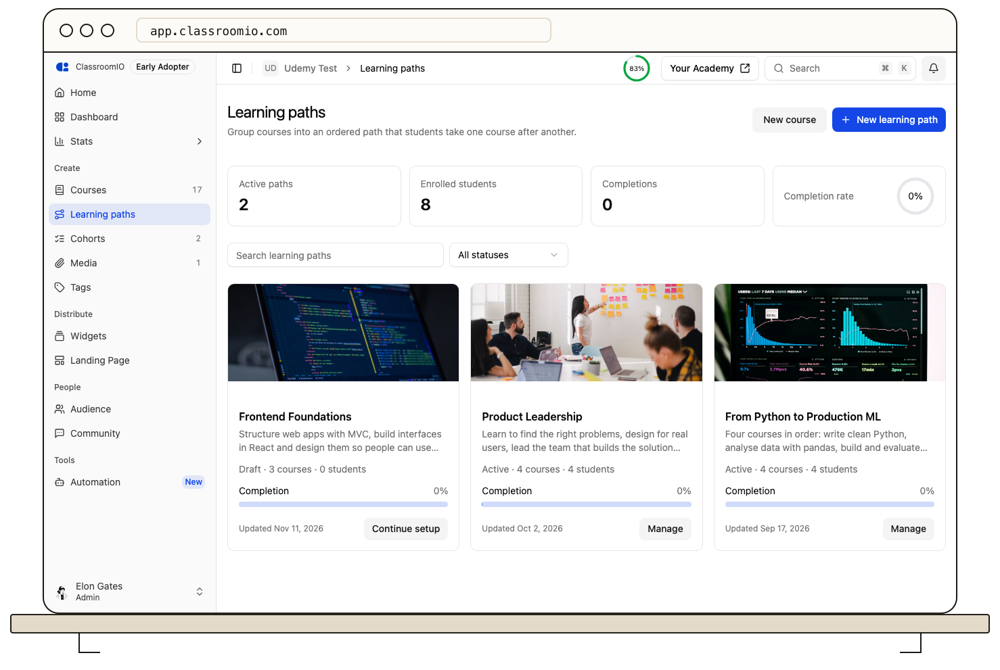

A learning path is a set of courses students take in a fixed order. Students see their paths in the ClassroomIO mobile app, under **My learning** and **Explore**. Only organization admins can create and change learning paths. Tutors can open them to see their courses and settings.

## Create the path

1. Select **Learning paths** in the organization sidebar.
2. Select **New learning path**, enter a name and an optional description, and select **Create**.

A new path starts as a draft, so only admins and tutors can see it.

## Add and order courses

1. Open the path and go to **Courses**.
2. Select **Add courses**, choose courses from your organization, and confirm. They are added at the end of the path.
3. Drag courses to change their order. Use the remove button on a row to take a course out of the path.

With **Unlock courses in order** on, a student finishes every lesson and exercise in a course before the next course opens. A course the student joined on their own before it became part of the path stays open. Removing a course from the path doesn't unenroll anyone.

## Add students

1. Go to **People** and select **Add students**.
2. Enter the emails of existing accounts, separated by commas or new lines.

Each email that isn't added gets a reason: no account uses the email, the person is an admin or tutor, or they are already in the path. When **Enroll students in every course** is on, students added to the path are also enrolled in each course, including courses added later. Removing a student from the path keeps their course enrollments.

## Settings

In **Settings**, set the name, description, and cover image, and choose:

- **Students can join on their own**: active paths appear in **Explore** in the mobile app. Students can join a path there when none of its courses is paid or closed to self-enrollment.
- **Unlock courses in order** and **Enroll students in every course**, as described above.
- **Status**: **Active** shows the path to students and needs at least one published course. **Draft** keeps it visible only to admins and tutors. **Archived** hides it from students and keeps its data.

Select **Save changes** in the action bar. Admins can also delete a path from **Settings**. Deleting a path keeps its students' course enrollments and progress.

## Related guides

- [Create a course from scratch](/build-courses/create-a-course-from-scratch): build the courses a path contains
- [Choose free or sequential progression](/deliver-and-engage/choose-free-or-sequential-progression): control the order of items inside a course
