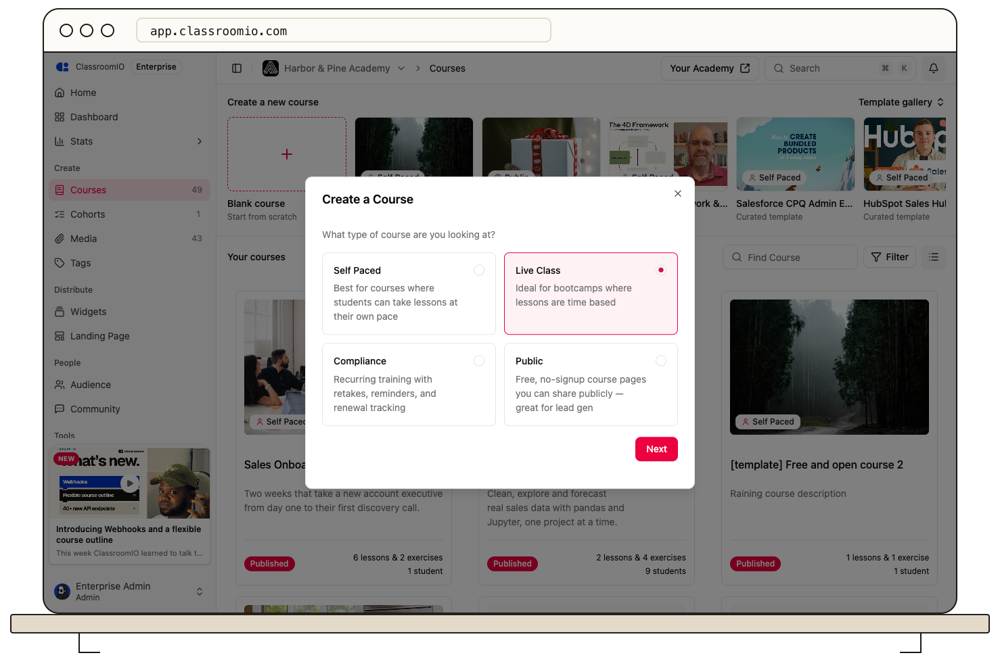

Choose **Live Class** for an instructor-led course, then schedule sessions on its lessons. Selecting the course type does not create a meeting or set a session time.

## Create the course

### 1. Select Live Class

As an administrator, open **Courses → Blank course**, choose **Live Class**, and select **Next**. Enter **Course name** and **Short Description**, then select **Finish**.

For an existing course, select **Live class** under **Settings → Course type** and select **Save changes**. Review existing enrollment and completion rules before changing the type.

### 2. Add the content and sessions

Use **Content → Add content** to create lessons and exercises. Open a lesson's **Settings** to configure its live session, including the time and join link.

Follow [Run a live class](/create-and-deliver/live-class) to finish scheduling and verify the student-facing session card. You need a meeting link from your chosen meeting provider; creating the course does not create one for you.

### 3. Review reminders and grading

In course **Settings**, review **Session email reminders**. Choose reminder times that suit the session, then save your changes. Check exercise question types and points before students submit; the course type alone does not supply correct answers or a grading rubric.

Use **Submissions** or **Marks** to review student work that needs instructor scoring.

## Release content and enroll students

Locked lessons and exercises remain unavailable to students. Unlock material when it should be released, publish the course, and choose an enrollment method.

For a scheduled session, the welcome email can include a calendar invite for the next session. Test the actual invitation and session link with a demo student before the class.

## Related guides

- [Create and edit a lesson](/build-courses/create-and-edit-a-lesson) — add teaching materials
- [Run a live class](/create-and-deliver/live-class) — schedule meetings and session reminders
- [Customize the welcome email](/manage-students/welcome-email) — set expectations for new students
- [Publish a course and allow self-enrollment](/build-courses/publish-a-course-and-allow-self-enrollment) — make the finished course available
