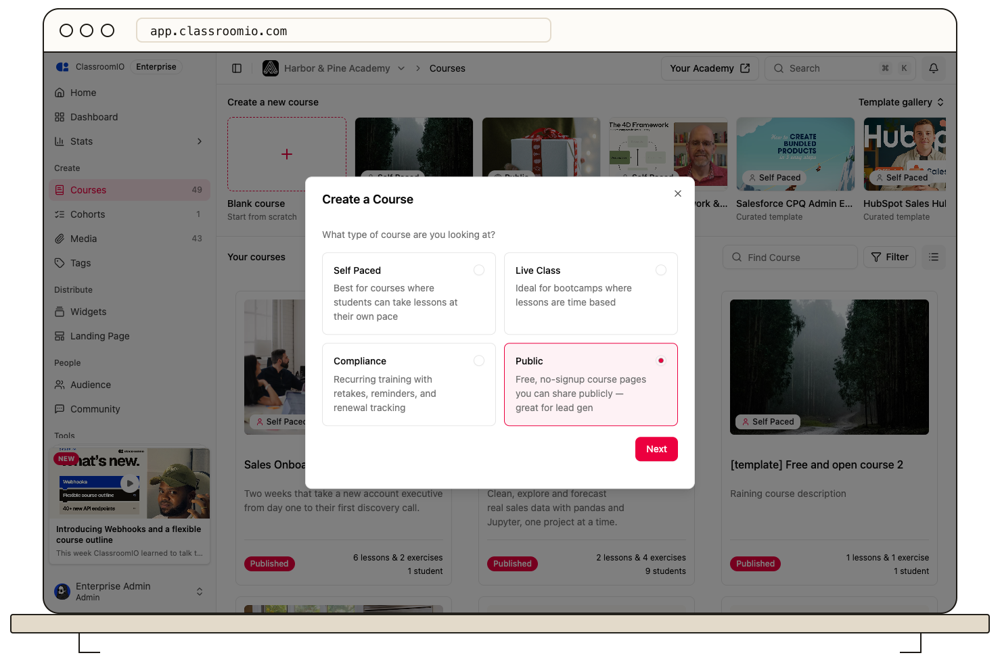

Choose **Public** to share course content without requiring visitors to sign in or enroll. Public exercises support automatically graded question types and run in the visitor’s browser.

## Before you start

Only publish material you intend anyone with the link to access. Public courses use a different experience from the signed-in student LMS; use a self-paced, live class, or compliance course when you need managed enrollment and student records.

## Create and prepare the course

### 1. Select Public

As an administrator, open **Courses → Blank course**, choose **Public**, and select **Next**. Enter the name and short description, then select **Finish**.

### 2. Add open learning content

Create lessons and exercises in **Content**. Add notes, videos, slides, or documents, and unlock the items visitors should be able to open.

Public exercises only offer question types that can be graded automatically. Set correct answers and points, and preview every exercise before publishing.

### 3. Check the public settings

In **Settings**, review the course details, course link, and **Public course callout**. If the link is not set up, select **Set up landing page** under **Course Link** and [configure the course landing page](/publish-and-brand/course-landingpage). The callout can direct visitors to your website or another course.

If you enable **Allow learners to copy lesson pages as Markdown**, unlocked lessons also have a public Markdown URL. Include that extra public access in your review.

### 4. Publish and test without signing in

Turn on **Publish Course**, save, and open **View Course Site** in a signed-out browser. Check the outline, unlocked lessons, embedded materials, exercises, and any callout link.

## Convert an existing course

:::warning[Conversion changes access]
Changing a course to Public changes its access and exercise experience. Review the content and your need for enrolled-student tracking before converting an existing course.
:::

Choose **Public** under **Settings → Course type**. If the course contains questions that cannot be automatically graded, use **Fix blocking questions** to replace or remove them, save the exercises, and complete the conversion. The course cannot convert until all blocking questions are resolved.

## Related guides

- [Compare ClassroomIO course types](/create-and-deliver/course-types) — choose the delivery and access model
- [Set answers, points, and automatic grading](/build-courses/set-answers-points-and-automatic-grading) — configure scoring before students submit
- [Add a course callout](/build-courses/add-a-course-callout) — give visitors a next step
- [Publish a course and allow self-enrollment](/build-courses/publish-a-course-and-allow-self-enrollment) — make the finished course available
