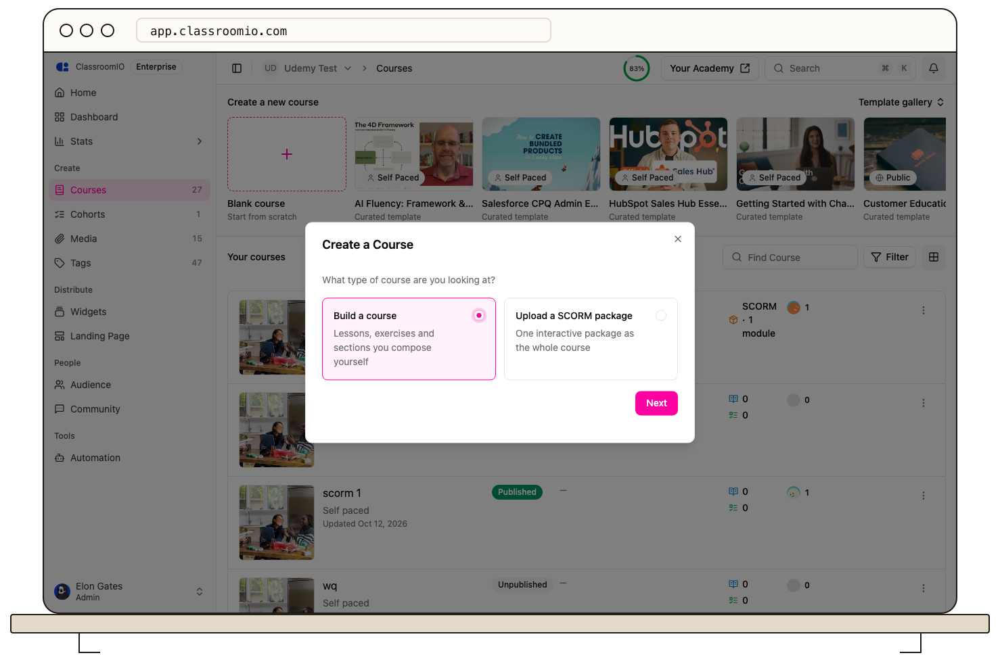
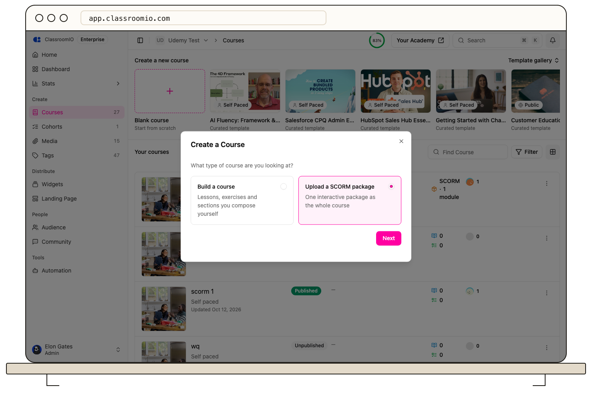
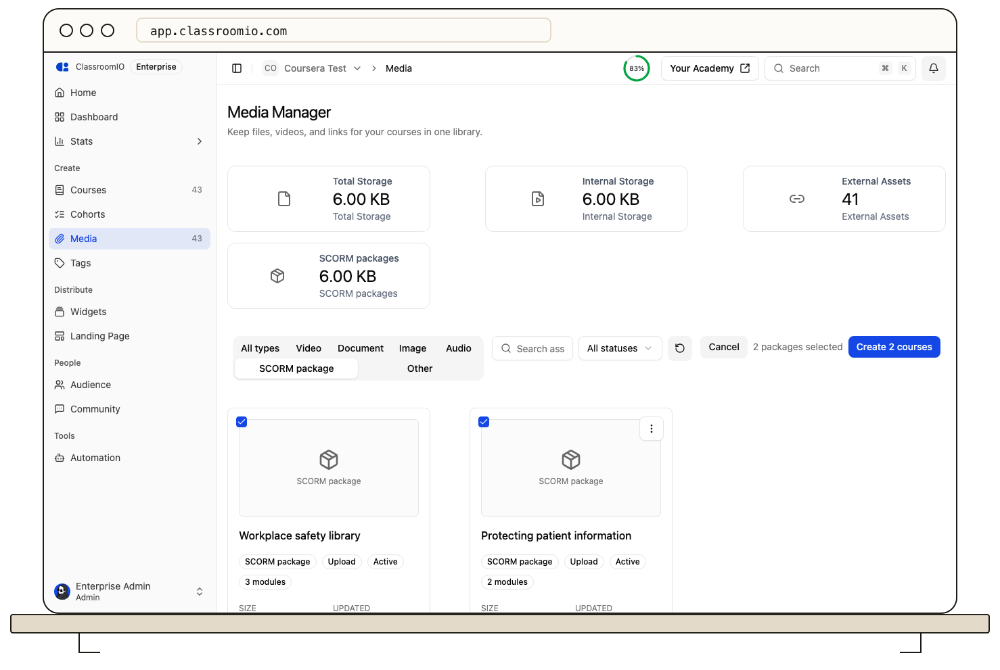

To create a SCORM course, choose **New course → Upload a SCORM package**, give it a title, and upload or attach the package. The course navigation shows **Package** where other courses show Content. Certificates, the landing page, and People work as in any course.

## Before you start

:::info[SCORM is an Enterprise feature]
On ClassroomIO Cloud, SCORM courses are included in every paid plan. On the Free plan the **Upload a SCORM package** option shows a **Paid plans** pill and opens the upgrade modal. On a self-hosted server it needs an enterprise license key that includes SCORM.
:::

A SCORM course holds exactly one SCORM package and no sections or lessons. It is Self-paced — Live class, Public, and Compliance do not apply to a single-package course. To add lessons, exercises, or compliance tracking later, convert it to a standard course in course settings. That step cannot be undone.

## Create one SCORM course

### 1. Start from New course

Open **Courses** and choose **New course**. The dialog starts with a choice: **Build a course** (today's flow, unchanged) or **Upload a SCORM package**.

Choose **Upload a SCORM package**. On the Free plan it shows **Paid plans** with an upgrade prompt; on an unlicensed self-hosted server it shows **Needs an enterprise license** and links to the licensing docs.

### 2. Enter the course details

Enter the title and short description. Creating the course makes the course and its one empty SCORM activity in one step, and lands on the Package page where you can upload or attach the package, exactly as for a SCORM item added to a course.

### 3. Add or upload the package

On the Package page, choose **Upload package** to open the package modal. Upload a new ZIP on the **Upload** tab or pick an existing package from your organisation's **Library**, and wait while ClassroomIO checks and unpacks it. Large packages can take a few minutes, and you can leave the page. When it is ready, review the modules, the pass mark, and the completion rule, then publish. See [Add a SCORM package](/build-courses/add-a-scorm-package) for the Package, Instructions, and Settings tabs.

## Create several courses at once

To make several SCORM courses at once, open the **Media Manager**, filter by SCORM package, choose **Select**, pick the packages, and choose **Create N courses**. The dialog shows the course title from each manifest. It creates one draft SCORM course per package. Processing or failed packages cannot be selected.

You can also open **Create course from package** on a single package card. It shows the course title from the manifest and a preview of the SCORM course navigation.

## What a SCORM course looks like

- **Admin navigation:** **Package** sits where Content sits, with the package icon, and opens the package editor with its Package, Instructions, Results, and Settings tabs. Submissions, Marks, Attendance, and Compliance are hidden. Everything else — News Feed, Certificates, Analytics, Landing Page, People, AI Tutor, Settings — stays.
- **Learner navigation:** News Feed (when the organization shows it), **Package**, and Certificates. Package is a plain nav item: click to enter, nothing to expand. The module menu lives on the package page. The footer's Previous and Next buttons are hidden; the progress ring stays.
- **Entry:** the course page, **Continue** buttons on learner home, and `?next=true` all go straight to the package.
- **Landing page:** the curriculum shows the package with its title, module count, and module titles.
- **Course cards and rows:** show **SCORM · N modules** instead of lesson and exercise counts.

Course progress and certificates need no special case: the course has one item, and it is the package. The SCORM package reports its own score, as with every SCORM platform. For recurring compliance training or high-stakes certification, build a standard course and add a ClassroomIO exercise as a separate graded step alongside the package.

## Convert to a standard course

To add lessons, exercises, or multiple sections later, open **Settings** in the course navigation, scroll to the **Convert to a standard course** card, and choose **Convert to a standard course**.

This sets the course format back to standard, keeps the SCORM package in place as an activity item in the content outline, and restores full course outline editing with sections, lessons, exercises, and other content types. Confirm the dialog — this conversion cannot be undone (a standard course cannot be converted back into a single-activity course).

While the course remains a single-activity SCORM course, its sole package activity cannot be deleted. You can use **Upload new version** to upload a newer export of the same package, **Swap package** to attach a different package, or **Remove** to detach the package. The course itself can be deleted as usual.

## What happens when a plan or license lapses

Learners keep taking the package, and results stay available. You cannot create new SCORM courses, upload or replace packages, or change package settings until SCORM is included again.

## Troubleshooting

### I cannot add a lesson to a SCORM course

That is by design. A SCORM course holds exactly one SCORM activity. To add lessons, exercises, or sections, convert it to a standard course first in **Settings → Convert to a standard course**.

### I cannot switch a SCORM course to Public

SCORM packages are not available in Public courses, because those are taken without signing in. A course with SCORM packages cannot be switched to Public.

## Related guides

- [Add a SCORM package](/build-courses/add-a-scorm-package) — packages inside a standard course, completion rules, and replacing versions
- [Review SCORM results](/analytics-and-reporting/review-scorm-results) — per-learner status, attempts, and CSV export
- [Create a compliance course](/build-courses/create-a-compliance-course) — recurring training and compliance records
