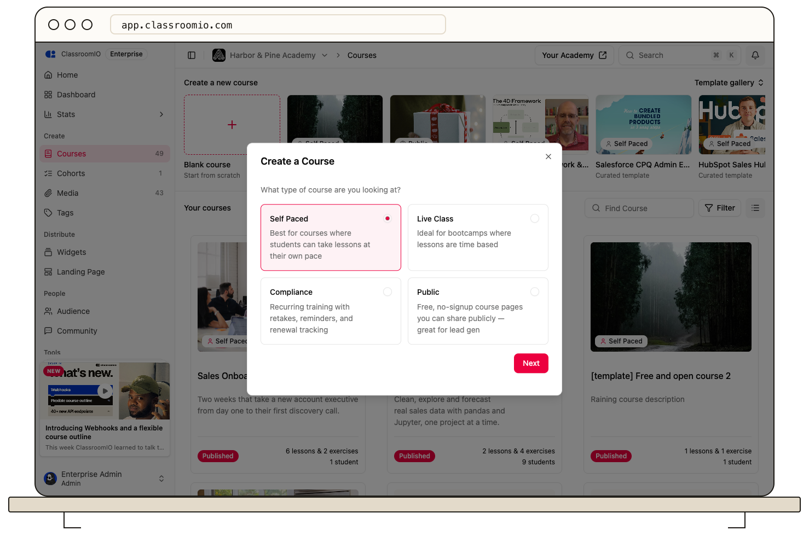

Choose **Self Paced** when creating a blank course so students can work through lessons and exercises on their own schedule. Add progression rules when you need them to complete content in a particular order.

## Create the course

### 1. Select Self Paced

Open **Courses → Blank course**, choose **Self Paced**, and select **Next**. Enter **Course name** and **Short Description**, then select **Finish**. Administrators can create courses.

For an existing course, open **Settings → Course type**, choose **Self paced**, and select **Save changes**. Review the effect on your students before changing a live or compliance course.

### 2. Add lessons and exercises

Open **Content → Add content**. Add sections if they help organize the course, then create lessons and exercises in the intended order. A lesson can combine notes, videos, slide decks, and documents.

### 3. Choose how students progress

In **Settings → Content**, choose **Free** for access to unlocked items in any order, or **Sequential** to require earlier content to be completed first.

Set each lesson's completion rule and each exercise's submission or passing requirement. Video-watch completion requires uploaded video; external embeds do not provide that tracking. See [progression and completion](/create-and-deliver/course-progression).

## Check access and publish

Review locked items before publishing; a published course can still contain unavailable content. Choose your enrollment method, publish the course, and test with a separately enrolled demo student. Students can then return to the course and continue their work.

## Related guides

- [Create and edit a lesson](/build-courses/create-and-edit-a-lesson) — add teaching materials
- [Create an exercise](/create-and-deliver/create-exercise) — add questions and an assessment
- [Control progression and completion](/create-and-deliver/course-progression) — choose when students can continue
- [Publish a course and allow self-enrollment](/build-courses/publish-a-course-and-allow-self-enrollment) — make the finished course available
